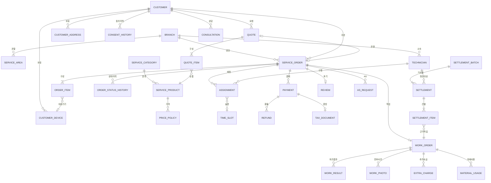
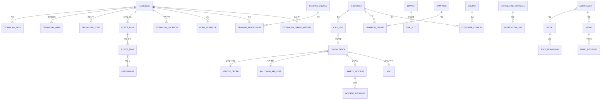

# 01. ERD (데이터 모델 정의서)

> 에어컨 청소 기반 지역생활서비스 플랫폼 — MVP ~ 2단계 확장 대응 데이터 모델
> 문서 버전: v1.1 · 작성일: 2026-11-22 · 작성 관점: 프로그램 분석·설계자
> v1.2(단계 1 보강): 서비스 지역 오픈 알림 신청 `area_open_request`(§2.2.7, §3.9) 추가, 알림 템플릿 `AREA_OPENED`, 설정 `AREA_OPEN_REQUEST_KEEP_DAYS`
> v1.4(단계 3 구현 반영): `call_log`·`consultation`·`consult_script`·`customer_tag`·`assignment`·`assignment_history` 구현, §4 단계 3 코드 그룹, 설정 `PRIVACY_REASK_MONTHS`, §3.5 상담 초기 상태, 상담 번호 형식
> v1.3(단계 2 구현 반영): §4 단계 2 코드 그룹, `system_setting` 슬롯·취소·약관 키, `notification_log.created_at`, `refund.requested_by` 타입, 접수번호 형식, 알림 템플릿 코드, 결제·환불 INSERT ONLY 처리 방식
> v1.1(단계 0 구현 반영): `admin_user` Supabase Auth 연결, 일시 타입 확정, §4 코드 그룹 추가, `system_setting` 키 추가, 가격 정책 동순위 결정 규칙
> 연계 문서: [02_기능정의서.md](./02_기능정의서.md) · [03_IA.md](./03_IA.md)

---

## 0. 문서 개요

### 0.1 근거 문서와 반영 내용

| 근거 문서 | 이 ERD에 반영한 내용 |
|---|---|
| 에어컨 라이프 플랫폼 전략(1차 회의 정리 v1.0) | 지역 거점(1거점=1생활권), 표준 견적(기기형태·대수·오염도), 3층 수익 구조, 기사 등급(견습→정식→팀장)·교육 파이프라인, 주 1회 정산, 현금영수증/세금계산서, 재방문 캠페인(작업 11개월 후), 개인정보 동의·보관·파기, 작업 전후 사진, AS·보증, KPI 7종 |
| 상담 PORTAL 화면설계서 v1.0 | 전화번호 기반 고객 조회·신규 등록(주소 4단계 정제), 개인정보 수집 동의(동의/미동의/질의못함)·철회, 상담 유형(출장접수/독촉·전달/안전사고), 미완료 상담·클레임 Alert, 이중접수 체크, 7일 Time Table(시간대별 가용 슬롯), 출장 가능 기사 스케줄, 야간·휴일 출장비 할증, 미지정(긴급) 접수, 수리·VOC·보상 이력 탭, 안전사고 수신자·매체/기관 |
| 서비스 PORTAL 화면설계서 v0.2 | 기사별 접수 목록(이관/미처리/처리), 처리 정보 입력(처리코드·미처리코드·유무상·고장코드·수리코드), 다인 방문(지원 기사), 비용 구성(출장비·작업비·부품비·별도금액·할증·영수금액), 별도금액+증빙 첨부, 안전관리/서비스 파일첨부, 활동내역, 기회고객(B2B 리드) 등록, 타 기사 이관 |
| MCS 서비스 메인화면 v2.1 | 기사 홈(오늘 할일: 메모·자재·약속 / 주간 할일 D~D+2), 주요 공지(전체·안전·거점), 퀵메뉴(즐겨찾기·순서), 나만의 캘린더(근무/메모 전환, 타 기사 공유), 메모(머리말 템플릿, 기간·반복, 지정 수신자, 08:30 팝업), VOC 건수·NPS |

> 참고 문서(하이런 B2E, MCS)는 제조사 A/S 조직용 시스템입니다. 본 플랫폼은 **소규모 지역 청소 사업자**에 맞게 "센터→거점", "SE→기사", "수리→청소 작업", "부품→소모품/자재"로 치환하고, 제조사 전용 개념(제조번호 이력, 렌탈, HIM/SMILE 고객유형, 그룹임직원 할인, PL포털 등)은 제외하거나 단순화했습니다.

### 0.2 역할(Actor) 정의

| 역할 | 코드 | 설명 | 주 채널 |
|---|---|---|---|
| 고객 | `CUSTOMER` | 개인(가정) 또는 법인(B2B) 고객. 견적·예약·결제·후기 | 모바일 앱/모바일웹 |
| 기사 | `TECHNICIAN` | 교육 수료 후 배정받아 현장 작업 수행. 등급: 견습/정식/팀장 | 기사 모바일 앱 |
| 관리자 | `ADMIN` | 세부 권한 역할로 구분 (아래) | 관리자 웹(PC) |
| └ 상담원 | `ADM_CS` | 전화접수(상담 콘솔), 독촉·클레임·안전사고 접수 | |
| └ 운영자(배정) | `ADM_OPS` | 배정·일정·처리 콘솔, 기사 관리 | |
| └ 거점장 | `ADM_BRANCH` | 소속 거점 데이터 한정 전체 운영 권한 | |
| └ 정산/재무 | `ADM_FIN` | 결제·환불·정산·증빙 | |
| └ 마케터 | `ADM_MKT` | 캠페인·쿠폰·콘텐츠 | |
| └ 슈퍼관리자 | `ADM_SUPER` | 전체 권한, 코드·권한·정책 관리 | |

### 0.3 설계 원칙 (바이브 코딩 시 지켜야 할 규칙)

1. **PK**: 모든 테이블은 `id` (BIGINT, 자동증가) 대리키 사용. 외부 노출용 번호는 별도 컬럼(`order_no` 등)으로 둡니다.
2. **공통 감사 컬럼**: 모든 업무 테이블에 `created_at`, `created_by`, `updated_at`, `updated_by` 포함. 표에서는 생략하고 "공통컬럼"으로 표기합니다.
3. **소프트 삭제**: 고객·기사·주문·상품 등 이력이 중요한 테이블은 `deleted_at` (NULL=유효)로 논리 삭제합니다. 결제·정산·상태이력은 삭제 불가(INSERT ONLY).
4. **코드값**: 상태·유형 같은 값은 `common_code` 테이블로 관리하고, 컬럼에는 코드 문자열(VARCHAR)을 저장합니다. 본 문서의 "코드값" 열에 초기 값을 명시했습니다.
5. **금액**: 원 단위 정수(`INT` 또는 `BIGINT`), 부가세 포함 금액 기준. 할인·할증은 별도 행으로 분리해 합계를 재계산 가능하게 합니다.
6. **일시**: `TIMESTAMP WITH TIME ZONE`(PostgreSQL `timestamptz`)으로 통일(단계 0 확정). 표의 `DATETIME`은 이 타입으로 읽습니다. 날짜만 필요한 곳은 `DATE`.
7. **개인정보**: 연락처·주소 상세는 암호화 저장(🔒 표시), 조회용 마스킹/검색용 해시 컬럼 별도 운영. 동의 철회·보관기간 경과 시 파기 배치 대상.
8. **거점 단위 데이터 격리**: 운영 데이터(주문·기사·일정·정산)는 `branch_id`를 가지며, 거점장 권한은 자기 거점만 조회합니다.
9. **상태 변경은 이력 테이블에 남긴다**: 주문·배정·정산의 상태 변경 시 `*_status_history`에 1행 INSERT.

### 0.4 도메인 구성 (총 13개 도메인, 84개 테이블)

| # | 도메인 | 접두/대표 테이블 | 테이블 수 |
|---|---|---|---|
| D1 | 조직·권한·공통 | `branch`, `admin_user`, `role`, `common_code` | 8 |
| D2 | 고객 | `customer`, `customer_address`, `customer_device`, `consent_history`, `area_open_request` | 7 |
| D3 | 상품·가격 | `service_category`, `service_product`, `price_policy`, `surcharge_rule` | 6 |
| D4 | 견적 | `quote`, `quote_item`, `device_image` | 3 |
| D5 | 주문(접수) | `service_order`, `order_item`, `order_status_history` | 4 |
| D6 | 상담·VOC | `consultation`, `call_log`, `followup_request`, `safety_incident`, `voc` | 7 |
| D7 | 기사·교육 | `technician`, `technician_skill`, `technician_zone`, `training_course`, `work_schedule` | 9 |
| D8 | 배정·일정·코스 | `time_slot`, `assignment`, `route_plan`, `route_stop`, `technician_location` | 6 |
| D9 | 현장작업 | `work_order`, `work_result`, `work_photo`, `extra_charge`, `material_usage`, `activity_log` | 8 |
| D10 | 결제·증빙 | `payment`, `refund`, `tax_document` | 3 |
| D11 | 정산 | `commission_policy`, `settlement_batch`, `settlement`, `settlement_item` | 4 |
| D12 | CRM·마케팅 | `campaign`, `coupon`, `notification_log`, `review`, `as_request`, `b2b_lead` | 9 |
| D13 | 업무지원·콘텐츠 | `notice`, `memo`, `faq`, `tech_document`, `quick_menu`, `attachment`, `audit_log` | 10 |

---

## 1. 전체 관계도 (핵심 엔터티)

> 아래 다이어그램은 Mermaid `erDiagram` 표기입니다. GitHub·Notion·VS Code(Mermaid 확장)에서 그림으로 렌더링됩니다.

### 1.1 핵심 업무 흐름 관계 (견적 → 주문 → 배정 → 작업 → 결제 → 정산)

### 1.2 상담·기사·CRM 관계

---

## 2. 테이블 정의서

표기: **PK** 기본키 · **FK** 외래키 · **UK** 유니크 · **NN** NOT NULL · 🔒 암호화 대상 · 공통컬럼 = `created_at, created_by, updated_at, updated_by`

---

### D1. 조직·권한·공통

#### 2.1.1 `branch` — 거점(지역 사업장)
전략 문서의 "1개 거점 = 1개 생활권(반경 5km 내외)" 단위. 하이런의 '서비스센터'에 해당.

| 컬럼 | 타입 | 제약 | 설명 | 코드값/예시 |
|---|---|---|---|---|
| id | BIGINT | PK | 거점 ID | |
| branch_code | VARCHAR(20) | UK, NN | 거점 코드 | `EP01`(은평), `BP01`(부평) |
| name | VARCHAR(50) | NN | 거점명 | 은평거점 |
| status | VARCHAR(20) | NN | 운영 상태 | `PREPARING`, `ACTIVE`, `PAUSED`, `CLOSED` |
| address | VARCHAR(200) | | 거점(교육장) 주소 | |
| center_lat / center_lng | DECIMAL(10,7) | | 거점 중심 좌표 | |
| radius_km | DECIMAL(4,1) | | 서비스 반경 | 5.0 |
| phone | VARCHAR(20) | | 대표 전화 | |
| manager_admin_id | BIGINT | FK→admin_user | 거점장 | |
| open_time / close_time | TIME | | 기본 운영 시간 | 08:00 / 18:00 |
| opened_at | DATE | | 개소일 | |
| 공통컬럼 + deleted_at | | | | |

#### 2.1.2 `service_area` — 거점 관할 지역
주소 → 거점 자동 매핑에 사용. 하이런의 '지역현황'·'관할센터'에 해당.

| 컬럼 | 타입 | 제약 | 설명 | 코드값/예시 |
|---|---|---|---|---|
| id | BIGINT | PK | | |
| branch_id | BIGINT | FK→branch, NN | 담당 거점 | |
| sido / sigungu / eupmyeondong | VARCHAR(30) | NN | 시도/시군구/읍면동 | 서울/은평구/불광동 |
| legal_dong_code | VARCHAR(10) | UK | 법정동 코드 | |
| is_serviceable | BOOLEAN | NN, 기본 true | 서비스 가능 여부 | |
| travel_fee | INT | 기본 0 | 원거리 출장비(권역 외곽) | |
| 공통컬럼 | | | | |

#### 2.1.3 `admin_user` — 관리자 계정

| 컬럼 | 타입 | 제약 | 설명 | 코드값/예시 |
|---|---|---|---|---|
| id | BIGINT | PK | | |
| auth_user_id | UUID | UK | 인증 계정(Supabase Auth `auth.users.id`). 비밀번호는 인증 서비스에만 저장 | |
| login_id | VARCHAR(50) | UK, NN | 로그인 ID | |
| name | VARCHAR(30) | NN | 이름 | |
| phone 🔒 | VARCHAR(100) | | 연락처 | |
| email | VARCHAR(100) | UK, NN | 이메일(인증 계정 로그인 이메일) | |
| role_id | BIGINT | FK→role, NN | 역할 | |
| branch_id | BIGINT | FK→branch | 소속 거점(NULL=본사 전체) | |
| status | VARCHAR(20) | NN | 계정 상태 | `ACTIVE`, `LOCKED`, `RETIRED` |
| last_login_at | DATETIME | | 최근 로그인 | |
| login_fail_count | INT | 기본 0 | 실패 횟수가 `ADMIN_LOGIN_MAX_FAIL`(기본 5)에 도달하면 LOCKED, 성공·잠금 해제 시 0 | |
| 공통컬럼 + deleted_at | | | | |

> 단계 0 변경: 비밀번호를 직접 저장하지 않고 Supabase Auth에 위임하면서 `password_hash`를 없애고 `auth_user_id`를 추가했습니다. 로그인은 `login_id`로 계정을 찾은 뒤 `email`로 인증합니다. 로컬 개발·테스트는 Mock 인증(`packages/integrations`)을 씁니다. `auth_user_id`는 Mock과 함께 쓰기 위해 DB 외래키를 걸지 않습니다.

#### 2.1.4 `role` / 2.1.5 `permission` / 2.1.6 `role_permission` — 역할·권한(RBAC)

`role`

| 컬럼 | 타입 | 제약 | 설명 | 코드값/예시 |
|---|---|---|---|---|
| id | BIGINT | PK | | |
| role_code | VARCHAR(30) | UK, NN | 역할 코드 | `ADM_CS`, `ADM_OPS`, `ADM_BRANCH`, `ADM_FIN`, `ADM_MKT`, `ADM_SUPER` |
| name | VARCHAR(50) | NN | 역할명 | 상담원 |
| data_scope | VARCHAR(20) | NN | 데이터 범위 | `ALL`(전체), `BRANCH`(소속 거점), `SELF`(본인) |

`permission`

| 컬럼 | 타입 | 제약 | 설명 | 코드값/예시 |
|---|---|---|---|---|
| id | BIGINT | PK | | |
| menu_code | VARCHAR(50) | NN | 메뉴(화면) ID | `A-ORD-010` (03_IA 화면 ID와 일치) |
| action | VARCHAR(20) | NN | 행위 | `READ`, `CREATE`, `UPDATE`, `DELETE`, `EXPORT`, `APPROVE` |
| UK(menu_code, action) | | | | |

`role_permission`: `role_id`(FK), `permission_id`(FK), PK(role_id, permission_id)

#### 2.1.7 `common_code` — 공통 코드

| 컬럼 | 타입 | 제약 | 설명 | 코드값/예시 |
|---|---|---|---|---|
| id | BIGINT | PK | | |
| group_code | VARCHAR(50) | NN | 코드 그룹 | `ORDER_STATUS`, `DEVICE_TYPE`, `PENDING_REASON` |
| code | VARCHAR(50) | NN | 코드 | `WALL` |
| name | VARCHAR(100) | NN | 표시명 | 벽걸이형 |
| sort_order | INT | 기본 0 | 정렬 순서 | |
| is_active | BOOLEAN | 기본 true | 사용 여부 | |
| extra_json | JSON | | 부가 속성(색상, 아이콘 등) | |
| UK(group_code, code) | | | | |

#### 2.1.8 `holiday` — 공휴일 (휴일 할증 판단용)

| 컬럼 | 타입 | 제약 | 설명 |
|---|---|---|---|
| holiday_date | DATE | PK | 공휴일 |
| name | VARCHAR(50) | NN | 명칭 |
| is_surcharge | BOOLEAN | 기본 true | 휴일 할증 적용 여부 |

---

### D2. 고객

#### 2.2.1 `customer` — 고객

| 컬럼 | 타입 | 제약 | 설명 | 코드값/예시 |
|---|---|---|---|---|
| id | BIGINT | PK | 고객 ID | |
| customer_no | VARCHAR(20) | UK, NN | 고객 번호 | `C2611000123` |
| customer_type | VARCHAR(20) | NN | 고객 구분 | `PERSONAL`(개인), `BUSINESS`(법인/B2B) |
| name 🔒 | VARCHAR(100) | NN | 고객명(법인은 담당자명) | |
| phone1 🔒 | VARCHAR(100) | NN | 대표 연락처 | |
| phone1_hash | CHAR(64) | IDX | 전화번호 검색용 해시(상담 콘솔 조회 키) | |
| phone2 🔒 | VARCHAR(100) | | 보조 연락처 | |
| emergency_phone 🔒 | VARCHAR(100) | | 비상 연락처 | |
| email | VARCHAR(100) | | | |
| join_channel | VARCHAR(20) | NN | 유입 채널 | `APP`, `PHONE`, `B2B`, `REFERRAL`, `MIGRATION` |
| auth_provider | VARCHAR(20) | | 앱 가입 인증 수단 | `KAKAO`, `NAVER`, `APPLE`, `PHONE` |
| auth_provider_key | VARCHAR(100) | | 소셜 고유키 | |
| grade | VARCHAR(20) | 기본 `NORMAL` | 고객 등급 | `NORMAL`, `VIP`, `FREQUENT`(다빈도), `CAUTION`(주의/블랙) |
| corporate_account_id | BIGINT | FK→corporate_account | 법인 고객 소속 | |
| privacy_agree_status | VARCHAR(20) | NN | 개인정보 수집 동의 현재값 | `AGREED`, `DISAGREED`, `NOT_ASKED`(질의못함) |
| marketing_agree | BOOLEAN | 기본 false | 마케팅 수신 동의 | |
| happycall_reject | BOOLEAN | 기본 false | 해피콜/만족도 조사 거부 | |
| referral_code | VARCHAR(10) | UK | 추천인 코드 | |
| referred_by_customer_id | BIGINT | FK→customer | 추천인 | |
| last_service_date | DATE | | 최근 작업일(재방문 캠페인 기준) | |
| total_order_count | INT | 기본 0 | 누적 완료 건수(집계) | |
| memo | TEXT | | 내부 메모(상담원 공유) | |
| status | VARCHAR(20) | NN | 상태 | `ACTIVE`, `DORMANT`(휴면), `WITHDRAWN`(탈퇴), `PURGED`(파기) |
| withdrawn_at | DATETIME | | 탈퇴일 | |
| purge_due_date | DATE | | 파기 예정일(보관기간 만료일) | |
| 공통컬럼 + deleted_at | | | | |

#### 2.2.2 `customer_address` — 고객 주소 (복수 보유)
하이런 상담 PORTAL의 "주소검색 → 주소선택 → 상세주소입력 → 주소정제" 4단계 결과를 저장.

| 컬럼 | 타입 | 제약 | 설명 | 코드값/예시 |
|---|---|---|---|---|
| id | BIGINT | PK | | |
| customer_id | BIGINT | FK→customer, NN | | |
| alias | VARCHAR(30) | | 주소 별칭 | 우리집, 사무실 |
| zipcode | VARCHAR(10) | NN | 우편번호 | |
| road_address | VARCHAR(200) | NN | 도로명 주소 | |
| jibun_address | VARCHAR(200) | | 지번 주소 | |
| detail_address 🔒 | VARCHAR(200) | | 상세 주소(동·호) | |
| legal_dong_code | VARCHAR(10) | | 법정동 코드 → service_area 매핑 | |
| lat / lng | DECIMAL(10,7) | | 좌표(동선 최적화) | |
| housing_type | VARCHAR(20) | | 주거 유형 | `APT`, `VILLA`, `OFFICETEL`, `HOUSE`, `OFFICE`, `STORE`, `SCHOOL` |
| building_age_group | VARCHAR(20) | | 건물 연식(노후 주택 리스크) | `UNDER10`, `10TO20`, `OVER20` |
| has_elevator | BOOLEAN | | 엘리베이터 유무 | |
| parking_note | VARCHAR(200) | | 주차 안내 | |
| branch_id | BIGINT | FK→branch | 매핑된 거점(자동) | |
| is_default | BOOLEAN | 기본 false | 기본 주소 | |
| 공통컬럼 + deleted_at | | | | |

#### 2.2.3 `customer_device` — 고객 보유 기기
DB 축적의 핵심("무엇을·어떤 기기를"). 재방문 시 자동 견적에 재사용.

| 컬럼 | 타입 | 제약 | 설명 | 코드값/예시 |
|---|---|---|---|---|
| id | BIGINT | PK | | |
| customer_id | BIGINT | FK→customer, NN | | |
| address_id | BIGINT | FK→customer_address | 설치 주소 | |
| device_category | VARCHAR(20) | NN | 기기 대분류 | `AIRCON`, `WASHER`, `DRYER`, `HOOD`, `MATTRESS` (2단계 확장) |
| device_type | VARCHAR(20) | NN | 기기 형태 | `WALL`(벽걸이), `STAND`(스탠드), `CEILING_1WAY`, `CEILING_4WAY`(천장형), `TWO_IN_ONE`(2in1), `WINDOW`(창문형), `SYSTEM`(시스템) |
| brand | VARCHAR(30) | | 제조사 | `SAMSUNG`, `LG`, `CARRIER`, `WINIA`, `ETC` |
| model_name | VARCHAR(50) | | 모델명 | |
| install_year | SMALLINT | | 설치(구입) 연도 | |
| location_in_house | VARCHAR(30) | | 설치 위치 | 거실, 안방 |
| is_inverter | BOOLEAN | | 인버터 여부 | |
| has_heating | BOOLEAN | | 냉난방 겸용 여부(겨울 수요) | |
| last_cleaned_at | DATE | | 최근 청소일 | |
| recognized_by_ai | BOOLEAN | 기본 false | 이미지 인식으로 등록 여부 | |
| photo_file_id | BIGINT | FK→attachment | 대표 사진 | |
| 공통컬럼 + deleted_at | | | | |

#### 2.2.4 `consent_history` — 개인정보·약관 동의 이력 (INSERT ONLY)
하이런 "고객정보 수집 동의 팝업(동의/미동의/질의못함)", "개인정보 철회"를 이력으로 보존.

| 컬럼 | 타입 | 제약 | 설명 | 코드값/예시 |
|---|---|---|---|---|
| id | BIGINT | PK | | |
| customer_id | BIGINT | FK→customer, NN | | |
| consent_type | VARCHAR(30) | NN | 동의 항목 | `TERMS`, `PRIVACY_REQUIRED`, `PRIVACY_OPTIONAL`, `LOCATION`, `MARKETING_SMS`, `MARKETING_PUSH`, `THIRD_PARTY` |
| action | VARCHAR(20) | NN | 행위 | `AGREE`, `DISAGREE`, `NOT_ASKED`, `WITHDRAW` |
| channel | VARCHAR(20) | NN | 입수 경로 | `APP`, `PHONE`(상담원 구두), `WEB`, `PAPER` |
| terms_version | VARCHAR(20) | | 약관 버전 | v1.2 |
| agent_admin_id | BIGINT | FK→admin_user | 구두 동의 받은 상담원 | |
| call_log_id | BIGINT | FK→call_log | 근거 통화 | |
| created_at | DATETIME | NN | 동의 일시 | |

> `customer.privacy_agree_status`는 이 테이블의 최신값 캐시. 최초 동의일·최근 동의일은 이 테이블에서 MIN/MAX로 산출.

#### 2.2.5 `corporate_account` — 법인(B2B) 거래처

| 컬럼 | 타입 | 제약 | 설명 | 코드값/예시 |
|---|---|---|---|---|
| id | BIGINT | PK | | |
| company_name | VARCHAR(100) | NN | 상호명 | |
| biz_reg_no | VARCHAR(20) | UK | 사업자등록번호 | |
| ceo_name | VARCHAR(50) | | 대표자 | |
| biz_type / biz_item | VARCHAR(50) | | 업태/종목(세금계산서용) | |
| tax_email | VARCHAR(100) | | 계산서 수신 이메일 | |
| site_name | VARCHAR(100) | | 현장명 | ○○초등학교 |
| account_type | VARCHAR(20) | | 거래처 유형 | `SCHOOL`, `OFFICE`, `STORE`, `FACILITY`, `MANAGEMENT_CO` |
| contract_status | VARCHAR(20) | | 계약 상태 | `NONE`, `ACTIVE`, `EXPIRED` |
| contract_start / contract_end | DATE | | 정기 계약 기간 | |
| payment_terms | VARCHAR(20) | | 결제 조건 | `PREPAID`, `MONTHLY_INVOICE`(월말 계산서) |
| dedicated_branch_id | BIGINT | FK→branch | 전담 거점 | |
| 공통컬럼 + deleted_at | | | | |

#### 2.2.6 `customer_tag` — 고객 태그(다빈도, 주의, 이사예정 등)
`customer_id`(FK), `tag_code`(VARCHAR, common_code `CUSTOMER_TAG`), `note`, 공통컬럼. PK(customer_id, tag_code)

#### 2.2.7 `area_open_request` — 서비스 지역 오픈 알림 신청 (단계 1 보강)
비서비스 지역 주소로 견적을 시작한 고객이 남기는 "이 지역이 열리면 알려 주세요" 신청(F-CUS-QUO-08). 회원 가입 전이라 `customer`와 연결하지 않고 연락처만 받습니다. 관할 지역(`service_area`)이 서비스 가능이 되면 대기 중 신청자에게 1회 안내하고(F-ADM-DSP-11, F-SYS-19), 안내·만료 후에는 연락처를 지웁니다(BR-003).

| 컬럼 | 타입 | 제약 | 설명 | 코드값/예시 |
|---|---|---|---|---|
| id | BIGINT | PK | | |
| legal_dong_code | VARCHAR(10) | NN, IDX | 신청 지역 법정동 코드(주소 검색 결과) | 4113511000 |
| sido / sigungu / eupmyeondong | VARCHAR(30) | NN | 지역명(안내 문구·관리자 집계용). 도로명·상세주소는 저장하지 않음 | 경기/성남시 분당구/백현동 |
| phone 🔒 | VARCHAR(100) | | 알림 받을 휴대폰 번호. `NOTIFIED`·`EXPIRED`가 되면 NULL | |
| phone_hash | CHAR(64) | | 중복 신청 확인용 해시. 연락처와 함께 NULL | |
| privacy_agreed_at | DATETIME | NN | 개인정보(연락처) 수집·이용 동의 일시. 동의 없이는 저장하지 않음 | |
| status | VARCHAR(20) | NN | 신청 상태(§3.9) | `WAITING`, `NOTIFIED`, `EXPIRED` |
| branch_id | BIGINT | FK→branch | 안내 시점에 매핑된 거점(신청 시점엔 관할이 없어 NULL) | |
| notified_at | DATETIME | | 오픈 안내 발송 일시 | |
| notify_channel | VARCHAR(20) | | 실제 발송 채널 | `ALIMTALK`, `SMS`(알림톡 실패 대체) |
| notify_fail_count | INT | 기본 0 | 발송 실패 횟수(실패하면 `WAITING` 유지, 다음 배치에서 재시도) | |
| last_fail_reason | VARCHAR(200) | | 최근 실패 사유 | |
| 공통컬럼 | | | | |
| UK(legal_dong_code, phone_hash) WHERE status='WAITING' | | | 같은 지역·같은 번호의 대기 신청은 1건 | |

> 단계 2에서 `notification_log`가 생기면 발송 1건마다 `related_type='AREA_OPEN_REQUEST'`로 함께 남깁니다. 그 전까지는 이 행의 `notified_at`·`notify_channel`·`last_fail_reason`이 발송 이력입니다.

---

### D3. 상품·가격 (표준 견적표)

#### 2.3.1 `service_category` — 서비스 카테고리

| 컬럼 | 타입 | 제약 | 설명 | 코드값/예시 |
|---|---|---|---|---|
| id | BIGINT | PK | | |
| code | VARCHAR(20) | UK | 카테고리 코드 | `AIRCON_CLEAN`, `WASHER_CLEAN`, `INSPECTION`(점검), `AS_REVISIT` |
| name | VARCHAR(50) | NN | 표시명 | 에어컨 청소 |
| phase | SMALLINT | | 오픈 단계(1=MVP, 2=가전확장, 3=잡일) | 1 |
| is_active | BOOLEAN | | 노출 여부 | |
| sort_order | INT | | | |

#### 2.3.2 `service_product` — 서비스 상품 (기기형태 × 작업범위)

| 컬럼 | 타입 | 제약 | 설명 | 코드값/예시 |
|---|---|---|---|---|
| id | BIGINT | PK | | |
| category_id | BIGINT | FK→service_category, NN | | |
| product_code | VARCHAR(30) | UK, NN | 상품 코드 | `AC-WALL-FULL` |
| name | VARCHAR(100) | NN | 상품명 | 벽걸이 완전분해 세척 |
| device_type | VARCHAR(20) | NN | 대상 기기 형태(customer_device와 동일 코드) | `WALL` |
| clean_level | VARCHAR(20) | NN | 작업 범위 | `BASIC`(일반), `FULL`(완전분해), `OUTDOOR`(실외기) |
| base_duration_min | INT | NN | 표준 소요 시간(분) — 슬롯 계산 | 90 |
| required_tech_count | SMALLINT | 기본 1 | 필요 인원(천장형·시스템은 2인) | 1 |
| required_skill_level | VARCHAR(20) | | 필요 숙련 등급 | `TRAINEE`, `REGULAR`, `LEADER` |
| description | TEXT | | 작업 범위 설명(고객 노출) | |
| included_items | TEXT | | 포함 항목 | 필터·열교환기·송풍팬·드레인판 |
| excluded_items | TEXT | | 불포함 항목(추가요금 사유 사전 공개) | |
| warranty_days | INT | 기본 30 | 무상 AS 보증 기간 | 30 |
| is_active | BOOLEAN | | | |
| 공통컬럼 + deleted_at | | | | |

#### 2.3.3 `price_policy` — 가격 정책 (기간·거점별 단가)

| 컬럼 | 타입 | 제약 | 설명 | 코드값/예시 |
|---|---|---|---|---|
| id | BIGINT | PK | | |
| product_id | BIGINT | FK→service_product, NN | | |
| branch_id | BIGINT | FK→branch | NULL=전 거점 공통 | |
| customer_type | VARCHAR(20) | | `PERSONAL`/`BUSINESS`/NULL(공통) | |
| unit_price | INT | NN | 1대 단가(부가세 포함) | 90000 |
| multi_unit_discount_json | JSON | | 대수 할인 규칙 | `[{"min":2,"rate":5},{"min":3,"rate":10}]` |
| valid_from / valid_to | DATE | NN / | 적용 기간(성수기·비수기 차등 가능) | |
| priority | INT | 기본 0 | 중복 시 우선순위. 같으면 ① 거점 지정 > 전 거점 공통 ② 고객유형 지정 > 공통 ③ `valid_from` 최신 ④ `id` 큰 것 순(단계 0 확정, `packages/domain` `selectPricePolicy`) | |
| 공통컬럼 | | | | |

#### 2.3.4 `surcharge_rule` — 할증·추가요금 규칙
하이런: "평일 18시 이후 / 토요일·공휴일 방문 시 출장 점검료 30,000원". 전략: "오염도·추가요금 발생 조건 사전 공개".

| 컬럼 | 타입 | 제약 | 설명 | 코드값/예시 |
|---|---|---|---|---|
| id | BIGINT | PK | | |
| rule_code | VARCHAR(30) | UK, NN | 규칙 코드 | `NIGHT`, `HOLIDAY`, `HIGH_PLACE`(고소작업), `HEAVY_DIRT`(오염 심함), `OUTER_AREA`(권역 외), `URGENT`(당일긴급), `NO_PARKING` |
| name | VARCHAR(50) | NN | 표시명 | 야간 방문 할증 |
| apply_type | VARCHAR(20) | NN | 적용 시점 | `AUTO_QUOTE`(견적 자동), `ON_SITE`(현장 추가, 고객동의 필요) |
| condition_json | JSON | | 조건 | `{"weekday":true,"after":"18:00"}` |
| amount_type | VARCHAR(10) | NN | `FIXED`/`RATE` | FIXED |
| amount | INT | NN | 금액 또는 % | 30000 |
| per_unit | BOOLEAN | 기본 false | 대당 적용 여부 | |
| customer_notice | VARCHAR(300) | | 고객 안내 문구 | |
| is_active | BOOLEAN | | | |
| 공통컬럼 | | | | |

#### 2.3.5 `service_option` — 부가 옵션(실외기 추가, 항균 코팅 등)
`id`, `product_id`(FK, NULL=전체 공통), `option_code`(UK), `name`, `price`, `duration_min`, `is_active`, 공통컬럼

#### 2.3.6 `material` — 자재·소모품 마스터 (MCS '자재', 3단계 MRO 대비)
`id`, `material_code`(UK), `name`, `unit`(EA/L/BOX), `unit_cost`(원가), `sale_price`(판매가), `safety_stock`, `is_active`, 공통컬럼

---

### D4. 견적

#### 2.4.1 `quote` — 견적
전략 G: "위치 → 기기 형태 → 대수 → 자동 견적 → 예약". 비회원도 견적 가능(전화번호 인증 후 주문 전환).

| 컬럼 | 타입 | 제약 | 설명 | 코드값/예시 |
|---|---|---|---|---|
| id | BIGINT | PK | | |
| quote_no | VARCHAR(20) | UK, NN | 견적 번호 | `Q2611220001` |
| customer_id | BIGINT | FK→customer | NULL 허용(비회원 견적) | |
| guest_phone_hash | CHAR(64) | | 비회원 연락처 해시 | |
| channel | VARCHAR(20) | NN | 견적 채널(`ORDER_CHANNEL` 코드 중) | `APP`, `PHONE`, `B2B` |
| address_id | BIGINT | FK→customer_address | | |
| legal_dong_code | VARCHAR(10) | NN | 견적 지역 | |
| branch_id | BIGINT | FK→branch | 매핑 거점(NULL=서비스 불가 지역) | |
| is_serviceable | BOOLEAN | NN | 서비스 가능 지역 여부 | |
| subtotal_amount | INT | NN | 상품 합계 | |
| discount_amount | INT | 기본 0 | 대수 할인 + 쿠폰 | |
| surcharge_amount | INT | 기본 0 | 자동 할증 합계 | |
| total_amount | INT | NN | 최종 견적가 | |
| estimated_duration_min | INT | | 예상 소요 시간 | |
| status | VARCHAR(20) | NN | 상태(§3.8, `QUOTE_STATUS`) | `DRAFT`, `ISSUED`, `CONVERTED`(주문전환), `EXPIRED` |
| expires_at | DATETIME | | 유효기한(발행 후 `QUOTE_EXPIRE_DAYS`일, BR-015) | |
| price_snapshot_json | JSON | | 견적 시점 단가·규칙 스냅샷(BR-014). 항목별 표시명·단가·적용 가격 정책 ID·대수 할인 구간·할증 규칙, 포함/불포함 항목, 현장 추가요금 조건(ON_SITE)을 담고 결과 화면(C-QUO-040)은 이 값으로 그린다 | |
| 공통컬럼 | | | | |

단계 1 구현 메모: 고객 앱 견적은 비회원 견적이라 `customer_id`·`address_id`가 비어 있고, 주소는 저장하지 않고 `legal_dong_code`만 남깁니다. `customer_id`·`address_id`(그리고 `quote_item.customer_device_id`)의 FK 제약은 해당 테이블이 생기는 단계(2·9)의 마이그레이션에서 겁니다. 견적은 서버만 읽고 쓰며 RLS는 켜 두고 정책은 두지 않습니다(관리자 조회 정책은 견적을 보여 주는 관리자 화면이 생길 때 추가).

#### 2.4.2 `quote_item` — 견적 상세

| 컬럼 | 타입 | 제약 | 설명 |
|---|---|---|---|
| id | BIGINT | PK | |
| quote_id | BIGINT | FK→quote, NN | |
| item_type | VARCHAR(20) | NN | `QUOTE_ITEM_TYPE`: `PRODUCT`, `OPTION`, `SURCHARGE`, `DISCOUNT` |
| product_id / option_id / surcharge_rule_id | BIGINT | FK | 유형별 참조 |
| customer_device_id | BIGINT | FK→customer_device | 대상 기기(있으면) |
| quantity | INT | NN | 대수 |
| unit_price | INT | NN | 단가 |
| amount | INT | NN | 금액(할인은 음수). 항목 합계 = `quote.total_amount` |

#### 2.4.3 `device_image` — 기기 이미지 인식 (SHOULD, 2차)

| 컬럼 | 타입 | 제약 | 설명 | 코드값/예시 |
|---|---|---|---|---|
| id | BIGINT | PK | | |
| quote_id | BIGINT | FK→quote | | |
| customer_device_id | BIGINT | FK→customer_device | | |
| file_id | BIGINT | FK→attachment, NN | 업로드 이미지 | |
| purpose | VARCHAR(20) | NN | 목적 | `DEVICE_TYPE`, `BRAND_LABEL`, `DIRT_LEVEL` |
| recognized_type / recognized_brand | VARCHAR(30) | | 인식 결과 | |
| dirt_level | VARCHAR(10) | | 오염도 | `LOW`, `MID`, `HIGH` |
| confidence | DECIMAL(4,3) | | 신뢰도 | 0.932 |
| user_confirmed | BOOLEAN | | 고객이 결과 확인/수정 | |
| 공통컬럼 | | | | |

---

### D5. 주문(접수)

#### 2.5.1 `service_order` — 서비스 주문(접수)
하이런의 '출장접수'에 해당. 앱 예약·전화 접수·B2B·AS 재방문·캠페인 모두 이 테이블로 통합.

| 컬럼 | 타입 | 제약 | 설명 | 코드값/예시 |
|---|---|---|---|---|
| id | BIGINT | PK | | |
| order_no | VARCHAR(20) | UK, NN | 접수 번호(고객·기사 공용) | `2611221530A1` (접수 시각 KST YYMMDDHHmm + 같은 분 일련 A1~A9·B1…Z9) |
| customer_id | BIGINT | FK→customer, NN | | |
| address_id | BIGINT | FK→customer_address, NN | 방문지 | |
| branch_id | BIGINT | FK→branch, NN | 담당 거점 | |
| quote_id | BIGINT | FK→quote | 원 견적 | |
| consultation_id | BIGINT | FK→consultation | 전화 접수 시 상담 건 | |
| parent_order_id | BIGINT | FK→service_order | AS·재방문 시 원 주문 | |
| channel | VARCHAR(20) | NN | 접수 채널 | `APP`, `PHONE`, `B2B`, `CAMPAIGN`, `AS`, `ADMIN` |
| order_type | VARCHAR(20) | NN | 접수 유형 | `NORMAL`(일반), `URGENT`(긴급), `AS`(무상AS), `B2B_CONTRACT`(정기계약) |
| status | VARCHAR(20) | NN | 주문 상태 (§3.1 상태 정의) | `RECEIVED` 등 |
| pending_reason | VARCHAR(30) | | 미처리(보류) 사유 | `CUSTOMER_ABSENT`, `POSTPONED_CUSTOMER`, `POSTPONED_TECH`, `MATERIAL_SHORT`, `WEATHER`, `ETC` |
| cancel_reason | VARCHAR(30) | | 취소 사유 | `CUSTOMER_REQUEST`, `NO_TECH`, `DUPLICATE`, `OUT_OF_AREA`, `NO_SHOW` |
| requested_date | DATE | | 고객 희망일 | |
| requested_time_from / to | TIME | | 희망 시간대 | |
| promised_at | DATETIME | | 확정 방문 약속 일시 | |
| arrival_window_start / arrival_window_end | DATETIME | | 고객에게 안내한 도착 허용 시간창(예: 10:00~12:00). 코스 최적화 시 이 범위를 벗어나면 안 됨 | |
| visit_type | VARCHAR(20) | | 방문 형태 | `IN_HOURS`(업무시간내), `NIGHT`(야간), `HOLIDAY`(휴일) |
| required_tech_count | SMALLINT | 기본 1 | 필요 인원(2인방문 필요 표시) | |
| customer_request | VARCHAR(500) | | 고객 요청사항 | 반려동물 있음, 주차 불가 |
| internal_note | VARCHAR(1000) | | 내부 전달사항(상담원→기사) | |
| subtotal_amount | INT | NN | 상품 합계 | |
| discount_amount | INT | 기본 0 | 할인 | |
| surcharge_amount | INT | 기본 0 | 할증(접수 시점) | |
| extra_amount | INT | 기본 0 | 현장 추가요금 합계(work_order 확정 시 갱신) | |
| total_amount | INT | NN | 최종 청구 금액 | |
| paid_amount | INT | 기본 0 | 결제 완료 금액 | |
| payment_status | VARCHAR(20) | NN | 결제 상태 | `UNPAID`, `PREPAID`(예약금/선결제), `PAID`, `PARTIAL_REFUND`, `REFUNDED`, `RECEIVABLE`(미수) |
| coupon_id | BIGINT | FK→customer_coupon | 적용 쿠폰 | |
| is_duplicate_checked | BOOLEAN | 기본 false | 이중접수 확인 완료 여부 | |
| completed_at | DATETIME | | 작업 완료 일시 | |
| canceled_at | DATETIME | | | |
| 공통컬럼 + deleted_at | | | | |

인덱스: `(branch_id, status, promised_at)`, `(customer_id, status)`, `(promised_at)`

#### 2.5.2 `order_item` — 주문 상세(기기별 작업 항목)

| 컬럼 | 타입 | 제약 | 설명 |
|---|---|---|---|
| id | BIGINT | PK | |
| order_id | BIGINT | FK→service_order, NN | |
| item_type | VARCHAR(20) | NN | `QUOTE_ITEM_TYPE`: `PRODUCT`, `OPTION`, `SURCHARGE`, `DISCOUNT` |
| product_id / option_id / surcharge_rule_id | BIGINT | FK | |
| customer_device_id | BIGINT | FK→customer_device | 대상 기기 |
| quantity | INT | NN | |
| unit_price | INT | NN | |
| amount | INT | NN | |
| item_status | VARCHAR(20) | 기본 `PLANNED` | `PLANNED`, `DONE`, `SKIPPED`(현장 작업 불가) |
| skip_reason | VARCHAR(200) | | 작업 불가 사유 |

#### 2.5.3 `order_status_history` — 주문 상태 이력 (INSERT ONLY)

| 컬럼 | 타입 | 제약 | 설명 |
|---|---|---|---|
| id | BIGINT | PK | |
| order_id | BIGINT | FK, NN | |
| from_status / to_status | VARCHAR(20) | NN(to) | 변경 전/후 |
| reason_code | VARCHAR(30) | | 보류·취소 사유 코드 |
| memo | VARCHAR(500) | | |
| actor_type | VARCHAR(20) | NN | `CUSTOMER`, `TECHNICIAN`, `ADMIN`, `SYSTEM` |
| actor_id | BIGINT | | 행위자 ID |
| created_at | DATETIME | NN | |

#### 2.5.4 `order_change_request` — 고객 일정변경·취소 요청
`id`, `order_id`(FK), `request_type`(`RESCHEDULE`/`CANCEL`), `requested_date`, `requested_time`, `reason`, `status`(`REQUESTED`/`APPROVED`/`REJECTED`), `handled_by`(FK→admin_user), `handled_at`, 공통컬럼

---

### D6. 상담·VOC (상담 콘솔)

#### 2.6.1 `call_log` — 통화(인입·발신) 기록
하이런 "IVR 정보, Call 인입유형, 연결대기시간" 반영. CTI 연동 전에는 상담원 수기 생성.

| 컬럼 | 타입 | 제약 | 설명 | 코드값/예시 |
|---|---|---|---|---|
| id | BIGINT | PK | | |
| direction | VARCHAR(10) | NN | `INBOUND`, `OUTBOUND` | |
| caller_phone 🔒 | VARCHAR(100) | NN | 발신 번호 | |
| caller_phone_hash | CHAR(64) | IDX | | |
| customer_id | BIGINT | FK→customer | 매칭된 고객 | |
| agent_admin_id | BIGINT | FK→admin_user | 상담원 | |
| ivr_path | VARCHAR(50) | | ARS 경로 | |
| wait_seconds | INT | | 연결 대기 시간 | |
| started_at / ended_at | DATETIME | | | |
| recording_url | VARCHAR(300) | | 녹취 파일(옵션) | |
| 공통컬럼 | | | | |

#### 2.6.2 `consultation` — 상담 건
하이런 상담 유형: 출장접수 / 독촉·전달 / 안전사고 (+ 일반문의·클레임은 VOC로 분리).

| 컬럼 | 타입 | 제약 | 설명 | 코드값/예시 |
|---|---|---|---|---|
| id | BIGINT | PK | | |
| consult_no | VARCHAR(20) | UK, NN | 상담 번호 | `J2611220001` |
| customer_id | BIGINT | FK→customer | | |
| call_log_id | BIGINT | FK→call_log | | |
| channel | VARCHAR(20) | NN | `PHONE`, `APP_CHAT`, `KAKAO`, `WEB` | |
| consult_type | VARCHAR(20) | NN | 상담 유형 | `INQUIRY`(일반문의), `ORDER`(출장접수), `FOLLOWUP`(독촉/전달), `CLAIM`(클레임), `SAFETY`(안전사고), `CHANGE`(변경/취소) |
| sub_type | VARCHAR(30) | | 세부 유형(코드) | 가격문의, 일정문의 |
| related_order_id | BIGINT | FK→service_order | 관련 주문 | |
| content | TEXT | | 상담 내용 | |
| status | VARCHAR(20) | NN | `OPEN`(미완료), `IN_PROGRESS`, `DONE`, `TRANSFERRED`(이관) | |
| agent_admin_id | BIGINT | FK→admin_user | 상담원 | |
| completed_at | DATETIME | | | |
| 공통컬럼 | | | | |

#### 2.6.3 `followup_request` — 독촉·전달
하이런 "독촉/전달: 상담 독촉 / 출장 독촉, 독촉회차·유형·원인, 미처리사유, 담당 SE".

| 컬럼 | 타입 | 제약 | 설명 | 코드값/예시 |
|---|---|---|---|---|
| id | BIGINT | PK | | |
| consultation_id | BIGINT | FK, NN | | |
| target_type | VARCHAR(20) | NN | 대상 | `CONSULT`, `ORDER` |
| target_order_id | BIGINT | FK→service_order | | |
| followup_count | INT | NN | 독촉 회차(같은 주문 기준 자동 증가) | 2 |
| followup_type | VARCHAR(20) | NN | 유형 | `SCHEDULE_DELAY`, `NO_CONTACT`, `RESULT_COMPLAINT`, `MESSAGE_DELIVERY` |
| cause | VARCHAR(30) | | 독촉 원인 | |
| message | VARCHAR(500) | NN | 전달 내용(80자 제한 권장) | |
| receiver_tech_id | BIGINT | FK→technician | 전달 대상 기사 | |
| receiver_admin_id | BIGINT | FK→admin_user | 전달 대상 관리자 | |
| status | VARCHAR(20) | NN | `SENT`, `READ`, `REPLIED`, `CLOSED` | |
| reply | VARCHAR(500) | | 회신 내용 | |
| 공통컬럼 | | | | |

#### 2.6.4 `safety_incident` — 안전사고(파손·누수·인적 사고)
하이런 안전사고: 피해유형·발생경위·피해내용·고객요구사항·응대조치·매체/기관(언론/인터넷 체크 시 임원 알림).

| 컬럼 | 타입 | 제약 | 설명 | 코드값/예시 |
|---|---|---|---|---|
| id | BIGINT | PK | | |
| incident_no | VARCHAR(20) | UK | | `S2611220001` |
| consultation_id | BIGINT | FK | | |
| order_id | BIGINT | FK→service_order | 관련 작업 | |
| technician_id | BIGINT | FK→technician | 관련 기사 | |
| damage_type | VARCHAR(30) | NN | 피해 유형 | `DEVICE_BREAK`(기기파손), `WATER_LEAK`(누수), `PROPERTY`(재산), `INJURY`(인명), `FIRE_ELECTRIC` |
| occurred_at | DATETIME | | 발생 일시 | |
| circumstance | TEXT | NN | 발생 경위(4,000B) | |
| damage_detail | TEXT | NN | 피해 내용(2,000B) | |
| customer_demand | TEXT | | 고객 요구사항(4,000B) | |
| response_action | TEXT | | 응대 조치(2,000B) | |
| media_flags | VARCHAR(100) | | 매체/기관(복수) | `PRESS`, `INTERNET`, `POLICE`, `FIRE`, `INSURANCE`, `ETC` |
| is_escalated | BOOLEAN | 기본 false | 경영진 보고 대상(PRESS/INTERNET 시 자동 true) | |
| insurance_claim_no | VARCHAR(50) | | 배상책임보험 접수번호 | |
| compensation_amount | INT | | 보상 금액 | |
| status | VARCHAR(20) | NN | `REPORTED`, `INVESTIGATING`, `NEGOTIATING`, `COMPENSATED`, `CLOSED` | |
| 공통컬럼 | | | | |

#### 2.6.5 `incident_recipient` — 안전사고 통보 수신자
`id`, `incident_id`(FK), `recipient_type`(`BRANCH_MANAGER`/`OWNER`/`EXECUTIVE`/`MANUAL`), `admin_user_id`(FK, 내부), `name`, `org`, `phone`🔒, `email`, `notified_at`, `notify_result`

#### 2.6.6 `voc` — VOC·클레임
하이런 VOC CC Card: 진행상태·등급·경보여부·처리부서·귀책부서·원인·고객조치.

| 컬럼 | 타입 | 제약 | 설명 | 코드값/예시 |
|---|---|---|---|---|
| id | BIGINT | PK | | |
| voc_no | VARCHAR(20) | UK | | `V2611220001` |
| consultation_id | BIGINT | FK | | |
| customer_id | BIGINT | FK, NN | | |
| order_id | BIGINT | FK→service_order | | |
| technician_id | BIGINT | FK→technician | 귀책(방문) 기사 → VOC 카운트 | |
| channel | VARCHAR(20) | NN | 접수 매체 | `PHONE_IN`, `APP`, `REVIEW`, `SNS` |
| voc_type | VARCHAR(20) | NN | 유형 | `COMPLAINT`(불만), `PRAISE`(칭찬), `SUGGESTION`, `INQUIRY` |
| category_l / category_m | VARCHAR(30) | | 대/중분류 | 품질/세척불량, 태도/불친절, 가격/추가요금, 일정/지연 |
| title | VARCHAR(200) | NN | | |
| content | TEXT | NN | | |
| severity | VARCHAR(10) | | 등급 | `LOW`, `MID`, `HIGH` |
| is_alert | BOOLEAN | | 경보 여부 | |
| status | VARCHAR(20) | NN | `RECEIVED`, `CONFIRMING`(확정중), `PROCESSING`, `DONE` | |
| handler_admin_id | BIGINT | FK | 처리 담당 | |
| root_cause | VARCHAR(500) | | 원인 | |
| customer_action | VARCHAR(500) | | 고객 조치(재방문, 환불 등) | |
| linked_as_request_id | BIGINT | FK→as_request | 재방문 연결 | |
| closed_at | DATETIME | | | |
| 공통컬럼 | | | | |

#### 2.6.7 `consult_script` — 상담 스크립트/응대 멘트 (개인정보 동의 멘트, 야간·휴일 안내 등)
`id`, `script_code`(UK), `title`, `content`, `trigger_point`(`PRIVACY_CONSENT`/`NIGHT_VISIT`/`HOLIDAY_VISIT`/`PURGE_REQUEST`), `is_active`, 공통컬럼

> 단계 3 구현: `call_log`·`consultation`·`consult_script`를 만들었습니다(`followup_request`·`safety_incident`·`incident_recipient`·`voc`는 단계 8). 상담 번호는 `J` + KST `YYMMDD` + 4자리 일련번호. 상담 콘솔에서 고객을 확정하면 `call_log`(INBOUND, 발신 번호 암호화·해시) 1행을 만들고, 전화 출장접수는 `consultation`(consult_type `ORDER`, status `DONE`, sub_type = `ORDER_SYMPTOM` 코드)과 주문을 한 트랜잭션에서 만듭니다. 접수 시 받은 브랜드·모델명·고객 요구일시는 별도 컬럼 없이 `consultation.content`에 함께 적습니다. `voc`가 생기기 전까지 클레임은 consult_type `CLAIM`·status `OPEN`으로 남겨 BR-022 Alert의 "미완료 클레임"으로 셉니다. 일반문의·클레임 세부 유형은 코드 그룹 `INQUIRY_SUB_TYPE`. 기본 스크립트 4종(PRIVACY_CONSENT·NIGHT_VISIT·HOLIDAY_VISIT·PURGE_REQUEST)은 시드로 넣고 A-CNT-050에서 삭제할 수 없습니다(사용 안 함으로만 변경).

---

### D7. 기사·교육

#### 2.7.1 `technician` — 기사

| 컬럼 | 타입 | 제약 | 설명 | 코드값/예시 |
|---|---|---|---|---|
| id | BIGINT | PK | | |
| tech_code | VARCHAR(20) | UK, NN | 기사 코드 | `T00123` |
| login_id | VARCHAR(50) | UK | 기사 앱 로그인 ID(휴대폰 번호) | |
| password_hash | VARCHAR(255) | | | |
| name | VARCHAR(30) | NN | 이름 | |
| display_name | VARCHAR(30) | | 동명이인 구분 표시명 | 김민수_A |
| phone 🔒 | VARCHAR(100) | NN | | |
| branch_id | BIGINT | FK→branch, NN | 소속 거점 | |
| grade | VARCHAR(20) | NN | 등급 | `TRAINEE`(견습), `REGULAR`(정식), `LEADER`(팀장) |
| contract_type | VARCHAR(20) | NN | 계약 형태(세무·노무 판단 근거) | `EMPLOYEE`(근로), `FREELANCER`(도급·사업소득 3.3%), `PARTNER`(사업자) |
| biz_reg_no | VARCHAR(20) | | 사업자 기사인 경우 | |
| status | VARCHAR(20) | NN | 상태 | `APPLICANT`(지원), `TRAINING`(교육중), `ACTIVE`(활동), `PAUSED`(휴직), `LEFT`(이탈) |
| joined_at | DATE | | 활동 시작일(정착률 계산 기준) | |
| left_at | DATE | | 이탈일 | |
| leave_reason | VARCHAR(30) | | 이탈 사유(분석용) | `INCOME`, `WORKLOAD`, `SEASONAL`, `HEALTH`, `CAREER_CHANGE` |
| accompany_required_count | INT | 기본 3 | 초기 동행 배정 필요 건수 | |
| accompany_done_count | INT | 기본 0 | 동행 완료 건수 | |
| licenses | VARCHAR(200) | | 보유 자격(전기기사 등 → 부가 수익 전환) | |
| bank_code | VARCHAR(10) | | 정산 은행 | |
| bank_account 🔒 | VARCHAR(100) | | 정산 계좌 | |
| account_holder | VARCHAR(30) | | 예금주 | |
| has_vehicle | BOOLEAN | | 차량 보유 | |
| vehicle_no | VARCHAR(20) | | | |
| insurance_joined | BOOLEAN | | 배상책임보험 가입 | |
| rating_avg | DECIMAL(3,2) | | 평균 평점(집계) | 4.85 |
| voc_count | INT | 기본 0 | 누적 VOC 건수(집계) | |
| profile_photo_id | BIGINT | FK→attachment | 고객 노출 사진 | |
| intro | VARCHAR(300) | | 고객 노출 소개 | |
| 공통컬럼 + deleted_at | | | | |

#### 2.7.2 `technician_skill` — 기사 숙련(기기 유형별 작업 가능 여부)
`technician_id`(FK), `device_type`(코드), `skill_level`(`CAN_ASSIST`/`CAN_SOLO`/`CAN_TEACH`), `certified_at`, `certified_by`(FK→admin_user). PK(technician_id, device_type)

#### 2.7.3 `technician_area` — 기사 관할 법정동 (구역의 법정동 목록)
`technician_id`(FK), `zone_id`(FK→technician_zone), `legal_dong_code`, `priority`(1=주 관할, 2=보조 관할), PK(technician_id, legal_dong_code)

> 관할 판단(주문이 기사 관할 안인지)은 이 테이블의 법정동 일치로 합니다. 지도 경계 표시는 `technician_zone.boundary_geojson`을 씁니다.

#### 2.7.3-1 `technician_zone` — 기사 관할 구역 (지도 경계)
기사 앱 지도에 관할 경계를 그리고, 관할 안 주문만 보여 주고 자가 배정을 허용하는 기준입니다.

| 컬럼 | 타입 | 제약 | 설명 | 코드값/예시 |
|---|---|---|---|---|
| id | BIGINT | PK | | |
| technician_id | BIGINT | FK→technician, NN | | |
| branch_id | BIGINT | FK→branch, NN | 거점 범위 안에서만 지정 가능 | |
| zone_name | VARCHAR(50) | NN | 구역명 | 불광·대조 권역 |
| zone_type | VARCHAR(20) | NN | 구분 | `PRIMARY`(주 관할), `SECONDARY`(보조·지원 가능) |
| define_method | VARCHAR(20) | NN | 지정 방식 | `DONG_SET`(법정동 선택), `DRAWN`(지도에 직접 그림) |
| boundary_geojson | JSON | | 경계 다각형(GeoJSON Polygon/MultiPolygon). DONG_SET이면 법정동 경계를 합쳐 자동 생성 | |
| center_lat / center_lng | DECIMAL(10,7) | | 지도 초기 중심 | |
| color | VARCHAR(10) | | 지도 표시 색 | #3B82F6 |
| valid_from / valid_to | DATE | | 적용 기간(성수기 관할 확대 등) | |
| 공통컬럼 + deleted_at | | | | |

#### 2.7.4 `technician_grade_history` — 등급 변경 이력
`id`, `technician_id`(FK), `from_grade`, `to_grade`, `reason`, `approved_by`(FK→admin_user), `effective_date`, `created_at`

#### 2.7.5 `work_schedule` — 기사 근무 일정 (MCS '나만의 캘린더 – 근무')

| 컬럼 | 타입 | 제약 | 설명 | 코드값/예시 |
|---|---|---|---|---|
| id | BIGINT | PK | | |
| technician_id | BIGINT | FK, NN | | |
| work_date | DATE | NN | 일자 | |
| schedule_type | VARCHAR(20) | NN | 근무 유형 | `WORK`, `OFF`(휴무), `HALF_AM`, `HALF_PM`(반차), `ANNUAL`(연차), `ON_CALL`(휴일당직), `TRAINING`(교육) |
| start_time / end_time | TIME | | 근무 시간 | 08:00/18:00 |
| max_jobs | INT | | 당일 최대 작업 건수 | 5 |
| note | VARCHAR(200) | | | |
| UK(technician_id, work_date) | | | | |

#### 2.7.6 `training_course` — 교육 과정
전략: "30~50만 원 교육, 이론 + 분해·조립 실습 + 현장 동행, 수료 기준 명확화".

| 컬럼 | 타입 | 제약 | 설명 | 코드값/예시 |
|---|---|---|---|---|
| id | BIGINT | PK | | |
| course_code | VARCHAR(20) | UK | | `TR-AC-BASIC` |
| name | VARCHAR(100) | NN | 과정명 | 에어컨 분해세척 기본과정 |
| course_type | VARCHAR(20) | NN | `BASIC`, `ADVANCED`, `SAFETY`, `LEADER` | |
| fee | INT | 기본 0 | 수강료(교육 매출) | 400000 |
| total_hours | INT | | 총 교육 시간 | 40 |
| pass_criteria | VARCHAR(300) | | 수료 기준 | 실습평가 80점, 동행 3건 |
| branch_id | BIGINT | FK→branch | 교육 거점 | |
| start_date / end_date | DATE | | 기수 일정 | |
| capacity | INT | | 정원 | |
| status | VARCHAR(20) | | `RECRUITING`, `IN_PROGRESS`, `FINISHED` | |
| 공통컬럼 | | | | |

#### 2.7.7 `training_enrollment` — 수강 이력
`id`, `course_id`(FK), `technician_id`(FK), `paid_amount`, `attendance_rate`, `practical_score`, `result`(`ENROLLED`/`PASSED`/`FAILED`/`DROPPED`), `completed_at`, `certificate_no`, 공통컬럼

#### 2.7.8 `technician_application` — 기사 지원서(상시 모집)
`id`, `name`, `phone`🔒, `age_group`, `region`, `experience_years`, `licenses`, `source`(`SNS`/`JOB_SITE`/`REFERRAL`/`GOV_PROGRAM`), `support_target_flag`(시니어·여성 등 지원사업 가점), `status`(`APPLIED`/`INTERVIEW`/`ACCEPTED`/`REJECTED`), `technician_id`(FK, 합격 후 생성), 공통컬럼

---

### D8. 배정·일정

#### 2.8.1 `time_slot` — 거점 운영 슬롯 (상담 PORTAL Time Table)
하이런 Time Table: 7일 × 시간대(08~18시) 가용 건수 + 계약/긴급/당직 구분. 상담원·고객 예약 화면이 이 테이블로 가용 시간 표시.

| 컬럼 | 타입 | 제약 | 설명 | 코드값/예시 |
|---|---|---|---|---|
| id | BIGINT | PK | | |
| branch_id | BIGINT | FK, NN | | |
| slot_date | DATE | NN | 일자 | |
| slot_hour | SMALLINT | NN | 시작 시각(시) | 9 |
| slot_kind | VARCHAR(20) | NN | 슬롯 구분 | `NORMAL`, `CONTRACT`(B2B계약 전용), `URGENT`(긴급), `ON_CALL`(당직) |
| capacity | INT | NN | 수용 가능 건수(가용 기사 수 기반 자동 계산 + 수동 조정) | 3 |
| booked_count | INT | 기본 0 | 예약 건수 | 2 |
| is_closed | BOOLEAN | 기본 false | 마감 처리(수동) | |
| UK(branch_id, slot_date, slot_hour, slot_kind) | | | | |

> 가용 건수 = capacity − booked_count. 동시성 제어: 예약 시 `booked_count < capacity` 조건부 UPDATE(낙관적 잠금).

#### 2.8.2 `assignment` — 기사 배정

| 컬럼 | 타입 | 제약 | 설명 | 코드값/예시 |
|---|---|---|---|---|
| id | BIGINT | PK | | |
| order_id | BIGINT | FK→service_order, NN | | |
| technician_id | BIGINT | FK→technician | NULL = 미지정(긴급) 대기 | |
| role | VARCHAR(20) | NN | 역할 | `MAIN`(주기사), `SUPPORT`(지원·2인방문), `ACCOMPANY`(교육 동행) |
| time_slot_id | BIGINT | FK→time_slot | | |
| scheduled_start / scheduled_end | DATETIME | | 배정 시간 | |
| assign_method | VARCHAR(20) | NN | `AUTO`(자동 추천), `MANUAL`(운영자), `SELF`(기사가 관할 지도에서 직접 일정에 넣음) | |
| status | VARCHAR(20) | NN | 배정 상태 | `REQUESTED`(기사 자가 배정 요청, 승인 대기), `PROPOSED`, `ACCEPTED`, `REJECTED`, `TRANSFERRED`(타기사 이관), `CANCELED` |
| route_order | SMALLINT | | 당일 동선 순번(확정 코스의 `route_stop.stop_seq` 캐시) | |
| in_zone | BOOLEAN | | 배정 시점에 기사 관할 구역 안이었는지 | |
| reject_reason | VARCHAR(200) | | | |
| assigned_by | BIGINT | FK→admin_user | | |
| accepted_at | DATETIME | | | |
| 공통컬럼 | | | | |

#### 2.8.3 `assignment_history` — 배정·이관 이력 (INSERT ONLY)
`id`, `order_id`(FK), `from_technician_id`, `to_technician_id`, `action`(`ASSIGN`/`REASSIGN`/`TRANSFER`/`UNASSIGN`/`SELF_REQUEST`/`SELF_APPROVE`), `reason`, `actor_type`, `actor_id`, `created_at`

> 단계 3 구현: 상담 콘솔에서 기사를 직접 고를 수 있어 `assignment`·`assignment_history`를 단계 4-1에서 앞당겨 만들었습니다. 기사 선택 접수는 `assignment`(role `MAIN`, assign_method `MANUAL`, status `ACCEPTED`, `time_slot_id`·`scheduled_start/end`) 1행과 `assignment_history`(action `ASSIGN`) 1행을 넣습니다. `assignment_history`는 INSERT ONLY(DB 트리거). 배정 보드·재배정은 단계 4-1.

#### 2.8.4 `route_plan` — 기사 일자별 방문 코스
기사가 관할 구역 안에서 하루(또는 다음 날) 방문 순서를 짜는 단위입니다. 기사 1명 × 일자 1개.

| 컬럼 | 타입 | 제약 | 설명 | 코드값/예시 |
|---|---|---|---|---|
| id | BIGINT | PK | | |
| technician_id | BIGINT | FK→technician, NN | | |
| plan_date | DATE | NN | 코스 일자 | |
| status | VARCHAR(20) | NN | 코스 상태 | `DRAFT`(작성중), `OPTIMIZED`(자동 추천 적용), `CONFIRMED`(확정·고객 안내), `IN_PROGRESS`(진행중), `DONE` |
| start_point_type | VARCHAR(20) | NN | 출발지 | `HOME`(기사 자택), `BRANCH`(거점), `CURRENT`(현재 위치) |
| start_lat / start_lng | DECIMAL(10,7) | | 출발 좌표 | |
| end_point_type | VARCHAR(20) | | 도착지 | `HOME`, `BRANCH`, `NONE` |
| total_jobs | INT | | 방문 건수 | 5 |
| total_distance_m | INT | | 총 이동거리 | 23500 |
| total_travel_min | INT | | 총 이동시간 | 85 |
| total_work_min | INT | | 총 작업시간 | 420 |
| optimize_method | VARCHAR(20) | | `MANUAL`, `AUTO` | |
| optimized_at | DATETIME | | 자동 최적화 실행 시각 | |
| confirmed_at | DATETIME | | 확정 시각 | |
| confirm_deadline | DATETIME | | 확정 마감(전날 18:00, 설정값). 이후 변경은 운영자 승인 | |
| version | INT | 기본 1 | 확정 후 변경 횟수 | |
| 공통컬럼 | | | | |
| UK(technician_id, plan_date) | | | | |

#### 2.8.5 `route_stop` — 코스의 방문 지점

| 컬럼 | 타입 | 제약 | 설명 | 코드값/예시 |
|---|---|---|---|---|
| id | BIGINT | PK | | |
| route_plan_id | BIGINT | FK→route_plan, NN | | |
| stop_seq | SMALLINT | NN | 방문 순서 | 1 |
| stop_type | VARCHAR(20) | NN | 지점 유형 | `JOB`(작업), `BREAK`(휴식·식사), `MATERIAL`(자재 수령), `BRANCH`(거점 복귀) |
| assignment_id | BIGINT | FK→assignment | JOB일 때 | |
| order_id | BIGINT | FK→service_order | JOB일 때 | |
| lat / lng | DECIMAL(10,7) | NN | 지점 좌표(고객 주소 좌표) | |
| window_start / window_end | DATETIME | | 도착 허용 시간창(주문의 arrival_window 복사) | |
| planned_arrival / planned_departure | DATETIME | | 계획 도착·출발 | |
| work_min | INT | | 예상 작업시간(상품 표준 소요시간 합) | 90 |
| travel_min_from_prev | INT | | 직전 지점에서 이동시간 | 15 |
| distance_m_from_prev | INT | | 직전 지점에서 이동거리 | 3200 |
| is_locked | BOOLEAN | 기본 false | 순서 고정(최적화 시 이동 안 함) | |
| window_violation | BOOLEAN | 기본 false | 시간창 위반 여부(경고 표시) | |
| eta | DATETIME | | 진행 중 실시간 예상 도착 | |
| eta_updated_at | DATETIME | | | |
| actual_arrival / actual_departure | DATETIME | | 실제 도착·출발(work_order와 동기) | |
| status | VARCHAR(20) | NN | `PLANNED`, `ARRIVED`, `DONE`, `SKIPPED` | |
| UK(route_plan_id, stop_seq) | | | | |

#### 2.8.6 `technician_location` — 기사 위치 기록
근무 중(근무 시작 ~ 종료)에만 수집. 실시간 ETA 계산과 관리자 코스 모니터링에 사용.

| 컬럼 | 타입 | 제약 | 설명 |
|---|---|---|---|
| id | BIGINT | PK | |
| technician_id | BIGINT | FK, NN | |
| lat / lng | DECIMAL(10,7) | NN | |
| accuracy_m | INT | | 정확도(m) |
| speed_kmh | DECIMAL(5,1) | | |
| route_plan_id | BIGINT | FK→route_plan | 진행 중 코스 |
| recorded_at | DATETIME | NN | 수집 시각(기본 1분 간격, 이동중일 때 30초) |

> 보관기간: 원본 위치는 90일 후 삭제(설정값), 이후 일별 이동거리 집계만 보존. 인덱스 `(technician_id, recorded_at)`.

---

### D9. 현장작업

#### 2.9.1 `work_order` — 작업(현장 처리) 건
서비스 PORTAL의 "처리 정보/수리결과정보" 영역. 주문 1건당 1개(재방문은 새 주문).

| 컬럼 | 타입 | 제약 | 설명 | 코드값/예시 |
|---|---|---|---|---|
| id | BIGINT | PK | | |
| order_id | BIGINT | FK→service_order, UK, NN | | |
| main_technician_id | BIGINT | FK→technician, NN | 처리 기사 | |
| status | VARCHAR(20) | NN | 작업 상태 | `READY`, `ON_THE_WAY`(이동중), `ARRIVED`, `IN_PROGRESS`, `DONE`, `PENDING`(미처리), `CANCELED` |
| departed_at | DATETIME | | 출발 | |
| arrived_at | DATETIME | | 도착(방문일시) | |
| started_at / finished_at | DATETIME | | 작업 시작/종료 | |
| work_minutes | INT | | 작업 소요(분) — 단위경제 분석 | |
| result_code | VARCHAR(30) | | 처리 코드 | `DONE_NORMAL`, `DONE_PARTIAL`, `NEED_REPAIR`(고장 발견→수리 안내), `NOT_CLEANABLE` |
| pending_code | VARCHAR(30) | | 미처리 코드 | `CUSTOMER_ABSENT`, `POSTPONED_CUSTOMER`, `MATERIAL_SHORT`, `UNSAFE_SITE` |
| dirt_level | VARCHAR(10) | | 현장 판정 오염도 | `LOW`, `MID`, `HIGH` |
| work_note | TEXT | | 처리 내용(고객 리포트에 노출) | |
| internal_note | TEXT | | 내부 메모 | |
| issue_found | VARCHAR(500) | | 발견 이슈(누수·전기 등 → 부가 영업) | |
| high_place_work | BOOLEAN | | 고소 작업 여부(안전관리) | |
| safety_checklist_done | BOOLEAN | 기본 false | 안전 체크리스트 완료 | |
| customer_signature_file_id | BIGINT | FK→attachment | 고객 확인 서명 | |
| labor_amount | INT | | 작업비 합계(주문 상품 기준) | |
| extra_amount | INT | 기본 0 | 추가요금 합계 | |
| material_amount | INT | 기본 0 | 자재 판매 금액 | |
| discount_amount | INT | 기본 0 | 현장 할인 | |
| final_amount | INT | | 최종 청구 금액 | |
| received_amount | INT | 기본 0 | 현장 영수 금액 | |
| is_settlement_target | BOOLEAN | 기본 false | 정산 대상 확정(완료+결제 확인 시 true) | |
| 공통컬럼 | | | | |

#### 2.9.2 `work_result` — 기기별 처리 결과
`id`, `work_order_id`(FK), `order_item_id`(FK), `customer_device_id`(FK), `result`(`DONE`/`SKIPPED`/`PARTIAL`), `condition_note`(기기 상태), `recommend_next`(차기 권장 시기, 개월), 공통컬럼

#### 2.9.3 `work_photo` — 작업 전·후 사진 (분쟁 예방·마케팅 소재)

| 컬럼 | 타입 | 제약 | 설명 | 코드값/예시 |
|---|---|---|---|---|
| id | BIGINT | PK | | |
| work_order_id | BIGINT | FK, NN | | |
| customer_device_id | BIGINT | FK | | |
| photo_type | VARCHAR(20) | NN | `BEFORE`, `DURING`, `AFTER`, `ISSUE`(이상 발견), `SAFETY`(안전관리), `RECEIPT`(증빙) | |
| file_id | BIGINT | FK→attachment, NN | | |
| taken_at | DATETIME | | 촬영 시각(EXIF) | |
| marketing_agree | BOOLEAN | 기본 false | 고객 마케팅 활용 동의 | |
| 공통컬럼 | | | | |

> 규칙: 완료 처리 시 기기당 BEFORE·AFTER 각 1장 이상 필수.

#### 2.9.4 `extra_charge` — 현장 추가요금 (서비스 PORTAL '별도금액')
업계 최대 불만(추가요금)을 통제하기 위해 **고객 동의 기록 필수**.

| 컬럼 | 타입 | 제약 | 설명 | 코드값/예시 |
|---|---|---|---|---|
| id | BIGINT | PK | | |
| work_order_id | BIGINT | FK, NN | | |
| surcharge_rule_id | BIGINT | FK→surcharge_rule | 사전 공개 규칙 기반이면 연결 | |
| charge_type | VARCHAR(20) | NN | `RULE`(사전공개 규칙), `MATERIAL`(자재구매), `ETC`(기타·관리자 승인 필요) | |
| title | VARCHAR(100) | NN | 항목명 | 오염 심함 추가 세척 |
| amount | INT | NN | 금액 | |
| reason | VARCHAR(300) | NN | 사유 | |
| evidence_file_id | BIGINT | FK→attachment | 증빙(사진) | |
| customer_agreed | BOOLEAN | NN | 고객 동의 여부 | |
| agreed_method | VARCHAR(20) | | `APP_CONFIRM`, `SIGNATURE`, `VERBAL` | |
| agreed_at | DATETIME | | | |
| approval_status | VARCHAR(20) | | ETC 유형일 때 관리자 승인 | `NOT_REQUIRED`, `REQUESTED`, `APPROVED`, `REJECTED` |
| approved_by | BIGINT | FK→admin_user | | |
| 공통컬럼 | | | | |

#### 2.9.5 `material_usage` — 자재 사용(MCS '오늘의 자재')
`id`, `work_order_id`(FK), `material_id`(FK), `quantity`, `unit_cost`, `charge_to_customer`(BOOLEAN), `sale_amount`, 공통컬럼

#### 2.9.6 `technician_material_stock` — 기사 보유 자재
`technician_id`(FK), `material_id`(FK), `quantity`, `updated_at`. PK(technician_id, material_id)

#### 2.9.7 `material_request` — 자재 요청·불출(D-1 이동중 자재)
`id`, `technician_id`(FK), `material_id`(FK), `quantity`, `needed_date`, `related_order_id`(FK), `status`(`REQUESTED`/`SHIPPED`(이동중)/`RECEIVED`/`CANCELED`), `handled_by`, 공통컬럼

#### 2.9.8 `activity_log` — 활동 내역(서비스 PORTAL '활동내역등록')
기사·관리자가 주문에 남기는 타임라인(통화, 문자, 방문 시도, 메모).
`id`, `order_id`(FK), `actor_type`(`TECHNICIAN`/`ADMIN`/`SYSTEM`), `actor_id`, `activity_type`(`CALL`/`SMS`/`VISIT_TRY`/`NOTE`/`PHOTO`/`STATUS`), `content`, `created_at`

---

### D10. 결제·증빙

#### 2.10.1 `payment` — 결제
PG 연동(카드·간편결제), 현장 결제(카드단말·계좌이체), B2B 월말 청구를 통합.

| 컬럼 | 타입 | 제약 | 설명 | 코드값/예시 |
|---|---|---|---|---|
| id | BIGINT | PK | | |
| payment_no | VARCHAR(30) | UK, NN | 결제 번호 | |
| order_id | BIGINT | FK→service_order, NN | | |
| customer_id | BIGINT | FK, NN | | |
| payment_stage | VARCHAR(20) | NN | 결제 시점 | `PREPAY`(예약 시 선결제/예약금), `ONSITE`(현장), `POSTPAY`(작업 후 앱결제), `INVOICE`(B2B 청구) |
| method | VARCHAR(20) | NN | 수단 | `CARD`, `EASY_PAY`(카카오/네이버/토스페이), `BANK_TRANSFER`, `VIRTUAL_ACCOUNT`, `CASH`, `ONSITE_CARD` |
| amount | INT | NN | 결제 금액 | |
| status | VARCHAR(20) | NN | `READY`, `APPROVED`, `FAILED`, `CANCELED`, `PARTIAL_CANCELED` | |
| pg_provider | VARCHAR(20) | | PG사 | `TOSS`, `NICE`, `KCP` |
| pg_tid | VARCHAR(100) | UK | PG 거래 ID | |
| approved_at | DATETIME | | 승인 일시 | |
| fail_reason | VARCHAR(300) | | 실패 사유(MCS '결제저장실패') | |
| collected_by_tech_id | BIGINT | FK→technician | 현장 수금 기사(현금·계좌) | |
| receipt_url | VARCHAR(300) | | 영수증 URL | |
| 공통컬럼 | | | | |

#### 2.10.2 `refund` — 환불·취소
`id`, `payment_id`(FK), `amount`, `reason_code`(`CUSTOMER_CANCEL`/`SERVICE_FAIL`/`COMPENSATION`/`DUPLICATE`), `reason_detail`, `cancel_fee`(취소 수수료), `status`(`REQUESTED`/`DONE`/`FAILED`), `pg_cancel_tid`, `requested_by`(VARCHAR(20), 요청 주체 `ACTOR_TYPE`: CUSTOMER/ADMIN — 고객·관리자 모두 요청하므로 FK 대신 주체 구분), `approved_by`(FK→admin_user), `refunded_at`, 공통컬럼

> 단계 2 구현: `payment`·`refund`는 INSERT ONLY(DB 트리거). 결제는 PG 확인이 끝난 뒤 최종 상태(`APPROVED`/`FAILED`)로 1행만 넣고(결제 시도마다 `payment_no` 새로 발급 = 포트원 결제 ID), 취소·환불은 `refund` 행으로 남긴다. 주문의 `paid_amount`·`payment_status`가 합계 캐시다.

#### 2.10.3 `tax_document` — 증빙(현금영수증·세금계산서)
전략 7.1: 개인=현금영수증, 법인=세금계산서.

| 컬럼 | 타입 | 제약 | 설명 | 코드값/예시 |
|---|---|---|---|---|
| id | BIGINT | PK | | |
| payment_id | BIGINT | FK | 개별 결제 기준 | |
| corporate_account_id | BIGINT | FK | 월합산 계산서 기준 | |
| doc_type | VARCHAR(20) | NN | `CASH_RECEIPT_INCOME`(소득공제), `CASH_RECEIPT_EXPENSE`(지출증빙), `TAX_INVOICE`, `CARD_SLIP` | |
| identity_no 🔒 | VARCHAR(100) | | 휴대폰/사업자번호 | |
| supply_amount / vat_amount / total_amount | INT | NN | 공급가/부가세/합계 | |
| issue_status | VARCHAR(20) | NN | `REQUESTED`, `ISSUED`, `FAILED`, `CANCELED` | |
| issued_no | VARCHAR(50) | | 국세청 승인번호 | |
| issued_at | DATETIME | | | |
| 공통컬럼 | | | | |

---

### D11. 정산 (기사 주 1회 정산)

#### 2.11.1 `commission_policy` — 수수료(분배) 정책
전략: "등급별 단가·수수료 차등", "초기 수수료 우대", 2단계 "개인 기사 중개 수수료 15~20%".

| 컬럼 | 타입 | 제약 | 설명 | 코드값/예시 |
|---|---|---|---|---|
| id | BIGINT | PK | | |
| policy_name | VARCHAR(50) | NN | | 정식기사 기본 |
| tech_grade | VARCHAR(20) | | 적용 등급(NULL=전체) | `REGULAR` |
| contract_type | VARCHAR(20) | | 적용 계약 형태 | `FREELANCER` |
| branch_id | BIGINT | FK | 적용 거점(NULL=전체) | |
| calc_type | VARCHAR(20) | NN | `RATE`(매출×%), `PER_UNIT`(대당 고정), `MIXED` | |
| tech_share_rate | DECIMAL(5,2) | | 기사 배분율(%) | 55.00 |
| per_unit_amount | INT | | 대당 지급액 | |
| extra_charge_share_rate | DECIMAL(5,2) | | 추가요금 배분율 | 70.00 |
| support_role_rate | DECIMAL(5,2) | | 지원(2인) 기사 배분율 | 30.00 |
| withholding_rate | DECIMAL(5,2) | | 원천징수율 | 3.30 |
| valid_from / valid_to | DATE | | | |
| 공통컬럼 | | | | |

#### 2.11.2 `settlement_batch` — 정산 회차(주 단위)
`id`, `batch_no`(UK, `S2026-W47`), `period_start`, `period_end`, `branch_id`(FK, NULL=전체), `status`(`DRAFT`/`CALCULATED`/`CONFIRMED`/`PAID`/`CLOSED`), `scheduled_pay_date`, `confirmed_by`(FK→admin_user), `confirmed_at`, `total_pay_amount`, 공통컬럼

#### 2.11.3 `settlement` — 기사별 정산서

| 컬럼 | 타입 | 제약 | 설명 |
|---|---|---|---|
| id | BIGINT | PK | |
| batch_id | BIGINT | FK→settlement_batch, NN | |
| technician_id | BIGINT | FK→technician, NN | |
| job_count | INT | NN | 처리 건수 |
| gross_sales | INT | NN | 담당 매출 합계 |
| base_pay | INT | NN | 기본 배분액 |
| extra_pay | INT | 기본 0 | 추가요금 배분 |
| incentive | INT | 기본 0 | 인센티브(소개 보상·평점 우수 등) |
| deduction | INT | 기본 0 | 공제(자재 사용, 장비 대여, 현장 수금 현금 상계) |
| cash_collected | INT | 기본 0 | 기사가 현장에서 받은 현금(상계 대상) |
| taxable_amount | INT | NN | 과세 대상 |
| withholding_tax | INT | 기본 0 | 원천징수세 |
| net_pay | INT | NN | 실지급액 |
| status | VARCHAR(20) | NN | `CALCULATED`, `TECH_CONFIRMED`(기사 확인), `DISPUTED`(이의), `CONFIRMED`, `PAID` |
| dispute_note | VARCHAR(500) | | 기사 이의 내용 |
| paid_at | DATETIME | | 지급 일시 |
| transfer_ref | VARCHAR(100) | | 이체 참조번호(펌뱅킹/송금 API) |
| UK(batch_id, technician_id) | | | |

#### 2.11.4 `settlement_item` — 정산 상세(작업 건별)
`id`, `settlement_id`(FK), `work_order_id`(FK), `order_id`(FK), `role`(`MAIN`/`SUPPORT`/`ACCOMPANY`), `sales_amount`, `share_rate`, `pay_amount`, `item_type`(`JOB`/`EXTRA`/`INCENTIVE`/`DEDUCTION`/`ADJUST`), `memo`

---

### D12. CRM·마케팅·품질

#### 2.12.1 `notification_template` — 알림 템플릿
`id`, `template_code`(UK, `ORDER_CONFIRMED`, `ORDER_CHANGED`(일정 변경, 단계 2), `ORDER_CANCELED`(취소, 단계 2), `VISIT_REMINDER`(방문 전날 18:00, 단계 2), `TECH_ASSIGNED`, `ON_THE_WAY`, `WORK_DONE`, `PAYMENT_DONE`, `REVISIT_11M`, `REVIEW_REQUEST`, `AREA_OPENED`(서비스 지역 오픈 안내, F-ADM-DSP-11)), `channel`(`ALIMTALK`/`SMS`/`PUSH`/`EMAIL`), `target`(`CUSTOMER`/`TECHNICIAN`/`ADMIN`), `title`, `body`(치환변수 `#{고객명}` 등), `kakao_template_id`, `is_active`, 공통컬럼

#### 2.12.2 `notification_log` — 알림 발송 이력
`id`, `template_id`(FK), `receiver_type`, `receiver_id`, `receiver_phone_masked`, `channel`, `related_type`(`ORDER`/`CAMPAIGN`/...), `related_id`, `status`(`QUEUED`/`SENT`/`FAILED`/`FALLBACK_SMS`), `sent_at`, `fail_reason`, `created_at`(단계 2 추가: 실패 건도 시각을 남기고 고객 알림함 C-NTF-010 정렬에 사용)

#### 2.12.3 `campaign` — 캠페인(재방문·시즌 사전예약)
전략: "작업 11개월 후 재방문 캠페인", "성수기 전 4~5월 사전예약".

| 컬럼 | 타입 | 제약 | 설명 | 코드값/예시 |
|---|---|---|---|---|
| id | BIGINT | PK | | |
| name | VARCHAR(100) | NN | | 2027 여름 사전예약 |
| campaign_type | VARCHAR(20) | NN | `REVISIT_AUTO`(자동 재방문), `SEASON`(시즌), `WINBACK`(휴면), `CROSS_SELL`(세탁기 등) | |
| target_rule_json | JSON | | 대상 조건 | `{"last_service_months":11,"branch":[1]}` |
| template_id | BIGINT | FK | 발송 템플릿 | |
| coupon_id | BIGINT | FK→coupon | 동봉 쿠폰 | |
| schedule_type | VARCHAR(20) | | `ONCE`, `DAILY_AUTO` | |
| send_at | DATETIME | | | |
| status | VARCHAR(20) | | `DRAFT`, `SCHEDULED`, `RUNNING`, `DONE`, `STOPPED` | |
| 공통컬럼 | | | | |

#### 2.12.4 `campaign_target` — 캠페인 대상·성과
`id`, `campaign_id`(FK), `customer_id`(FK), `sent_at`, `opened_at`, `converted_order_id`(FK→service_order, 전환 추적), `status`

#### 2.12.5 `coupon` / 2.12.6 `customer_coupon` — 쿠폰
`coupon`: `id`, `code`(UK), `name`, `discount_type`(`FIXED`/`RATE`), `discount_value`, `max_discount`, `min_order_amount`, `valid_from`, `valid_to`, `issue_limit`, `issued_count`, `target_category_id`, 공통컬럼
`customer_coupon`: `id`, `coupon_id`(FK), `customer_id`(FK), `status`(`ISSUED`/`USED`/`EXPIRED`), `used_order_id`(FK), `issued_at`, `used_at`

#### 2.12.7 `review` — 후기·평점

| 컬럼 | 타입 | 제약 | 설명 |
|---|---|---|---|
| id | BIGINT | PK | |
| order_id | BIGINT | FK, UK | 주문당 1건 |
| customer_id | BIGINT | FK, NN | |
| technician_id | BIGINT | FK, NN | |
| rating | SMALLINT | NN | 1~5 |
| nps_score | SMALLINT | | 0~10 추천 의향(NPS 산출) |
| tags | VARCHAR(200) | | 친절, 꼼꼼함, 시간준수 |
| content | VARCHAR(1000) | | |
| photo_file_ids | VARCHAR(200) | | |
| is_public | BOOLEAN | 기본 true | |
| admin_reply | VARCHAR(1000) | | |
| is_hidden | BOOLEAN | 기본 false | 관리자 숨김 |
| 공통컬럼 | | | |

#### 2.12.8 `as_request` — AS·보증 재방문
`id`, `as_no`(UK), `original_order_id`(FK), `new_order_id`(FK, 재방문 주문 생성 시), `customer_id`(FK), `reason`(`DIRT_REMAIN`/`LEAK`/`NOISE`/`ODOR`/`BROKEN`), `content`, `photo_file_ids`, `is_warranty`(보증기간 내 무상 여부 자동판정), `responsible_tech_id`(FK), `status`(`REQUESTED`/`ACCEPTED`/`SCHEDULED`/`DONE`/`REJECTED`), `handled_by`, 공통컬럼

#### 2.12.9 `b2b_lead` — 기회고객(B2B 영업 리드)
서비스 PORTAL '기회고객 등록' 전달사항 양식(현장명·사업명·담당자·연락처·설치시기·수량·현장이슈) 반영.

| 컬럼 | 타입 | 제약 | 설명 |
|---|---|---|---|
| id | BIGINT | PK | |
| lead_no | VARCHAR(20) | UK | |
| source_type | VARCHAR(20) | NN | `TECH_FIELD`(기사 현장 발굴), `CS_CALL`, `WEB_FORM` |
| source_order_id | BIGINT | FK | 발굴 근거 주문 |
| registered_by_type / registered_by_id | | | 등록자(기사/관리자) |
| site_name | VARCHAR(100) | NN | 현장명 |
| business_type | VARCHAR(20) | | `MAINTENANCE`, `CLEANING`, `RELOCATION`, `NEW_INSTALL`, `ADDON_SALES` |
| contact_name / contact_title | VARCHAR(50) | | 시설 담당자/직책 |
| contact_phone 🔒 / contact_email | VARCHAR(100) | | |
| indoor_qty / outdoor_qty | INT | | 실내기/실외기 수량 |
| install_year_month | VARCHAR(7) | | 설치 시기 |
| site_issue | VARCHAR(500) | | 현장 이슈 |
| branch_id | BIGINT | FK | 담당 거점 |
| owner_admin_id | BIGINT | FK | 영업 담당 |
| stage | VARCHAR(20) | NN | `NEW`, `CONTACTED`, `QUOTED`, `WON`, `LOST` |
| corporate_account_id | BIGINT | FK | 수주 시 거래처 연결 |
| referral_reward | INT | | 기사 소개 보상(정산 인센티브로 연동) |
| 공통컬럼 | | | |

---

### D13. 업무지원·콘텐츠·시스템

#### 2.13.1 `notice` — 공지 (MCS: 전체/안전/거점 공지)
`id`, `notice_type`(`ALL`/`SAFETY`/`BRANCH`/`CUSTOMER`), `target_audience`(`TECHNICIAN`/`ADMIN`/`CUSTOMER`/`ALL`), `branch_id`(FK, 거점 공지), `title`, `content`, `is_pinned`, `is_popup`, `publish_from`, `publish_to`, `author_admin_id`(FK), 공통컬럼
`notice_read`: `notice_id`, `reader_type`, `reader_id`, `read_at` (필독 확인)

#### 2.13.2 `memo` — 메모 (MCS 나만의 캘린더 메모)

| 컬럼 | 타입 | 제약 | 설명 | 코드값/예시 |
|---|---|---|---|---|
| id | BIGINT | PK | | |
| owner_type / owner_id | VARCHAR(20) / BIGINT | NN | 작성자(기사/관리자) | |
| header_code | VARCHAR(20) | | 머리말 템플릿 | `RECEIVABLE`(미수금), `REVISIT`(재방문), `CUSTOMER_CONTACT`(고객연락), `MANUAL` |
| content | VARCHAR(1000) | NN | 내용 | |
| related_order_id | BIGINT | FK | 관련 주문 | |
| start_date / end_date | DATE | NN | 메모 기간 | |
| is_all_day | BOOLEAN | 기본 true | | |
| repeat_type | VARCHAR(20) | | `NONE`, `DAILY`, `WEEKLY`, `MONTHLY`, `YEARLY` | |
| is_shared | BOOLEAN | 기본 false | 공유 메모(타인 캘린더 노출) | |
| popup_enabled | BOOLEAN | 기본 false | 지정일 팝업 | |
| popup_time | TIME | | 팝업 시각 | 08:30 |
| priority_source | VARCHAR(20) | | 표시 우선순위 근거(행정<사무장<거점장<본인) | |
| is_done | BOOLEAN | 기본 false | 완료 체크 | |
| 공통컬럼 + deleted_at | | | | |

`memo_recipient`: `memo_id`(FK), `receiver_type`, `receiver_id`, `read_at` — 지정 수신자(권한 보유자만 지정 가능)

#### 2.13.3 `faq` — FAQ (상담 Q&A 축적 → RAG 상담 소스)
`id`, `category`, `audience`(`CUSTOMER`/`TECHNICIAN`), `question`, `answer`, `source_consultation_id`(FK), `view_count`, `is_published`, `sort_order`, 공통컬럼

#### 2.13.4 `tech_document` — 기술자료·SOP·서비스 핸드북·CS 응대 Tip
`id`, `doc_type`(`SOP`/`TECH_GUIDE`/`CS_TIP`/`SAFETY`/`HANDBOOK`), `device_type`, `title`, `content`, `file_ids`, `version`, `is_required_read`, 공통컬럼

#### 2.13.5 `quick_menu` — 기사 앱 퀵메뉴(즐겨찾기)
`id`, `user_type`(`TECHNICIAN`/`ADMIN`), `user_id`, `menu_code`(화면 ID), `sort_order`, 공통컬럼. UK(user_type, user_id, menu_code)

#### 2.13.6 `attachment` — 첨부파일 (공통)
`id`, `storage_key`(S3 등 object key), `original_name`, `mime_type`, `size_bytes`, `ref_type`(`WORK_PHOTO`/`EXTRA_CHARGE`/`SAFETY`/`DEVICE`/`REVIEW`/`NOTICE`/`DOC`), `ref_id`, `uploaded_by_type`, `uploaded_by_id`, `created_at`, `deleted_at`

#### 2.13.7 `audit_log` — 감사 로그 (개인정보 조회·다운로드·권한 변경 추적)
`id`, `actor_type`, `actor_id`, `action`(`VIEW_PII`/`EXPORT`/`UPDATE`/`DELETE`/`LOGIN`/`PERMISSION_CHANGE`), `target_table`, `target_id`(VARCHAR(50): 문자열 PK 테이블 대응), `ip_address`, `user_agent`, `detail_json`, `created_at`. **INSERT ONLY**: DB 트리거로 UPDATE·DELETE를 막습니다.

#### 2.13.8 `system_setting` — 시스템 설정(키-값)
`setting_key`(PK, 예: `QUOTE_EXPIRE_DAYS`=7, `REVISIT_MONTHS`=11, `PURGE_YEARS`=…, `SETTLEMENT_WEEKDAY`=`WED`, `POPUP_DEFAULT_TIME`=08:30, `DUPLICATE_CHECK_DAYS`=30, `ROUTE_CONFIRM_DEADLINE`=전날 18:00, `ROUTE_TRAVEL_BUFFER_MIN`=10, `ARRIVAL_WINDOW_HOURS`=2, `LOCATION_INTERVAL_SEC`=60, `LOCATION_RETENTION_DAYS`=90, `SELF_ASSIGN_ENABLED`=거점별 Y/N, `SELF_ASSIGN_NEEDS_APPROVAL`=Y, `ADMIN_LOGIN_MAX_FAIL`=5, `ADMIN_PASSWORD_MIN_LENGTH`=8, `QUOTE_SITE_SURVEY_MIN_UNITS`=4(시스템·천장형 합계가 이 대수 이상이면 "현장 확인 견적" 안내, 단계 1), 단계 2: `SLOT_DAYS_AHEAD`=14(슬롯 자동 생성·고객 달력 일수), `SLOT_JOBS_PER_TECH_HOUR`=1(기사 1명 시간당 처리 건수), `WORK_DEFAULT_START`=09:00·`WORK_DEFAULT_END`=18:00(근무 시간을 비운 일정의 기본값, 반차는 가운데 시각으로 나눔), `CANCEL_FEE_HOURS`=24·`CANCEL_FEE_AMOUNT`=0(BR-030 방문 N시간 전부터 취소 수수료, 금액은 운영사가 정함), `TERMS_VERSION`=v1.0(동의 이력에 남는 약관 버전), `AREA_OPEN_REQUEST_KEEP_DAYS`=365(오픈 알림 신청 대기 보관일, 지나면 EXPIRED·연락처 삭제, BR-003), 단계 3: `PRIVACY_REASK_MONTHS`=12(BR-023 미동의 고객 재질의 주기, 개월)), `setting_value`, `description`, `updated_at`, `updated_by`

---

## 3. 상태 정의 (State Machine)

### 3.1 주문 상태 `service_order.status`

| 코드 | 명칭 | 의미 | 다음 가능 상태 | 변경 주체 |
|---|---|---|---|---|
| `QUOTED` | 견적완료 | 견적 후 예약 미확정(선택 사용) | RECEIVED, CANCELED | 고객 |
| `RECEIVED` | 접수 | 예약/전화 접수 완료, 배정 전 | ASSIGN_WAIT, ASSIGNED, CANCELED | 고객/상담원 |
| `ASSIGN_WAIT` | 배정대기(미지정) | 기사 미선택 접수(긴급·미지정 건) | ASSIGNED, CANCELED | 시스템/운영자 |
| `ASSIGNED` | 배정완료 | 기사·일정 확정, 고객 알림 발송 | ON_THE_WAY, PENDING, CANCELED, ASSIGN_WAIT(배정취소) | 운영자/기사 수락 |
| `ON_THE_WAY` | 이동중 | 기사 출발 | IN_PROGRESS, PENDING | 기사 |
| `IN_PROGRESS` | 작업중 | 도착·작업 시작 | WORK_DONE, PENDING | 기사 |
| `PENDING` | 미처리(보류) | 고객부재·연기·자재부족 등 | ASSIGNED(재약속), CANCELED | 기사/운영자 |
| `WORK_DONE` | 작업완료 | 처리 저장(사진·결과 입력), 결제 대기 | COMPLETED | 기사 |
| `COMPLETED` | 완료 | 결제 확인 완료 → 정산 대상, 후기 요청 | (종료) · AS 시 새 주문 | 시스템 |
| `CANCELED` | 취소 | 고객/운영 취소 | (종료) | 고객/운영자 |

규칙
- 고객 앱 취소: `RECEIVED`·`ASSIGNED`에서만 가능. 방문 24시간 이내 취소 시 취소 수수료 정책 적용(설정값).
- `PENDING` 저장 시 `pending_reason` 필수. 재약속 시 `promised_at` 갱신 + 이력.
- `WORK_DONE` → `COMPLETED`: `paid_amount >= total_amount` 또는 B2B 월말청구(`payment_stage=INVOICE`) 승인 시 자동 전환.
- 서비스 PORTAL 목록 정렬 규칙: 처리완료 상태는 목록 맨 아래 + 배경색 구분.

### 3.2 작업 상태 `work_order.status`
`READY → ON_THE_WAY → ARRIVED → IN_PROGRESS → DONE` / 분기: `PENDING`, `CANCELED`. 주문 상태와 동기화(작업 상태 변경 시 주문 상태 자동 갱신).

### 3.3 정산 상태
`settlement_batch`: `DRAFT → CALCULATED → CONFIRMED → PAID → CLOSED`
`settlement`(기사별): `CALCULATED → TECH_CONFIRMED | DISPUTED → CONFIRMED → PAID`

### 3.4 기사 상태
`APPLICANT → TRAINING → ACTIVE ⇄ PAUSED → LEFT` (등급은 별도: `TRAINEE → REGULAR → LEADER`)

### 3.5 상담 상태
`OPEN(미완료) → IN_PROGRESS → DONE` / `TRANSFERRED`. 동일 고객의 `OPEN` 상담·미완료 VOC가 있으면 상담 콘솔 진입 시 Alert.

단계 3 구현: 초기 상태는 `OPEN` 또는 `DONE`(통화 중 처리 완료한 일반문의·전화 출장접수는 바로 `DONE`으로 생성). 허용 전이는 `OPEN → IN_PROGRESS/DONE/TRANSFERRED`, `IN_PROGRESS → DONE/TRANSFERRED`(`packages/domain` `assertConsultTransition`). 상담 상태는 별도 이력 테이블 없이 `completed_at`·`updated_by`로 남깁니다.

### 3.6 코스 상태 `route_plan.status`
`DRAFT → OPTIMIZED → CONFIRMED → IN_PROGRESS → DONE`
- `CONFIRMED`가 되면 코스의 계획 도착시각으로 고객에게 "방문 예정 시간" 안내가 나갑니다.
- 확정 후 순서를 바꾸면 `version` +1, 도착시각이 바뀐 고객에게 변경 안내. 확정 마감(전날 18:00) 이후 변경은 운영자 승인 필요.
- 진행 중 지연이 생기면 `route_stop.eta`를 다시 계산하고, 다음 고객 도착이 30분 이상 늦어지면 자동 안내.

### 3.7 자가 배정 `assignment.status = REQUESTED`
기사가 관할 지도에서 미배정 주문을 일정에 넣으면 `REQUESTED` → 운영자 승인 시 `ACCEPTED`(거점 설정이 승인 불필요면 즉시 `ACCEPTED`) / 반려 시 `REJECTED`.

### 3.8 견적 상태 `quote.status` (단계 1)

| 코드 | 명칭 | 의미 | 다음 가능 상태 | 변경 주체 |
|---|---|---|---|---|
| `DRAFT` | 작성중 | 저장만 하고 고객에게 발행 전(상담 콘솔 작성 중 등) | ISSUED, EXPIRED | 상담원 |
| `ISSUED` | 발행 | 견적 결과를 고객에게 보여 줌. 유효기한 `expires_at` 설정 | CONVERTED, EXPIRED | 고객 앱/상담원 |
| `CONVERTED` | 주문전환 | 이 견적으로 주문 생성(단계 2·3) | (종료) | 시스템 |
| `EXPIRED` | 만료 | 유효기한 경과(F-SYS-02 매일 01:00) | (종료) | 시스템 |

- 전이표는 `packages/domain` `QUOTE_TRANSITIONS`가 단일 출처입니다. 견적에는 상태 이력 테이블이 없어 상태 컬럼만 바꿉니다.
- 고객 앱 견적은 계산 즉시 `ISSUED`로 저장합니다. 배치 전이라도 유효기한이 지난 `ISSUED` 견적은 화면에서 만료로 보여 줍니다.

### 3.9 오픈 알림 신청 상태 `area_open_request.status` (단계 1 보강)

| 코드 | 명칭 | 의미 | 다음 가능 상태 | 변경 주체 |
|---|---|---|---|---|
| `WAITING` | 대기 | 신청 접수, 지역 오픈 전(또는 발송 실패로 재시도 대기) | NOTIFIED, EXPIRED | 고객 |
| `NOTIFIED` | 안내완료 | 지역이 서비스 가능이 되어 오픈 안내 발송 성공. 연락처 삭제 | (종료) | 시스템(관할 지역 저장·F-SYS-19) |
| `EXPIRED` | 만료 | 보관일(`AREA_OPEN_REQUEST_KEEP_DAYS`) 경과. 연락처 삭제 | (종료) | 시스템(F-SYS-19) |

- 전이표는 `packages/domain` `AREA_OPEN_TRANSITIONS`가 단일 출처입니다. 이력 테이블은 두지 않고 상태 컬럼만 바꿉니다.
- 발송이 실패하면 상태를 바꾸지 않고 `notify_fail_count`+1, `last_fail_reason`만 남겨 다음 배치에서 다시 보냅니다.

---

## 4. 주요 코드 그룹 (common_code 초기 데이터)

| group_code | 코드 목록 |
|---|---|
| `DEVICE_TYPE` | WALL 벽걸이 / STAND 스탠드 / CEILING_1WAY 천장형1way / CEILING_4WAY 천장형4way / TWO_IN_ONE 2in1 / WINDOW 창문형 / SYSTEM 시스템 |
| `BRAND` | SAMSUNG / LG / CARRIER / WINIA / CHUNGHO / ETC |
| `HOUSING_TYPE` | APT / VILLA / OFFICETEL / HOUSE / OFFICE / STORE / SCHOOL |
| `ORDER_CHANNEL` | APP / PHONE / B2B / CAMPAIGN / AS / ADMIN |
| `ORDER_STATUS` | §3.1 참조 |
| `PENDING_REASON` | CUSTOMER_ABSENT 고객부재 / POSTPONED_CUSTOMER 출장연기(고객) / POSTPONED_TECH 출장연기(기사) / MATERIAL_SHORT 자재미지참 / UNSAFE_SITE 작업불가현장 / WEATHER 기상 / ETC |
| `CANCEL_REASON` | CUSTOMER_REQUEST / NO_TECH / DUPLICATE / OUT_OF_AREA / NO_SHOW / PRICE |
| `RESULT_CODE` | DONE_NORMAL 정상완료 / DONE_PARTIAL 일부완료 / NEED_REPAIR 수리필요안내 / NOT_CLEANABLE 세척불가 |
| `CONSULT_TYPE` | INQUIRY / ORDER / FOLLOWUP / CLAIM / SAFETY / CHANGE |
| `DAMAGE_TYPE` | DEVICE_BREAK / WATER_LEAK / PROPERTY / INJURY / FIRE_ELECTRIC |
| `MEDIA_FLAG` | PRESS 언론 / INTERNET 인터넷 / POLICE 경찰 / FIRE 소방 / INSURANCE 보험사 / ETC 대외단체 |
| `MEMO_HEADER` | RECEIVABLE [미수금] / REVISIT [재방문] / CUSTOMER_CONTACT [고객연락] / MANUAL 수기 |
| `TECH_GRADE` | TRAINEE 견습 / REGULAR 정식 / LEADER 팀장 |
| `ZONE_TYPE` | PRIMARY 주 관할 / SECONDARY 보조 관할 |
| `ROUTE_STATUS` | DRAFT 작성중 / OPTIMIZED 자동추천 / CONFIRMED 확정 / IN_PROGRESS 진행중 / DONE 완료 |
| `STOP_TYPE` | JOB 작업 / BREAK 휴식 / MATERIAL 자재수령 / BRANCH 거점복귀 |
| `SCHEDULE_TYPE` | WORK / OFF / HALF_AM / HALF_PM / ANNUAL / ON_CALL / TRAINING |
| `PAYMENT_METHOD` | CARD / EASY_PAY / BANK_TRANSFER / VIRTUAL_ACCOUNT / CASH / ONSITE_CARD |

표시명이 위 표에 없던 그룹(BRAND, HOUSING_TYPE, ORDER_CHANNEL, CANCEL_REASON, CONSULT_TYPE, DAMAGE_TYPE, SCHEDULE_TYPE, PAYMENT_METHOD)의 한글 표시명은 `packages/db/src/seed-data.ts`에 넣었고 A-SYS-040에서 바꿀 수 있습니다.

**단계 0에서 추가한 그룹** (§2 테이블의 코드값 열을 코드 그룹으로 등록)

| group_code | 코드 목록 | 사용 컬럼 |
|---|---|---|
| `BRANCH_STATUS` | PREPARING 준비중 / ACTIVE 운영중 / PAUSED 일시중지 / CLOSED 폐점 | branch.status |
| `ADMIN_STATUS` | ACTIVE 사용 / LOCKED 잠김 / RETIRED 퇴사 | admin_user.status |
| `DATA_SCOPE` | ALL 전체 / BRANCH 소속 거점 / SELF 본인 | role.data_scope |
| `PERMISSION_ACTION` | READ 조회 / CREATE 등록 / UPDATE 수정 / DELETE 삭제 / EXPORT 다운로드 / APPROVE 승인 | permission.action |
| `SERVICE_PHASE` | 1 MVP / 2 가전확장 / 3 잡일 | service_category.phase |
| `CLEAN_LEVEL` | BASIC 일반 / FULL 완전분해 / OUTDOOR 실외기 | service_product.clean_level |
| `CUSTOMER_TYPE` | PERSONAL 개인 / BUSINESS 법인 | price_policy.customer_type |
| `SURCHARGE_RULE` | NIGHT 야간 방문 할증 / HOLIDAY 휴일 방문 할증 / HIGH_PLACE 고소작업 / HEAVY_DIRT 오염 심함 / OUTER_AREA 권역 외 / URGENT 당일긴급 / NO_PARKING 주차 불가 | surcharge_rule.rule_code |
| `SURCHARGE_APPLY_TYPE` | AUTO_QUOTE 견적 자동 / ON_SITE 현장 추가(고객 동의) | surcharge_rule.apply_type |
| `AMOUNT_TYPE` | FIXED 정액 / RATE 정률(%) | surcharge_rule.amount_type |
| `MATERIAL_UNIT` | EA 개 / L 리터 / BOX 박스 | material.unit |
| `ATTACHMENT_REF_TYPE` | WORK_PHOTO / EXTRA_CHARGE / SAFETY / DEVICE / REVIEW / NOTICE / DOC | attachment.ref_type |
| `AUDIT_ACTION` | VIEW_PII / EXPORT / UPDATE / DELETE / LOGIN / PERMISSION_CHANGE | audit_log.action |

**단계 1에서 추가한 그룹**

| group_code | 코드 목록 | 사용 컬럼 |
|---|---|---|
| `QUOTE_STATUS` | DRAFT 작성중 / ISSUED 발행 / CONVERTED 주문전환 / EXPIRED 만료 | quote.status (§3.8) |
| `QUOTE_ITEM_TYPE` | PRODUCT 상품 / OPTION 옵션 / SURCHARGE 할증 / DISCOUNT 할인 | quote_item.item_type |
| `AREA_OPEN_STATUS` | WAITING 대기 / NOTIFIED 안내완료 / EXPIRED 만료 | area_open_request.status (§3.9) |

**단계 2에서 추가한 그룹** (§2 테이블의 코드값 열을 코드 그룹으로 등록)

| group_code | 코드 목록 | 사용 컬럼 |
|---|---|---|
| `CUSTOMER_STATUS` | ACTIVE 정상 / DORMANT 휴면 / WITHDRAWN 탈퇴 / PURGED 파기 | customer.status |
| `CUSTOMER_GRADE` | NORMAL 일반 / VIP VIP / FREQUENT 다빈도 / CAUTION 주의 | customer.grade |
| `JOIN_CHANNEL` | APP 앱 / PHONE 전화 / B2B B2B / REFERRAL 추천 / MIGRATION 이관 | customer.join_channel |
| `AUTH_PROVIDER` | KAKAO 카카오 / NAVER 네이버 / APPLE 애플 / PHONE 휴대폰 | customer.auth_provider |
| `PRIVACY_AGREE_STATUS` | AGREED 동의 / DISAGREED 미동의 / NOT_ASKED 질의못함 | customer.privacy_agree_status |
| `CONSENT_TYPE` | TERMS 서비스 이용약관 / PRIVACY_REQUIRED 개인정보 수집·이용(필수) / PRIVACY_OPTIONAL 개인정보 수집·이용(선택) / LOCATION 위치정보 이용 / MARKETING_SMS 혜택·이벤트 문자·알림톡 받기 / MARKETING_PUSH 혜택·이벤트 앱 알림 받기 / THIRD_PARTY 개인정보 제3자 제공 | consent_history.consent_type |
| `CONSENT_ACTION` | AGREE 동의 / DISAGREE 미동의 / NOT_ASKED 질의못함 / WITHDRAW 철회 | consent_history.action |
| `CONSENT_CHANNEL` | APP 앱 / PHONE 전화(구두) / WEB 웹 / PAPER 서면 | consent_history.channel |
| `ORDER_TYPE` | NORMAL 일반 / URGENT 긴급 / AS 무상AS / B2B_CONTRACT 정기계약 | service_order.order_type |
| `VISIT_TYPE` | IN_HOURS 업무시간내 / NIGHT 야간 / HOLIDAY 휴일 | service_order.visit_type |
| `PAYMENT_STATUS` | UNPAID 미결제 / PREPAID 선결제 / PAID 결제완료 / PARTIAL_REFUND 부분환불 / REFUNDED 환불 / RECEIVABLE 미수 | service_order.payment_status |
| `PAYMENT_STAGE` | PREPAY 예약 시 선결제 / ONSITE 현장 결제 / POSTPAY 작업 후 앱 결제 / INVOICE B2B 청구 | payment.payment_stage |
| `PAYMENT_TX_STATUS` | READY 대기 / APPROVED 승인 / FAILED 실패 / CANCELED 취소 / PARTIAL_CANCELED 부분취소 | payment.status |
| `PG_PROVIDER` | TOSS 토스페이먼츠 / NICE 나이스페이 / KCP KCP / MOCK 모의 결제(개발용) | payment.pg_provider (MOCK = 개발용 모의 결제) |
| `REFUND_REASON` | CUSTOMER_CANCEL 고객 취소 / SERVICE_FAIL 서비스 불가 / COMPENSATION 보상 / DUPLICATE 중복 결제 | refund.reason_code |
| `REFUND_STATUS` | REQUESTED 요청 / DONE 완료 / FAILED 실패 | refund.status |
| `CHANGE_REQUEST_TYPE` | RESCHEDULE 일정 변경 / CANCEL 취소 | order_change_request.request_type |
| `CHANGE_REQUEST_STATUS` | REQUESTED 요청 / APPROVED 승인 / REJECTED 반려 | order_change_request.status |
| `SLOT_KIND` | NORMAL 일반 / CONTRACT 계약 / URGENT 긴급 / ON_CALL 당직 | time_slot.slot_kind |
| `ITEM_STATUS` | PLANNED 예정 / DONE 완료 / SKIPPED 작업불가 | order_item.item_status |
| `ACTOR_TYPE` | CUSTOMER 고객 / TECHNICIAN 기사 / ADMIN 관리자 / SYSTEM 시스템 | order_status_history.actor_type, refund.requested_by |
| `NOTIFICATION_CHANNEL` | ALIMTALK 알림톡 / SMS 문자 / PUSH 앱 푸시 / EMAIL 이메일 | notification_template.channel, notification_log.channel |
| `NOTIFICATION_TARGET` | CUSTOMER 고객 / TECHNICIAN 기사 / ADMIN 관리자 | notification_template.target, notification_log.receiver_type |
| `NOTIFICATION_STATUS` | QUEUED 대기 / SENT 발송 / FAILED 실패 / FALLBACK_SMS 문자 대체 발송 | notification_log.status |
| `TECH_STATUS` | APPLICANT 지원 / TRAINING 교육중 / ACTIVE 활동 / PAUSED 휴직 / LEFT 이탈 | technician.status |
| `CONTRACT_TYPE` | EMPLOYEE 근로 / FREELANCER 도급(사업소득 3.3%) / PARTNER 사업자 | technician.contract_type |

**단계 3에서 추가한 그룹**

| group_code | 코드 목록 | 사용 컬럼 |
|---|---|---|
| `CALL_DIRECTION` | INBOUND 인입 / OUTBOUND 발신 | call_log.direction |
| `CONSULT_CHANNEL` | PHONE 전화 / APP_CHAT 앱 채팅 / KAKAO 카카오톡 / WEB 웹 | consultation.channel |
| `CONSULT_STATUS` | OPEN 미완료 / IN_PROGRESS 처리중 / DONE 완료 / TRANSFERRED 이관 | consultation.status |
| `ORDER_SYMPTOM` | REGULAR_CLEAN 정기 청소 / ODOR 냄새 / LEAK 누수 / WEAK_COOLING 냉방 약함 / MOLD 곰팡이·오염 / ETC 기타 | consultation.sub_type (consult_type=ORDER, 접수 증상) |
| `INQUIRY_SUB_TYPE` | PRICE 가격 문의 / SCHEDULE 일정 문의 / SERVICE 서비스 내용 문의 / QUALITY 품질/세척불량 / ATTITUDE 태도/불친절 / EXTRA_CHARGE 가격/추가요금 / DELAY 일정/지연 / ETC 기타 | consultation.sub_type (INQUIRY·CLAIM) |
| `SCRIPT_TRIGGER` | PRIVACY_CONSENT 개인정보 동의 / NIGHT_VISIT 야간 방문 안내 / HOLIDAY_VISIT 휴일 방문 안내 / PURGE_REQUEST 파기 요청 응대 | consult_script.trigger_point |
| `CUSTOMER_TAG` | FREQUENT 다빈도 / CAUTION 주의 / MOVING 이사예정 | customer_tag.tag_code |
| `ASSIGN_ROLE` | MAIN 주기사 / SUPPORT 지원기사 / ACCOMPANY 교육 동행 | assignment.role |
| `ASSIGN_METHOD` | AUTO 자동 추천 / MANUAL 운영자 / SELF 기사 자가 배정 | assignment.assign_method |
| `ASSIGN_STATUS` | REQUESTED 승인 대기 / PROPOSED 제안 / ACCEPTED 확정 / REJECTED 반려 / TRANSFERRED 이관 / CANCELED 취소 | assignment.status |
| `ASSIGN_ACTION` | ASSIGN 배정 / REASSIGN 재배정 / TRANSFER 이관 / UNASSIGN 배정 취소 / SELF_REQUEST 자가 배정 요청 / SELF_APPROVE 자가 배정 승인 | assignment_history.action |

---

## 5. KPI 산출 기준 (전략 문서 5.5 → 데이터 매핑)

| KPI | 목표(예시) | 산출식 | 원천 테이블 |
|---|---|---|---|
| 월 처리 건수(성수기) | 150건+ | COUNT(order) WHERE status=COMPLETED, 월별 | service_order |
| 건당 객단가·마진 | 마진율 30%+ | AVG(total_amount) / (매출 − 정산지급 − 자재원가) ÷ 매출 | service_order, settlement_item, material_usage |
| 재방문율(다음 시즌) | 30%+ | 전년 동기 완료 고객 중 금년 재주문 고객 비율 | service_order, customer |
| 기사 6개월 정착률 | 60%+ | joined_at 기준 6개월 경과 기사 중 status≠LEFT 비율 | technician |
| 비수기/성수기 매출 비 | 40%+ | (9~4월 월평균 매출) ÷ (5~8월 월평균 매출) | payment |
| AS·불만율 | 5% 이하 | (as_request + voc[COMPLAINT]) ÷ 완료 건수 | as_request, voc, service_order |
| 고객 획득비(CAC) | 객단가 15% 이하 | 마케팅비(수기 입력) ÷ 신규 고객 수 | customer, (marketing_cost 수기) |
| NPS | — | (추천 9~10 비율 − 비추천 0~6 비율) ×100, 월마감 누적 | review |

---

## 6. 개인정보 처리 규칙 (데이터 관점)

| 항목 | 규칙 |
|---|---|
| 암호화 컬럼 | 🔒 표시 컬럼은 AES-256-GCM 앱 레벨 양방향 암호화(키는 환경변수 `PII_ENCRYPTION_KEY`), 검색은 `*_hash`(SHA-256 + 페퍼) 사용 |
| 행 수준 보안 | Supabase의 브라우저 키(anon/authenticated)로 직접 접근하는 경우를 막기 위해 모든 테이블에 RLS를 켭니다. 권한 판정은 `has_permission(menu, action)`·`can_access_branch(branch_id)` 함수(§2.1.4~6, BR-102). 서버 코드는 서버 전용 연결로 접근하고 화면 권한을 코드에서 먼저 확인합니다 |
| 마스킹 | 목록 화면: 이름 `김*빈`, 전화 `010-****-7789`, 상세주소 비표시. 상세 열람 시 `audit_log(VIEW_PII)` 기록 |
| 동의 | 앱 가입 시 필수/선택 동의 → `consent_history`. 전화 접수 시 상담원이 구두 동의(동의/미동의/질의못함) 기록 |
| 철회 | 동의 철회 시 마케팅 발송 즉시 중단, 필수 동의 철회 = 탈퇴 처리 |
| 보관·파기 | 탈퇴 또는 최종 거래 후 보관기간(전자상거래법 기준 거래기록 5년 등, 법무 확인 필요) 경과 시 `customer.status=PURGED`, 개인 식별 컬럼 NULL/비식별화. 주문·결제 금액 데이터는 통계용으로 비식별 보존 |
| 오픈 알림 신청 | `area_open_request`는 동의(`privacy_agreed_at`) 받은 휴대폰 번호와 법정동만 저장(도로명·상세주소 미저장). 안내 발송(`NOTIFIED`) 또는 보관일 경과(`EXPIRED`) 즉시 `phone`·`phone_hash`를 NULL로 지움. 관리자 화면에는 지역별 건수만 보이고 번호는 보이지 않음 |
| 위치정보 | 주소 좌표는 서비스 제공 목적에 한정. 기사 위치(`technician_location`)는 기사 동의 후 근무 시작~종료 사이에만 수집, 고객에게는 이동중(ON_THE_WAY)일 때 도착 예정시각만 노출(좌표 비노출), 원본은 90일 후 삭제 |

---

## 7. 바이브 코딩 착수 가이드 (구현 순서 권장)

1. **1단계 (골격)**: D1 조직·권한 → D2 고객 → D3 상품·가격 → `common_code` 시드 데이터
2. **2단계 (MVP 핵심 흐름)**: D4 견적 → D5 주문 → D8 슬롯·배정 → D7·D8 관할 구역·코스(`technician_zone`, `route_plan`, `route_stop`) → D9 작업 → D10 결제
3. **3단계 (운영)**: D6 상담 콘솔 → D11 정산 → D12 알림·후기
4. **4단계 (확장)**: D7 교육 → D12 캠페인·쿠폰·B2B 리드 → D13 메모·캘린더·공지
5. 결제(PG)·알림톡·본인인증·주소검색(도로명주소 API)·지도(좌표)는 **외부 서비스 연동**으로 처리하고 직접 구현하지 않습니다(전략 문서 5.2 권고).

> AI 코딩 도구에 전달할 때는 "§2 테이블 정의서를 그대로 스키마로 만들고, §3 상태 정의를 서버 측 상태 전이 검증 로직으로 구현하라"고 지시하면 됩니다.
