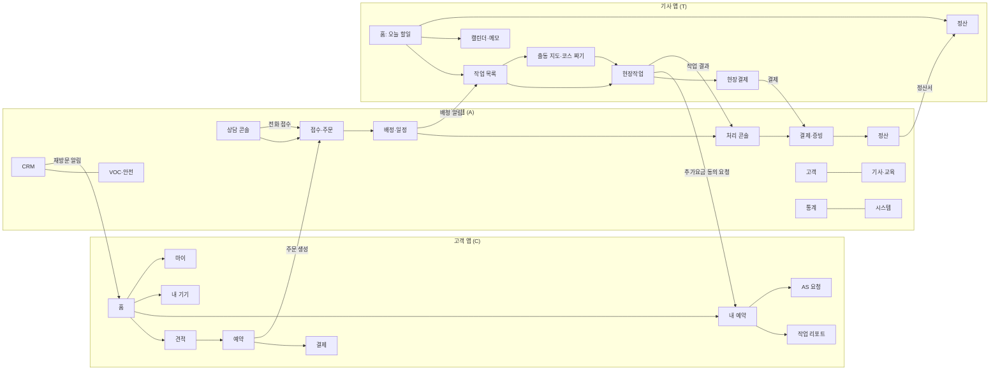
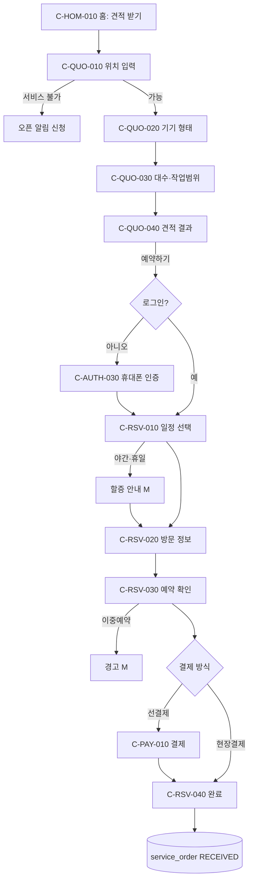
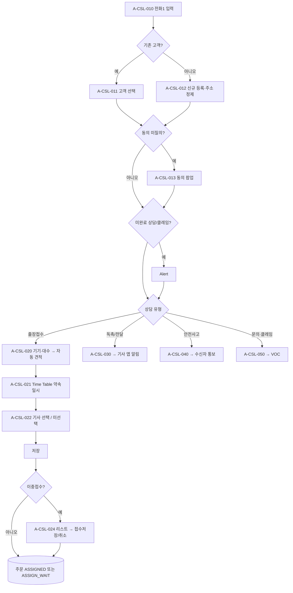
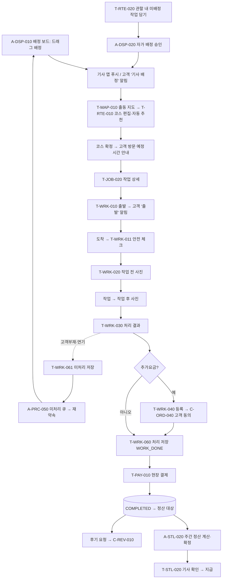
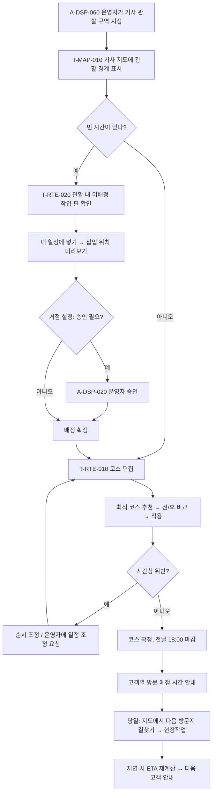

# 03. IA (Information Architecture)

> 에어컨 청소 기반 지역생활서비스 플랫폼 — 고객 앱 · 기사 앱 · 관리자 웹 정보구조
> 문서 버전: v1.0 · 작성일: 2026-11-22 · 작성 관점: 프로그램 분석·설계자
> 2026-11-23 보강: C-QUO-011 오픈 알림 신청, A-DSP-050 오픈 알림 대기 건수·미등록 지역 신청 현황
> 연계 문서: [01_ERD.md](./01_ERD.md) · [02_기능정의서.md](./02_기능정의서.md) (기능 ID)

---

## 0. 개요

### 0.1 채널 구성

| 채널 | 사용자 | 형태 | 내비게이션 | 화면 수(약) |
|---|---|---|---|---|
| 고객 앱 (C) | 개인·법인 고객 | 모바일 앱 + 모바일웹(반응형) | 하단 탭 4개 + 스텝형 플로우 | 38 |
| 기사 앱 (T) | 기사(견습·정식·팀장) | 모바일 앱 | 하단 탭 5개 + 퀵메뉴 | 37 |
| 관리자 웹 (A) | 상담원·운영자·거점장·정산·마케터·슈퍼관리자 | PC 웹(1440px 기준) | 상단 GNB 12개 + 좌측 LNB + 콘솔형 화면 | 82 |

### 0.2 IA 설계 원칙

1. **고객 앱은 "한 가지 목적"** — 전략 문서 합의사항(단일 목적 앱, 플랫폼이 지저분해지지 않게). 홈의 주 CTA는 "견적 받기" 하나. 견적까지 3단계(위치 → 기기 → 대수).
2. **기사 앱은 "오늘"과 "내 관할 지도" 중심** — MCS 메인의 구조(주요 공지 / 오늘 할일 / 주간 할일 / 퀵메뉴)를 홈에 그대로 반영. 현장작업은 순서가 정해진 스텝형(출발 → 도착 → 사진 → 결과 → 추가요금 → 완료 → 결제). 작업 탭은 목록과 지도를 같은 데이터로 전환하고, 지도에서 관할 구역 안의 일정·방문 코스를 직접 짭니다.
3. **관리자 웹은 "업무 흐름 순서"** — GNB 순서를 실제 업무 흐름(상담 → 접수 → 배정 → 처리 → 결제 → 정산)으로 배치. 상담 콘솔·처리 콘솔은 하이런 상담/서비스 PORTAL처럼 한 화면 안에서 조회·입력·이력을 모두 처리하는 콘솔형.
4. **권한에 따라 메뉴 자체를 숨김** — 역할별로 보이는 GNB가 다름(§4.4 권한 매트릭스).
5. **화면 ID = 권한 메뉴 코드** — `permission.menu_code`에 화면 ID를 그대로 사용.

### 0.3 화면 ID 규칙

`{채널}-{영역}-{번호3}`
- 채널: `C` 고객 · `T` 기사 · `A` 관리자
- 번호: 10 단위로 화면, 1 단위로 하위 팝업/탭 (예: `A-CSL-010` 상담 콘솔, `A-CSL-011` 고객 조회 팝업)
- 유형 표기: **P** 페이지 · **T** 탭 · **M** 모달/팝업 · **B** 바텀시트 · **S** 스텝(플로우 단계)

---

## 1. 전체 서비스 맵



---

## 2. 고객 앱 IA (C)

### 2.1 내비게이션 구조

| 하단 탭 | 아이콘 의미 | 루트 화면 | 비고 |
|---|---|---|---|
| 홈 | 집 | C-HOM-010 | 견적 받기 CTA, 진행 중 예약 카드 |
| 내 예약 | 달력 | C-ORD-010 | 진행/완료/취소 |
| 내 기기 | 에어컨 | C-DEV-010 | 보유 기기·다음 청소 권장일 (R2) |
| 마이 | 사람 | C-MY-010 | 정보·쿠폰·고객센터·설정 |

> 견적·예약은 탭이 아니라 **홈 CTA에서 시작하는 전체화면 스텝 플로우**(하단 탭 숨김, 상단 진행바 표시).
> 경로(단계 1): 홈 `/`(C-HOM-010) → `/quote`(C-QUO-010) → `/quote/device`(020) → `/quote/count`(030) → `/quote/result/{견적번호}`(040). 관리자 견적 시뮬레이터 A-PRD-050은 `/admin/prd/simulator`.
>
> 경로(단계 2): 로그인 `/login`(C-AUTH-010) → `/login/phone`(C-AUTH-030) → `/login/terms`(C-AUTH-020), 소셜 로그인 `/auth/{kakao|naver}` → `/auth/{provider}/callback`. 예약 `/reserve/{견적번호}`(C-RSV-010) → `/reserve/{견적번호}/visit`(020) → `/reserve/{견적번호}/confirm`(030) → `/reserve/pay/{접수번호}`(C-PAY-010) → `/reserve/done/{접수번호}`(C-RSV-040). 하단 탭: 홈 `/` · 예약 `/orders`(C-ORD-010, `?tab=`) · 고객센터 `/cs`(C-CS-010) · 마이 `/my`(C-MY-010). 상세 `/orders/{접수번호}`(C-ORD-020), 변경·취소 `/orders/{접수번호}/change`(C-ORD-030), 동의 관리 `/my/consents`(C-MY-030), 탈퇴 `/my/withdraw`(C-MY-040), 알림함 `/notifications`(C-NTF-010). 관리자: A-ORD-010 `/admin/ord/orders`, A-ORD-020 `/admin/ord/orders/{id}`, A-ORD-030 `/admin/ord/requests`, A-ORD-040 `/admin/ord/new`, A-DSP-030 `/admin/dsp/slots`, A-DSP-040 `/admin/dsp/schedules`, A-TEC-010 `/admin/tec/technicians`(단계 2는 기본 등록만, 상세 A-TEC-020은 4-1), A-CRM-040 `/admin/crm/templates`(문구 수정·발송 이력).

### 2.2 사이트맵 트리

```
고객 앱
├── [진입] 스플래시 / 온보딩(최초 1회, 3장)
├── 인증 (C-AUTH)
│   ├── C-AUTH-010 로그인(소셜 3종 + 휴대폰)
│   ├── C-AUTH-020 약관 동의
│   └── C-AUTH-030 휴대폰 인증 / 기존 전화고객 연동
├── 홈 (C-HOM-010)
│   ├── 진행 중 예약 카드 → C-ORD-020
│   ├── [견적 받기] → 견적 플로우
│   ├── 재방문 배너 → C-DEV-010 / 견적 플로우(이전 조건)
│   └── 알림 아이콘 → C-NTF-010
├── 견적 플로우 (C-QUO) ─ 스텝
│   ├── S1 C-QUO-010 위치 입력 (주소 검색 M / 서비스 불가 안내 M)
│   │   └── C-QUO-011 오픈 알림 신청 (서비스 불가 안내 M 안 폼)
│   ├── S2 C-QUO-020 기기 형태 선택
│   │   └── C-QUO-021 사진으로 인식 (R2)
│   ├── S3 C-QUO-030 대수·작업범위·옵션
│   ├── S4 C-QUO-040 견적 결과 (포함/불포함, 추가요금 조건 B)
│   └── C-QUO-050 대화형 견적 (R3, 대체 진입)
├── 예약 플로우 (C-RSV) ─ 스텝
│   ├── S5 C-RSV-010 일정 선택 (야간·휴일 할증 안내 M)
│   ├── S6 C-RSV-020 방문 정보 입력
│   ├── S7 C-RSV-030 예약 확인 (이중예약 경고 M)
│   ├── S8 C-PAY-010 결제 (쿠폰 선택 B)
│   └── S9 C-RSV-040 예약 완료
├── 내 예약 (C-ORD)
│   ├── C-ORD-010 예약 목록 [진행중 | 완료 | 취소]
│   └── C-ORD-020 예약 상세 (진행 타임라인, 기사 정보)
│       ├── C-ORD-030 일정 변경·취소 (B)
│       ├── C-ORD-040 추가요금 동의 (M, 푸시 진입)
│       ├── C-PAY-020 작업 후 결제
│       ├── C-PAY-030 증빙 신청 (B)
│       ├── C-ORD-050 작업 리포트 (전·후 사진)
│       ├── C-REV-010 후기 작성
│       └── C-AS-010 AS 요청
├── 내 기기 (C-DEV) (R2)
│   ├── C-DEV-010 기기 목록(주소별) → [다시 예약]
│   └── C-DEV-020 기기 등록·수정
├── 마이 (C-MY)
│   ├── C-MY-010 내 정보 / 주소록
│   ├── C-MY-020 쿠폰함
│   │   └── C-MY-021 친구 추천 (R3)
│   ├── C-CS-010 고객센터 (FAQ, 전화 연결)
│   │   └── C-CS-020 1:1 문의
│   ├── C-B2B-010 기업 견적 문의 (R3)
│   ├── C-MY-030 동의·알림 설정
│   └── C-MY-040 회원 탈퇴
└── 알림함 (C-NTF-010)
```

### 2.3 화면 목록

| 화면 ID | 화면명 | 유형 | Depth | 주요 구성요소 | 기능 ID | 로그인 |
|---|---|---|---|---|---|---|
| C-AUTH-010 | 로그인 | P | 1 | 소셜 버튼 3, 휴대폰 로그인, 둘러보기 | F-CUS-AUTH-01 | – |
| C-AUTH-020 | 약관 동의 | P | 2 | 전체동의, 필수/선택 항목, 약관 보기 | F-CUS-AUTH-03 | – |
| C-AUTH-030 | 휴대폰 인증 | P | 2 | 번호·인증번호, 기존 이력 연동 안내 | F-CUS-AUTH-02, 04 | – |
| C-HOM-010 | 홈 | P | 1 | 견적 받기 CTA, 진행 예약 카드, 재방문 배너, 표준가격 안내, 후기 하이라이트 | F-CUS-HOM-01 | 선택 |
| C-QUO-010 | 위치 입력 | S | 2 | 주소 검색, 저장 주소 선택, 서비스 가능 여부 | F-CUS-QUO-01 | 선택 |
| C-QUO-011 | 오픈 알림 신청 | M | 3 | 지역명, 휴대폰 번호, 개인정보 수집·이용 동의(필수), [알림 신청]·[다른 주소 검색] | F-CUS-QUO-08 | 선택 |
| C-QUO-020 | 기기 형태 선택 | S | 2 | 형태 일러스트 카드(복수 선택), 내 기기 불러오기, 사진 인식 버튼 | F-CUS-QUO-02 | 선택 |
| C-QUO-021 | 사진 인식 | M | 3 | 촬영/업로드, 인식 결과·수정 | F-CUS-QUO-05 | 선택 |
| C-QUO-030 | 대수·작업범위 | S | 2 | 형태별 수량 스테퍼, 일반/완전분해, 옵션 체크 | F-CUS-QUO-03 | 선택 |
| C-QUO-040 | 견적 결과 | S | 2 | 항목별 금액, 할인, 총액, 소요시간, 포함/불포함, 추가요금 조건, [예약하기](단계 2에서 활성)[저장·공유](R2) | F-CUS-QUO-04, 07 | 선택 |
| C-QUO-050 | 대화형 견적 | P | 2 | 채팅 UI, 선택 칩 | F-CUS-QUO-06 | 선택 |
| C-RSV-010 | 일정 선택 | S | 2 | 14일 달력, 시간대 버튼(마감/할증 배지) | F-CUS-RSV-01 | 필수 |
| C-RSV-020 | 방문 정보 | S | 2 | 상세주소, 주거유형, 엘리베이터·주차, 요청사항 | F-CUS-RSV-02 | 필수 |
| C-RSV-030 | 예약 확인 | S | 2 | 요약, 결제 방식(선결제/현장), 취소 규정 동의 | F-CUS-RSV-03, 05 | 필수 |
| C-PAY-010 | 결제 | S | 2 | 결제수단, 쿠폰, 최종금액, PG 호출 | F-CUS-PAY-01, 04 | 필수 |
| C-RSV-040 | 예약 완료 | S | 2 | 접수번호, 일정, 다음 단계 안내 | F-CUS-RSV-04 | 필수 |
| C-ORD-010 | 예약 목록 | P | 1 | 상태 탭, 예약 카드 | F-CUS-ORD-01 | 필수 |
| C-ORD-020 | 예약 상세 | P | 2 | 상태 타임라인, 방문 예정 시간(코스 확정 후)·이동중 도착 예정시각, 기사 프로필·전화, 항목·금액, 액션 버튼 | F-CUS-ORD-02 | 필수 |
| C-ORD-030 | 변경·취소 | B | 3 | 사유, 새 일정, 수수료 안내 | F-CUS-ORD-03 | 필수 |
| C-ORD-040 | 추가요금 동의 | M | 3 | 항목·사유·사진, [동의][거절] | F-CUS-ORD-04 | 필수 |
| C-ORD-050 | 작업 리포트 | P | 3 | 기기별 전·후 사진, 처리 내용, 발견 이슈, 차기 권장일 | F-CUS-ORD-05 | 필수 |
| C-PAY-020 | 작업 후 결제 | P | 3 | 차액, 결제수단 | F-CUS-PAY-02 | 필수 |
| C-PAY-030 | 증빙 신청 | B | 3 | 현금영수증/세금계산서 정보 | F-CUS-PAY-03 | 필수 |
| C-REV-010 | 후기 작성 | P | 3 | 별점, 추천의향(0~10), 태그, 사진, 내용 | F-CUS-REV-01 | 필수 |
| C-AS-010 | AS 요청 | P | 3 | 사유 선택, 사진, 내용, 보증 여부 표시 | F-CUS-AS-01 | 필수 |
| C-DEV-010 | 내 기기 | P | 1 | 주소별 기기 카드, 최근/다음 청소일, [다시 예약] | F-CUS-DEV-01, 02 | 필수 |
| C-DEV-020 | 기기 등록·수정 | P | 2 | 형태·브랜드·모델·위치·설치연도·사진 | F-CUS-DEV-01 | 필수 |
| C-MY-010 | 내 정보 | P | 1 | 프로필, 주소록 | F-CUS-MY-01 | 필수 |
| C-MY-020 | 쿠폰함 | P | 2 | 보유/사용/만료, 코드 등록 | F-CUS-CPN-01 | 필수 |
| C-MY-021 | 친구 추천 | P | 3 | 추천 코드, 공유 | F-CUS-CPN-02 | 필수 |
| C-MY-030 | 동의·알림 설정 | P | 2 | 마케팅·위치·푸시 토글 | F-CUS-AUTH-03 | 필수 |
| C-MY-040 | 회원 탈퇴 | P | 2 | 유의사항, 사유 | F-CUS-AUTH-05 | 필수 |
| C-CS-010 | 고객센터 | P | 2 | FAQ 검색·카테고리, 전화 연결 | F-CUS-CS-01, 03 | 선택 |
| C-CS-020 | 1:1 문의 | P | 3 | 문의 목록·작성·답변 | F-CUS-CS-02 | 필수 |
| C-B2B-010 | 기업 견적 문의 | P | 2 | 현장명·수량·담당자 폼 | F-CUS-B2B-01 | 선택 |
| C-NTF-010 | 알림함 | P | 2 | 알림 목록, 딥링크 | F-CUS-NTF-01 | 필수 |

---

## 3. 기사 앱 IA (T)

### 3.1 내비게이션 구조

| 하단 탭 | 루트 화면 | 비고 |
|---|---|---|
| 홈 | T-HOM-010 | 주요 공지 · VOC/NPS 배지 · 오늘 할일 · 주간 할일 · 퀵메뉴 (MCS 메인 구조) |
| 작업 | T-JOB-010 / T-MAP-010 | 상단 토글 [목록 ⇄ 지도]. 지도에서 관할 구역·출동지·코스 확인, [코스 짜기] 버튼으로 T-RTE-010 진입 |
| 캘린더 | T-CAL-010 | 근무 ⇄ 메모 전환 |
| 정산 | T-STL-010 | 주간 정산, 월 요약 |
| 더보기 | T-MORE-010 | 자재·기술자료·교육·기회고객·공지·설정 (★ 퀵메뉴 추가) |

> 현장작업(T-WRK)은 작업 상세에서 진입하는 **풀스크린 스텝 플로우**이며, 진행 중 작업이 있으면 모든 화면 상단에 "진행 중 작업" 고정 배너를 표시합니다.

### 3.2 사이트맵 트리

```
기사 앱
├── T-AUTH-010 로그인
├── 홈 (T-HOM-010)
│   ├── 주요 공지 3건 → T-NTC-010 공지 목록 / 상세
│   ├── 내 지표 배지 (이번 달 VOC n건 · NPS · 평점)
│   ├── 오늘 할일
│   │   ├── 오늘의 메모 (n/N) → T-MEMO-020 오늘의 메모 팝업
│   │   ├── 오늘의 자재 (D-1 이동중) → T-MAT-020
│   │   └── 오늘의 약속 (n/N, 미처리 우선) → T-JOB-010
│   ├── 주간 할일 [D-day | D+1 | D+2] 메모·자재·약속 건수
│   └── 퀵메뉴 (가로 슬라이드, 길게 눌러 순서 변경)
├── 작업 (T-JOB)
│   ├── T-JOB-010 작업 목록 [오늘 | 예정 | 미처리 | 완료]
│   ├── T-JOB-020 작업 상세 (고객·기기·요청·전달사항·과거이력·길찾기·전화)
│   │   ├── 배정 수락/거절 (B)
│   │   └── 타 기사 이관 요청 (B)
│   ├── T-MAP-010 출동 지도 [목록 ⇄ 지도 토글]
│   │   ├── 날짜 칩 [오늘 | 내일 | 날짜 선택]
│   │   ├── 레이어: 내 관할 구역(주·보조) / 내 작업 핀(번호=코스 순서) / 관할 내 미배정 핀 / 내 위치 / 코스 경로선
│   │   ├── 핀 미리보기 카드 (B) → [상세 T-JOB-020] [길찾기] [전화]
│   │   └── [코스 짜기] → T-RTE-010
│   ├── T-RTE-010 일자별 코스 편집 (지도 + 순서 리스트 분할)
│   │   ├── [최적 코스 추천] → 추천 전/후 비교 (B)
│   │   ├── 지점 추가: 휴식·자재수령 (B)
│   │   └── [코스 확정] → 고객 방문 예정 시간 안내
│   ├── T-RTE-020 관할 내 미배정 작업 (지도) → [내 일정에 넣기] → 삽입 위치 미리보기 (B)
│   └── T-RTE-030 주간 일정 (7일 × 시간대, R2)
├── 현장작업 플로우 (T-WRK) ─ 스텝
│   ├── S1 T-WRK-010 출발 / 도착
│   ├── S2 T-WRK-011 안전 체크리스트
│   ├── S3 T-WRK-020 작업 전 사진 → (작업) → 작업 후 사진
│   ├── S4 T-WRK-030 기기별 처리 결과 / 발견 이슈
│   ├── S5 T-WRK-040 추가요금 등록 → 고객 동의 대기/서명
│   ├── S6 T-WRK-050 자재 사용 (R2)
│   ├── S7 T-WRK-060 처리 저장(완료) — 처리 내용·고객 서명
│   ├── ↳ T-WRK-061 미처리 저장 (어느 단계에서든 진입)
│   ├── S8 T-PAY-010 현장 결제 / 수금 확인
│   └── S9 T-PAY-020 증빙 발행 요청
│   └── (공통) T-WRK-070 활동내역 등록 (B)
├── 캘린더 (T-CAL)
│   ├── T-CAL-010 나만의 캘린더 [근무 | 메모]
│   │   └── 날짜 선택 → 하단 당일 작업 목록 → T-JOB-020
│   ├── T-CAL-020 타 기사 캘린더 (R3)
│   ├── T-MEMO-010 메모 등록·수정 (머리말·기간·반복·수신자·팝업)
│   └── T-MEMO-020 오늘의 메모 팝업
├── 정산 (T-STL)
│   ├── T-STL-010 정산 목록 (회차별·월 요약)
│   └── T-STL-020 정산 상세 (건별) → [확인] / [이의 제기]
├── 더보기 (T-MORE-010)
│   ├── 자재: T-MAT-010 보유 자재 / T-MAT-020 자재 요청·불출 현황
│   ├── 교육: T-EDU-010 기술자료·SOP·CS Tip / T-EDU-020 내 교육·등급
│   ├── T-LEAD-010 기회고객 등록 (R3)
│   ├── T-NTC-010 공지사항
│   ├── T-MY-010 내 정보 (프로필·계좌·활동지역)
│   ├── T-MY-020 퀵메뉴 편집
│   └── 사용법 / 앱 설정
└── 알림 (T-NTF)
    ├── T-NTF-010 알림 목록
    └── T-NTF-020 독촉·전달 상세 / 회신
```

### 3.3 화면 목록

| 화면 ID | 화면명 | 유형 | Depth | 주요 구성요소 | 기능 ID |
|---|---|---|---|---|---|
| T-AUTH-010 | 로그인 | P | 1 | 휴대폰, 비밀번호/OTP, 자동로그인 | F-TEC-AUTH-01 |
| T-HOM-010 | 홈 | P | 1 | 근무 시작 토글, 공지 3건, VOC/NPS 배지, 오늘 할일 3카드, 주간 할일 D~D+2, 퀵메뉴 | F-TEC-HOM-01~05, F-TEC-AUTH-02 |
| T-NTC-010 | 공지 목록·상세 | P | 2 | 유형 필터(전체·안전·거점), 필독 표시 | F-TEC-HOM-01 |
| T-JOB-010 | 작업 목록 | P | 1 | 날짜 선택, 상태 탭, 작업 카드(시간·고객·주소·기기·상태·경과시간), 완료 건 하단·배경색 | F-TEC-JOB-01 |
| T-JOB-020 | 작업 상세 | P | 2 | 고객·주소(지도)·기기·요청·전달사항·과거 이력, [길찾기][전화][작업 시작], 수락/거절/이관 | F-TEC-JOB-02, 03, 05 |
| T-MAP-010 | 출동 지도 | P | 1 | 목록/지도 토글, 날짜 칩, 관할 구역 다각형, 상태색·번호 핀, 미배정 핀 레이어, 내 위치, 경로선, 핀 미리보기 카드, [코스 짜기] | F-TEC-MAP-01~05, F-TEC-RTE-06 |
| T-RTE-010 | 코스 편집 | P | 2 | 상단 지도(경로선) + 하단 순서 리스트(드래그, 🔒 고정), 지점별 도착 예정·이동시간·시간창, 위반 경고, 총 이동시간·거리, [최적 코스 추천][코스 확정] | F-TEC-RTE-01~03, F-TEC-RTE-06 |
| T-RTE-020 | 관할 내 미배정 작업 | P | 2 | 관할 구역 지도 + 미배정 핀, 필터(날짜·기기), 담기 가능 여부 표시, [내 일정에 넣기], 삽입 위치·이동시간 증가 미리보기 | F-TEC-RTE-04 |
| T-RTE-030 | 주간 일정 | P | 2 | 7일 × 시간대 그리드(작업·빈 시간·휴무), 날짜 선택 → T-RTE-010 | F-TEC-RTE-05 |
| T-WRK-010 | 출발·도착 | S | 3 | [출발] → 도착 예정 알림, [도착] | F-TEC-WRK-01, 02 |
| T-WRK-011 | 안전 체크리스트 | S | 3 | 고소·전기·보호구·약품 체크 | F-TEC-WRK-02 |
| T-WRK-020 | 작업 사진 | S | 3 | 기기별 전/후 촬영 슬롯, 이슈·안전 사진 | F-TEC-WRK-03 |
| T-WRK-030 | 처리 결과 | S | 3 | 기기별 결과·오염도·상태·차기 권장, 기기 추가, 발견 이슈 | F-TEC-WRK-04, 10 |
| T-WRK-040 | 추가요금 | S | 3 | 규칙 선택/기타 입력, 사유·사진, 동의 요청 상태, 서명 패드 | F-TEC-WRK-05 |
| T-WRK-050 | 자재 사용 | S | 3 | 자재 검색, 수량, 고객 청구 여부 | F-TEC-WRK-06 |
| T-WRK-060 | 처리 저장 | S | 3 | 필수값 체크 결과, 처리 내용, 금액 요약, 고객 서명 | F-TEC-WRK-07 |
| T-WRK-061 | 미처리 저장 | M | 3 | 미처리 코드, 메모, 재약속 희망일 | F-TEC-WRK-08 |
| T-WRK-070 | 활동내역 | B | 3 | 유형(통화·문자·방문시도·메모), 내용 | F-TEC-WRK-09 |
| T-PAY-010 | 현장 결제 | S | 3 | 최종 금액, [앱 결제 요청][결제 링크][카드단말][계좌][현금], 수금 입력 | F-TEC-PAY-01, 02 |
| T-PAY-020 | 증빙 발행 | B | 3 | 현금영수증 번호 | F-TEC-PAY-03 |
| T-CAL-010 | 나만의 캘린더 | P | 1 | 근무/메모 토글, 월 달력(접수/미처리 숫자, 휴무·반차, 메모 !표시), 하단 당일 작업 | F-TEC-CAL-01, 02 |
| T-CAL-020 | 타 기사 캘린더 | P | 2 | 공유 기사 +/−, 근무·공유메모 | F-TEC-CAL-03 |
| T-MEMO-010 | 메모 등록 | P | 2 | 머리말 칩, 내용, 기간/종일, 반복, 수신자(권한자), 팝업 설정 | F-TEC-MEMO-01, 02 |
| T-MEMO-020 | 오늘의 메모 | M | 2 | 메모 목록, 작성자, [메모 추가][확인], 팝업 On/Off | F-TEC-MEMO-03 |
| T-STL-010 | 정산 목록 | P | 1 | 회차 카드(기간·건수·실지급·상태), 월 수입 그래프 | F-TEC-STL-01, 03 |
| T-STL-020 | 정산 상세 | P | 2 | 배분·추가·인센티브·공제·원천세, 건별 내역, [확인][이의] | F-TEC-STL-02 |
| T-MAT-010 | 보유 자재 | P | 2 | 자재별 수량, 안전재고 경고 | F-TEC-MAT-01 |
| T-MAT-020 | 자재 요청 | P | 2 | 요청 폼, 상태(요청·이동중·수령) | F-TEC-MAT-02 |
| T-EDU-010 | 기술자료 | P | 2 | 유형·기기 필터, SOP·CS Tip·안전·핸드북 | F-TEC-EDU-01 |
| T-EDU-020 | 내 교육·등급 | P | 2 | 수강·수료, 등급 이력, 동행 n/3 | F-TEC-EDU-02 |
| T-LEAD-010 | 기회고객 등록 | P | 2 | 양식 9항목, 관련 작업 | F-TEC-LEAD-01 |
| T-MY-010 | 내 정보 | P | 2 | 프로필 사진·소개, 계좌, 활동지역, 비밀번호 | F-TEC-MY-01 |
| T-MY-020 | 퀵메뉴 편집 | P | 2 | 메뉴 ★ 토글, 드래그 정렬 | F-TEC-HOM-04 |
| T-MORE-010 | 더보기 | P | 1 | 메뉴 그리드(★ 즐겨찾기 버튼) | – |
| T-NTF-010 | 알림 | P | 2 | 배정·변경·독촉·동의결과·공지 | F-TEC-NTF-01 |
| T-NTF-020 | 독촉·전달 | P | 3 | 전달 내용, 관련 작업, 회신 | F-TEC-NTF-02 |

---

## 4. 관리자 웹 IA (A)

### 4.1 레이아웃

```
┌──────────────────────────────────────────────────────────────────────┐
│ 로고 │ GNB: 대시보드 상담 접수·주문 배정·일정 처리 고객 기사 상품 결제 정산 CRM·VOC 통계 시스템 │ 거점선택 ▼ │ 알림 │ 사용자 │
├──────────┬───────────────────────────────────────────────────────────┤
│ LNB      │ 브레드크럼: 상담 > 상담 콘솔                                │
│ (GNB별   │ ┌─────────────────────────────────────────────────────┐ │
│  하위    │ │ 콘텐츠 영역                                          │ │
│  메뉴)   │ │ - 목록형: 검색 영역 / 결과 그리드 / 페이지네이션       │ │
│          │ │ - 콘솔형: 고객 영역 / 입력 영역 / Time Table / 이력 탭 │ │
│ ★즐겨찾기 │ └─────────────────────────────────────────────────────┘ │
└──────────┴───────────────────────────────────────────────────────────┘
```
- 경로: 관리자 웹은 `/admin` 아래(고객 `/`, 기사 `/tech`와 같은 웹 앱, 06 v0.2). 로그인하지 않으면 `/admin/login`(A-AUTH-010)으로 이동합니다.
- 상단 **거점 선택**: 본사 소속(거점 미지정) 전체 범위 관리자는 전체/거점 전환, 거점 소속자는 고정(BR-102).
- 메뉴는 READ 권한이 있고 구현이 끝난 단계의 화면만 노출합니다(목록에서 들어가는 상세 화면은 LNB에 표시하지 않음).
- **긴급 알림 영역**: 미지정(긴급) 건, 장기 미처리, 안전사고 신규를 헤더 알림 배지로 표시.

### 4.2 사이트맵 트리 (GNB > LNB > 화면)

```
관리자 웹
├── A-AUTH-010 로그인 / A-AUTH-020 비밀번호 변경
├── 1. 대시보드 (A-DSH)
│   ├── A-DSH-010 운영 현황 (오늘)
│   └── A-DSH-020 KPI 대시보드
├── 2. 상담 (A-CSL)
│   ├── A-CSL-010 상담 콘솔 ★핵심
│   │   ├── A-CSL-011 고객정보 조회 (M) [고객목록 | 고객등록]
│   │   ├── A-CSL-012 신규 고객 등록 (T: 주소검색 → 주소선택 → 상세주소 → 주소정제)
│   │   ├── A-CSL-013 개인정보 수집 동의 (M) / 동의 철회 (M)
│   │   ├── A-CSL-014 고객정보 수정 (M) (해피콜 거부/해제)
│   │   ├── A-CSL-020 [탭] 출장접수
│   │   │   ├── A-CSL-021 Time Table 7일 (영역)
│   │   │   ├── A-CSL-022 출장 가능 기사 스케줄 (M)
│   │   │   ├── A-CSL-023 휴일 근무 기사 (M)
│   │   │   └── A-CSL-024 이중접수 고객 리스트 (M)
│   │   ├── A-CSL-030 [탭] 독촉/전달 (상담 독촉 | 출장 독촉)
│   │   ├── A-CSL-040 [탭] 안전사고 (수신자 추가 M)
│   │   ├── A-CSL-050 [탭] 일반문의·클레임
│   │   └── A-CSL-060 [하단 탭] 작업이력(n) | VOC이력(n) | 보상이력(n)
│   ├── A-CSL-070 상담 이력 조회 (목록)
│   └── A-CSL-080 1:1 문의 관리 (앱 문의 답변)
├── 3. 접수·주문 (A-ORD)
│   ├── A-ORD-010 주문 목록
│   ├── A-ORD-020 주문 상세 [기본 | 항목·금액 | 배정 | 작업결과·사진 | 결제 | 활동내역 | 상태이력]
│   ├── A-ORD-030 변경·취소 요청
│   └── A-ORD-040 수동 주문 등록
├── 4. 배정·일정 (A-DSP)
│   ├── A-DSP-010 배정 보드 ★핵심
│   ├── A-DSP-020 재배정·이관·자가 배정 요청
│   ├── A-DSP-030 운영 슬롯 관리 (거점 Time Table)
│   ├── A-DSP-040 기사 근무 일정
│   ├── A-DSP-050 관할 지역 관리 (거점-법정동)
│   ├── A-DSP-060 기사 관할 구역 지정 (지도)
│   └── A-DSP-070 코스 모니터링 지도 (R2)
├── 5. 처리 (A-PRC)
│   ├── A-PRC-010 처리 콘솔 ★핵심 (기사별 접수 조회)
│   │   └── A-PRC-020 처리 정보 입력 (영역) — 처리/미처리 저장, 파일첨부(M), 활동내역(M)
│   ├── A-PRC-030 작업 결과 검수 (R2)
│   ├── A-PRC-040 추가요금(별도금액) 승인
│   ├── A-PRC-050 미처리 큐
│   └── A-PRC-060 독촉·전달 현황
├── 6. 고객 (A-CUS)
│   ├── A-CUS-010 고객 목록
│   ├── A-CUS-020 고객 상세 (One View) [기본 | 주소·기기 | 주문 | 결제 | VOC·AS | 쿠폰 | 동의이력 | 메모]
│   └── A-CUS-030 파기 대상 관리
├── 7. 기사 (A-TEC)
│   ├── A-TEC-010 기사 목록
│   ├── A-TEC-020 기사 상세·등록 [기본·계약 | 숙련·지역 | 등급이력 | 작업통계 | 정산 | VOC]
│   ├── A-TEC-030 지원자 관리 (R2)
│   ├── A-TEC-040 교육 과정 (R2)
│   │   └── A-TEC-041 수강·수료 관리
│   ├── A-TEC-050 정착·이탈 분석 (R2)
│   └── A-TEC-060 자재 불출 관리 (R3)
├── 8. 상품·가격 (A-PRD)
│   ├── A-PRD-010 카테고리 관리
│   ├── A-PRD-011 상품 관리 (목록·상세)
│   ├── A-PRD-020 가격 정책
│   ├── A-PRD-030 할증·추가요금 규칙
│   ├── A-PRD-040 옵션·자재 마스터
│   └── A-PRD-050 견적 시뮬레이터
├── 9. 결제 (A-PAY)
│   ├── A-PAY-010 결제 내역
│   ├── A-PAY-020 결제 실패
│   ├── A-PAY-030 환불 처리
│   ├── A-PAY-040 미수금
│   └── A-PAY-050 증빙(현금영수증·세금계산서)
├── 10. 정산 (A-STL)
│   ├── A-STL-010 수수료 정책
│   ├── A-STL-020 정산 회차 (생성·계산·확정·지급)
│   ├── A-STL-030 기사별 정산 검토·조정
│   └── A-STL-040 원천세 자료
├── 11. CRM·VOC
│   ├── VOC·품질 (A-VOC)
│   │   ├── A-VOC-010 VOC 목록
│   │   │   └── A-VOC-011 VOC 카드 (M, 인쇄)
│   │   ├── A-VOC-020 안전사고 관리
│   │   ├── A-VOC-030 AS 요청
│   │   └── A-VOC-040 후기 관리
│   ├── 마케팅 (A-CRM)
│   │   ├── A-CRM-010 재방문 자동 캠페인
│   │   ├── A-CRM-020 캠페인 관리
│   │   ├── A-CRM-030 쿠폰 관리
│   │   └── A-CRM-040 알림 템플릿·발송 이력
│   ├── B2B (A-B2B) (R3)
│   │   ├── A-B2B-010 거래처
│   │   ├── A-B2B-020 기회고객(리드)
│   │   └── A-B2B-030 B2B 견적서
│   └── 콘텐츠 (A-CNT)
│       ├── A-CNT-010 공지사항
│       ├── A-CNT-020 FAQ
│       ├── A-CNT-030 기술자료·SOP
│       ├── A-CNT-040 메모·지정 메모 발송
│       └── A-CNT-050 상담 스크립트
├── 12. 통계 (A-STA)
│   ├── A-STA-010 매출
│   ├── A-STA-020 운영
│   ├── A-STA-030 기사 성과
│   └── A-STA-040 고객·CRM
└── 13. 시스템 (A-SYS)
    ├── A-SYS-010 관리자 계정
    ├── A-SYS-020 역할·권한
    ├── A-SYS-030 거점 관리
    ├── A-SYS-040 공통 코드
    ├── A-SYS-050 공휴일·시스템 설정
    └── A-SYS-060 감사 로그
```

### 4.3 핵심 콘솔 화면 레이아웃

#### A-CSL-010 상담 콘솔 (상담 PORTAL 구조 반영)
```
┌─────────────────────────────────────────────────────────────────────────┐
│ ① 고객 영역  [전화1 ______🔍]  김*빈 고객님 | 010-****-7789  [고객정보수정][B2B 리드][초기화] │
│    전화2 | 고객명 | 주소 | 고객등급(VIP/다빈도/주의) | 동의상태 | 최근작업일             │
├───────────────────────────────────────────┬─────────────────────────────┤
│ ② 상담 유형 탭                              │ ③ 거점·지역 현황              │
│ [출장접수][독촉/전달][안전사고][문의·클레임]   │  거점명 / 관할 / 미지정 20건    │
│                                           │  미처리 27건 / 휴일근무 기사(n) │
│  출장접수: 기기형태·대수·작업범위 → 자동견적   │  출장가능 기사(n) [운영슬롯관리] │
│  접수유형 | 요청사항 | 방문형태 | 2인방문      │                             │
│  요구일시 | 약속일시 | 기사 | 전달사항         │                             │
├───────────────────────────────────────────┴─────────────────────────────┤
│ ④ Time Table  <7일전 | 당일 | 7일후>                                       │
│  날짜 요일 │08│09│10│11│12│13│14│15│16│17│18│계약│긴급│당직│                  │
│  (셀 = 잔여 건수, 클릭 시 가용 기사 팝업)                       [저장]       │
├─────────────────────────────────────────────────────────────────────────┤
│ ⑤ 이력 탭  [작업이력(3)] [VOC이력(0)] [보상이력(0)]                          │
│  접수번호 | 상태 | 처리코드 | 유형 | 처리일 | 기기 | 기사 | 금액  (더블클릭 → 상단 로드) │
└─────────────────────────────────────────────────────────────────────────┘
```
- 초기 상태: 전화1 외 모든 입력 비활성. 고객 확정 후 활성.
- 고객 확정 시 Alert 순서: 개인정보 동의(미질의 시) → 미완료 상담 → 미완료 클레임 → 당일 상담 이력.

#### A-PRC-010 처리 콘솔 (서비스 PORTAL 구조 반영)
```
┌─────────────────────────────────────────────────────────────────────────┐
│ 조회: [기사명 ____🔍] [접수번호 ____] [전화 ____] [조회]  (동명이인 → 선택 팝업) │
├───────────────────────────┬─────────────────────────────────────────────┤
│ 기사 접수 목록              │ 처리 정보                                      │
│ No|접수번호|상태|기기|고객|  │ 고객·주소·계약정보 / 기기·증상 / 전달사항         │
│ 약속일시|미처리코드|처리유형  │ ─ 처리 결과 ─                                   │
│ (이관 → 미처리 → 처리 순,    │ 약속일시 | 방문일시 | 작업시간 | 처리기사 | 지원기사 │
│  처리건 하단 노란 배경)      │ 처리코드 | 미처리코드 | 안전관리 | 고소작업         │
│                           │ 작업비 | 추가요금 | 자재 | 할인 | 할증 | 합계 | 영수 │
│                           │ 처리 내용                                      │
│                           │ [추가요금][안전관리파일][서비스파일][활동내역]       │
│                           │ [타 기사 이관]               [미처리 저장/처리 저장] │
├───────────────────────────┴─────────────────────────────────────────────┤
│ 하단 탭: [작업 사진] [활동내역] [상태이력] [결제]                               │
└─────────────────────────────────────────────────────────────────────────┘
```
- 처리 정보를 입력하면 [미처리 저장] 버튼이 [처리 저장]으로 바뀜.

#### A-DSP-010 배정 보드
```
┌──────────────┬──────────────────────────────────────────┬──────────────┐
│ 배정대기       │ 기사 타임라인 (일)   08  10  12  14  16  18    │ 선택 건 상세   │
│ [긴급] 3       │ 김기사(정식) ████░░░██████░░░            │ 고객·주소·기기 │
│ [미지정] 5     │ 이기사(팀장) ░░██████░░░░████            │ 소요 90분      │
│ [미처리재약속] 2│ 박기사(견습) (동행만)                       │ 추천 기사 Top3 │
│ [자가배정 승인대기] 1│                                      │ [승인][반려]   │
│ 카드 드래그 →   │ 최기사 휴무 ▒▒▒▒▒▒▒▒▒▒▒▒                │ [배정][2인추가] │
└──────────────┴──────────────────────────────────────────┴──────────────┘
```

### 4.4 역할별 메뉴 권한 매트릭스

R=조회 · W=등록/수정 · A=승인/확정 · –=메뉴 숨김. 거점장(BRANCH)은 소속 거점 데이터만.

| GNB (화면 영역) | 상담원 CS | 운영자 OPS | 거점장 BRANCH | 정산 FIN | 마케터 MKT | 슈퍼 SUPER |
|---|---|---|---|---|---|---|
| 대시보드 운영 (A-DSH-010) | R | R | R | R | R | R |
| 대시보드 KPI (A-DSH-020) | – | – | R | R | R | R |
| 상담 콘솔 (A-CSL) | W | W | W | – | – | W |
| 접수·주문 (A-ORD) | R/W(등록) | W | W | R | – | W |
| 배정·일정 (A-DSP) | R(Time Table) | W | W·A | – | – | W |
| 관할 지역 (A-DSP-050) | – | R | W | – | – | W |
| 기사 관할 구역·코스 모니터링 (A-DSP-060·070) | – | W | W·A | – | – | W |
| 처리 콘솔 (A-PRC) | R | W | W·A | R | – | W |
| 추가요금 승인 (A-PRC-040) | – | A | A | R | – | A |
| 고객 (A-CUS) | R/W | R/W | R/W | R | R(통계용 비식별) | W |
| 파기 관리 (A-CUS-030) | – | – | – | – | – | A |
| 기사 (A-TEC) | R | R/W | W·A | R(계좌) | – | W |
| 상품·가격 (A-PRD) | R | R | R | R | R | W |
| 결제 (A-PAY) | R | R | R | W·A | – | W |
| 정산 (A-STL) | – | – | R | W·A | – | W·A |
| VOC·AS·안전 (A-VOC) | W | W | W·A | R | R(후기) | W |
| 마케팅 (A-CRM) | – | – | R | – | W | W |
| B2B (A-B2B) | R | R/W | W | R | R | W |
| 콘텐츠 (A-CNT) | R(FAQ W) | W(메모) | W | – | W | W |
| 통계 (A-STA) | – | R(운영) | R | R(매출) | R(CRM) | R |
| 시스템 (A-SYS) | – | – | – | – | – | W |
| 엑셀 다운로드 | – | R | R | R | R | R |

> 구현 매핑(단계 0): R→READ, W→READ·CREATE·UPDATE·DELETE, A→APPROVE(+READ), 엑셀 다운로드→조회 가능한 화면의 EXPORT. 괄호 셀은 해당 화면만 적용(예: 상담원 배정·일정 R(Time Table)=A-DSP-030 READ, 마케터 VOC R(후기)=A-VOC-040 READ, 상담원 콘텐츠 R(FAQ W)=A-CNT-020만 W). 단일 출처는 `packages/domain/src/rbac/permission-matrix.ts`이며 시드가 이 표로 `role_permission`을 채웁니다. 이후 변경은 A-SYS-020에서 합니다.

### 4.5 화면 목록 (관리자)

| 화면 ID | 화면명 | 유형 | 주요 구성요소 | 기능 ID |
|---|---|---|---|---|
| A-AUTH-010 | 로그인 | P | ID/PW, 잠금 안내 | F-ADM-SYS-01 |
| A-DSH-010 | 운영 현황 | P | 상태별 카운트 카드, 거점 슬롯 가동률, 긴급·장기미처리 목록, 기사 현황 | F-ADM-DSH-01 |
| A-DSH-020 | KPI | P | KPI 8종 카드·추이 차트, 목표 대비 | F-ADM-DSH-02 |
| A-CSL-010 | 상담 콘솔 | P | §4.3 레이아웃 | F-ADM-CSL-01~18 |
| A-CSL-011 | 고객정보 조회 | M | 고객 목록 그리드, [등록][수정][동의철회] | F-ADM-CSL-01 |
| A-CSL-012 | 신규 고객 등록 | T | 4단계 주소 정제, 저장 | F-ADM-CSL-02 |
| A-CSL-013 | 개인정보 동의 | M | 응대 멘트, [동의][미동의][질의못함] | F-ADM-CSL-03 |
| A-CSL-014 | 고객정보 수정 | M | 연락처·주소, 해피콜 거부/해제 | F-ADM-CSL-15 |
| A-CSL-020 | 출장접수 탭 | T | 기기·대수·견적, 접수 정보, 약속 | F-ADM-CSL-05, 09 |
| A-CSL-021 | Time Table | 영역 | 7일×시간대 잔여, 계약·긴급·당직 | F-ADM-CSL-06 |
| A-CSL-022 | 출장 가능 기사 | M | 기사·거점·등급·숙련·약속시간 | F-ADM-CSL-07 |
| A-CSL-023 | 휴일 근무 기사 | M | 당직 기사 목록 | F-ADM-CSL-08 |
| A-CSL-024 | 이중접수 리스트 | M | 동일번호 미완료 주문, [접수저장][접수취소] | F-ADM-CSL-10 |
| A-CSL-030 | 독촉/전달 탭 | T | 대상 주문 목록, 유형·원인·내용, 대상 기사 | F-ADM-CSL-11 |
| A-CSL-040 | 안전사고 탭 | T | 피해유형·경위·내용·요구·조치, 매체/기관, 수신자 | F-ADM-CSL-12 |
| A-CSL-050 | 문의·클레임 탭 | T | 유형, 내용, VOC 생성 | F-ADM-CSL-13 |
| A-CSL-060 | 이력 탭 | T | 작업·VOC·보상 이력 | F-ADM-CSL-14 |
| A-CSL-070 | 상담 이력 조회 | P | 기간·유형·상담원 검색 | F-ADM-CSL-13 |
| A-CSL-080 | 1:1 문의 관리 | P | 앱 문의 목록·답변 | F-CUS-CS-02 연계 |
| A-ORD-010 | 주문 목록 | P | 검색(기간·거점·상태·채널·기사·고객), 그리드, 엑셀 | F-ADM-ORD-01 |
| A-ORD-020 | 주문 상세 | P | 7개 탭, [수정][취소][재배정] | F-ADM-ORD-02~04 |
| A-ORD-030 | 변경·취소 요청 | P | 요청 목록, 승인/반려 | F-ADM-ORD-05 |
| A-ORD-040 | 수동 주문 등록 | P | 고객 검색, 항목·견적, 일정 | F-ADM-ORD-06 |
| A-DSP-010 | 배정 보드 | P | §4.3 레이아웃 | F-ADM-DSP-01~03 |
| A-DSP-020 | 재배정·이관·자가 배정 | P | 탭 [이관 요청 | 자가 배정 요청], 요청 기사·코스 영향(이동시간 증가), 승인/반려 | F-ADM-DSP-04, F-ADM-DSP-10 |
| A-DSP-030 | 운영 슬롯 | P | 거점·주간 그리드, capacity 조정, 마감 | F-ADM-DSP-05 |
| A-DSP-040 | 근무 일정 | P | 월간 근무표, 일괄 등록 | F-ADM-DSP-06 |
| A-DSP-050 | 관할 지역 | P | 법정동 매핑, 가능 여부, 출장비, 오픈 알림 대기 건수, 미등록 지역 신청 현황(지역·건수만). 서비스 가능으로 저장 시 오픈 안내 발송 | F-ADM-DSP-07, F-ADM-DSP-11 |
| A-DSP-060 | 기사 관할 구역 | P | 거점 지도, 기사 목록 선택, 법정동 클릭 선택/다각형 그리기, 주·보조 구분, 겹침·공백 표시, 적용 기간 | F-ADM-DSP-08 |
| A-DSP-070 | 코스 모니터링 | P | 거점 지도에 기사별 코스(색 구분)·현재 위치·지연 지점, 우측 기사 코스 타임라인, 마감 후 변경 요청 승인 | F-ADM-DSP-09 |
| A-PRC-010 | 처리 콘솔 | P | §4.3 레이아웃 | F-ADM-PRC-01, 02, 06, 07 |
| A-PRC-020 | 처리 정보 입력 | 영역 | 처리/미처리 저장, 첨부, 활동내역 | F-ADM-PRC-02 |
| A-PRC-030 | 결과 검수 | P | 완료 건 사진 뷰어, 승인/반려 | F-ADM-PRC-03 |
| A-PRC-040 | 추가요금 승인 | P | 유형·제목·금액·기사·사유·첨부, 승인/반려 | F-ADM-PRC-04 |
| A-PRC-050 | 미처리 큐 | P | 사유별 탭, 경과시간, 재약속/취소 | F-ADM-PRC-05 |
| A-PRC-060 | 독촉·전달 현황 | P | 발송·읽음·회신 | F-ADM-PRC-08 |
| A-CUS-010 | 고객 목록 | P | 검색·필터, 마스킹 그리드 | F-ADM-CUS-01 |
| A-CUS-020 | 고객 상세 | P | One View 8개 탭, 등급·태그 | F-ADM-CUS-02, 03 |
| A-CUS-030 | 파기 대상 | P | 예정 목록, 일괄 승인 | F-ADM-CUS-05 |
| A-TEC-010 | 기사 목록 | P | 필터, 상태·등급·평점·VOC | F-ADM-TEC-01 |
| A-TEC-020 | 기사 상세 | P | 6개 탭, 등급 변경 | F-ADM-TEC-02, 03 |
| A-TEC-030 | 지원자 | P | 지원서 목록·상태, 합격 처리 | F-ADM-TEC-04 |
| A-TEC-040 | 교육 과정 | P | 과정·기수 | F-ADM-TEC-05 |
| A-TEC-041 | 수강·수료 | P | 출석·점수·판정 | F-ADM-TEC-06 |
| A-TEC-050 | 정착·이탈 | P | 코호트 정착률, 이탈 사유 | F-ADM-TEC-07 |
| A-TEC-060 | 자재 불출 | P | 요청 승인·불출·재고 | F-ADM-TEC-08 |
| A-PRD-010 | 카테고리 | P | 카테고리 CRUD, 오픈 단계 | F-ADM-PRD-01 |
| A-PRD-011 | 상품 | P | 상품 목록·상세 | F-ADM-PRD-01 |
| A-PRD-020 | 가격 정책 | P | 거점·기간·유형별 단가, 대수 할인 | F-ADM-PRD-02 |
| A-PRD-030 | 할증·추가요금 규칙 | P | 조건·금액·안내 문구 | F-ADM-PRD-03 |
| A-PRD-040 | 옵션·자재 | P | 마스터 CRUD | F-ADM-PRD-04 |
| A-PRD-050 | 견적 시뮬레이터 | P | 조건 입력 → 결과 | F-ADM-PRD-05 |
| A-PAY-010 | 결제 내역 | P | 검색, PG 대사 상태 | F-ADM-PAY-01 |
| A-PAY-020 | 결제 실패 | P | 사유, 재요청 | F-ADM-PAY-02 |
| A-PAY-030 | 환불 | P | 요청·처리, 수수료 | F-ADM-PAY-03 |
| A-PAY-040 | 미수금 | P | 미수 목록, 메모 생성 | F-ADM-PAY-04 |
| A-PAY-050 | 증빙 | P | 발행·취소, 월합산 | F-ADM-PAY-05 |
| A-STL-010 | 수수료 정책 | P | 정책 CRUD | F-ADM-STL-01 |
| A-STL-020 | 정산 회차 | P | 회차 목록, [생성][계산][확정][지급파일] | F-ADM-STL-02, 04 |
| A-STL-030 | 기사별 정산 | P | 정산서, 건별, 조정, 이의 처리 | F-ADM-STL-03 |
| A-STL-040 | 원천세 자료 | P | 월별 지급명세 다운로드 | F-ADM-STL-05 |
| A-VOC-010 | VOC 목록 | P | 상태·분류·등급 필터 | F-ADM-VOC-01 |
| A-VOC-011 | VOC 카드 | M | 카드 정보, 처리·귀책, 인쇄 | F-ADM-VOC-01 |
| A-VOC-020 | 안전사고 | P | 진행상태, 보험·보상, 통보 이력 | F-ADM-VOC-02 |
| A-VOC-030 | AS 요청 | P | 보증 판정, 재방문 주문 생성 | F-ADM-VOC-03 |
| A-VOC-040 | 후기 | P | 답글·숨김, 저평점 표시 | F-ADM-VOC-04 |
| A-CRM-010 | 재방문 캠페인 | P | 자동 규칙, 대상 미리보기, 성과 | F-ADM-CRM-01 |
| A-CRM-020 | 캠페인 | P | 대상 조건, 예약 발송, 전환 | F-ADM-CRM-02 |
| A-CRM-030 | 쿠폰 | P | 생성·발급·현황 | F-ADM-CRM-03 |
| A-CRM-040 | 알림 템플릿 | P | 템플릿, 발송 이력·실패 | F-ADM-CRM-04 |
| A-B2B-010 | 거래처 | P | 법인·계약·결제조건 | F-ADM-B2B-01 |
| A-B2B-020 | 기회고객 | P | 리드 파이프라인(칸반) | F-ADM-B2B-02 |
| A-B2B-030 | B2B 견적서 | P | 견적서 작성·PDF | F-ADM-B2B-03 |
| A-CNT-010 | 공지 | P | 유형·대상·기간·고정·팝업, 읽음 현황 | F-ADM-CNT-01 |
| A-CNT-020 | FAQ | P | 고객/기사, 상담→FAQ 전환 | F-ADM-CNT-02 |
| A-CNT-030 | 기술자료 | P | SOP·가이드·Tip, 버전·필독 | F-ADM-CNT-03 |
| A-CNT-040 | 메모 발송 | P | 수신 기사 선택, 머리말·기간·팝업 | F-ADM-CNT-04 |
| A-CNT-050 | 상담 스크립트 | P | 멘트 CRUD | F-ADM-CNT-05 |
| A-STA-010~040 | 통계 4종 | P | 기간·거점 필터, 차트·표, 다운로드 | F-ADM-STA-01~04 |
| A-SYS-010 | 관리자 계정 | P | 계정 CRUD, 잠금 해제 | F-ADM-SYS-01 |
| A-SYS-020 | 역할·권한 | P | 메뉴×행위 매트릭스 | F-ADM-SYS-02 |
| A-SYS-030 | 거점 | P | 거점 CRUD | F-ADM-SYS-03 |
| A-SYS-040 | 공통 코드 | P | 그룹·코드 | F-ADM-SYS-04 |
| A-SYS-050 | 공휴일·설정 | P | 공휴일 달력, 설정 키-값 | F-ADM-SYS-05 |
| A-SYS-060 | 감사 로그 | P | 행위자·행위·대상 검색 | F-ADM-SYS-06, F-ADM-CUS-04 |

---

## 5. 핵심 사용자 흐름 (User Flow)

### 5.1 앱 견적 → 예약 → 결제 (고객)


### 5.2 전화 접수 (상담원, 상담 콘솔)


### 5.3 배정 → 현장작업 → 결제 → 정산


### 5.4 AS·VOC 흐름
```
C-AS-010 AS 요청 ─┐
A-CSL-050 클레임 ─┼→ A-VOC-030 / A-VOC-010 → 보증 판정(BR-050) → 무상 재방문 주문 생성 → A-DSP-010 배정
C-REV-010 저평점 ─┘                                     → 귀책 기사 기록 → A-STA-030 기사 성과 반영
```

### 5.5 관할 구역 안에서 일정·코스 짜기 (기사)


### 5.6 재방문 캠페인
```
F-SYS-06 (매일) 최근 작업 11개월 경과 고객 추출 → A-CRM-010 규칙 → 알림톡+쿠폰
→ 고객 C-HOM-010 재방문 배너 / C-DEV-010 [다시 예약] → 견적 플로우(이전 조건 자동 채움) → 전환 추적(campaign_target.converted_order_id)
```

---

## 6. 공통 UI·내비게이션 규칙

### 6.1 주문 상태 배지 (3채널 공통)

| 상태 | 고객 표시명 | 기사·관리자 표시명 | 색상 |
|---|---|---|---|
| RECEIVED | 예약 접수 | 접수 | 파랑 |
| ASSIGN_WAIT | 기사 배정 중 | 미지정(긴급) | 주황 |
| ASSIGNED | 기사 배정 완료 | 배정완료 | 남색 |
| ON_THE_WAY | 기사님 이동 중 | 이동중 | 보라 |
| IN_PROGRESS | 작업 중 | 작업중 | 청록 |
| PENDING | 일정 조율 중 | 미처리 | 빨강(48h 경과 시 진한 빨강) |
| WORK_DONE | 작업 완료(결제 대기) | 작업완료 | 연두 |
| COMPLETED | 완료 | 완료 | 회색(목록 하단, 노란 배경 옵션) |
| CANCELED | 취소 | 취소 | 연회색 |

### 6.2 공통 규칙

| 구분 | 규칙 |
|---|---|
| 고객 앱 | 스텝 플로우는 상단 진행바 + 뒤로가기 시 입력 유지. 금액은 항상 하단 고정 바에 표시. 추가요금 가능성은 견적 단계에서 미리 공개 |
| 기사 앱 | 큰 터치 영역(최소 48dp), 진행 중 작업 고정 배너, 오프라인 저장 표시, 필수 사진 미촬영 시 다음 단계 비활성 |
| 관리자 웹 | 검색 영역에서 Enter = 조회, 그리드 더블클릭 = 상세/로드, 저장 전 Confirm("저장하시겠습니까?"), 저장 후 Notification("저장에 성공하였습니다."), 필수 누락 Alert("○○은(는) 필수 입력값입니다.") |
| 개인정보 | 목록 마스킹, 상세에서 [보기] 클릭 시 원문 + 감사 로그 |
| 딥링크 | 알림 → 해당 화면(예: 추가요금 동의 푸시 → C-ORD-040) |
| 즐겨찾기 | 기사 앱 퀵메뉴(★), 관리자 LNB 즐겨찾기(★) — 모두 `quick_menu` 테이블 |
| 빈 상태 | 목록 결과 없음: "조회 결과가 없습니다." |

---

## 7. 추적 매트릭스 요약 (흐름 단계 × 화면 × 기능 × 테이블)

| 업무 단계 | 고객 화면 | 기사 화면 | 관리자 화면 | 핵심 기능 | 핵심 테이블 |
|---|---|---|---|---|---|
| 견적 | C-QUO-010~040 | – | A-CSL-020, A-PRD-050 | F-CUS-QUO-04 | quote, price_policy, surcharge_rule |
| 앱 예약 | C-RSV-010~040 | – | A-ORD-010 | F-CUS-RSV-01~04 | service_order, time_slot |
| 전화 접수 | – | – | A-CSL-010~024 | F-ADM-CSL-01~10 | customer, consultation, service_order |
| 배정 | C-ORD-020 | T-JOB-010~020 | A-DSP-010, A-DSP-020, A-CSL-022 | F-ADM-DSP-01~03, F-ADM-DSP-10 | assignment, technician |
| 관할·코스 | C-ORD-020(방문 예정 시간) | T-MAP-010, T-RTE-010~030 | A-DSP-060, A-DSP-070 | F-TEC-MAP-01~05, F-TEC-RTE-01~06, F-ADM-DSP-08·09 | technician_zone, technician_area, route_plan, route_stop, technician_location |
| 현장작업 | C-ORD-040, 050 | T-WRK-010~070 | A-PRC-010~050 | F-TEC-WRK-01~09 | work_order, work_photo, extra_charge |
| 결제 | C-PAY-010~030 | T-PAY-010~020 | A-PAY-010~050 | F-CUS-PAY-01, F-TEC-PAY-01 | payment, tax_document |
| 정산 | – | T-STL-010~020 | A-STL-010~040 | F-ADM-STL-02~04 | settlement_batch, settlement |
| 사후관리 | C-REV-010, C-AS-010 | T-NTF-020 | A-VOC-010~040, A-CRM-010 | F-ADM-VOC-03, F-ADM-CRM-01 | review, as_request, voc, campaign |

> 바이브 코딩 시: 화면 ID 단위로 "03_IA의 화면 구성요소 + 02_기능정의서의 해당 기능 ID 처리 규칙 + 01_ERD의 관련 테이블"을 한 묶음 프롬프트로 전달하면 화면별로 일관되게 구현할 수 있습니다.
