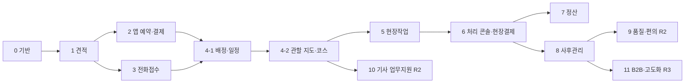

# 04. 구현 계획표 (업무 흐름 단위)

> 기준 문서: [02_기능정의서.md](./02_기능정의서.md) · 화면 ID는 [03_IA.md](./03_IA.md), 테이블은 [01_ERD.md](./01_ERD.md) 기준
> 문서 버전: v1.0 · 작성일: 2026-11-22

---

## 0. 계획 원칙

1. **흐름이 끝까지 이어지는 단위로 자른다.** 각 단계가 끝나면 "고객이 견적을 받는다", "주문이 기사에게 배정된다"처럼 실제로 돌려볼 수 있는 흐름이 하나 완성됩니다.
2. **데이터 생산자 → 소비자 순서.** 주문을 만드는 화면(견적·예약·전화접수)을 먼저, 주문을 처리하는 화면(배정·현장작업)을 다음에, 결과를 집계하는 화면(정산·통계)을 마지막에 둡니다.
3. **관리자 백오피스는 흐름보다 반 걸음 먼저.** 상품·가격·거점·슬롯 같은 기준 데이터가 없으면 고객 화면이 동작하지 않으므로 해당 흐름 단계 안에서 관리자 화면을 먼저 만듭니다.
4. **외부 연동은 처음엔 대체(모의) 구현으로.** PG·알림톡·주소 API는 해당 단계에서 "모의 응답 → 실연동" 순으로 붙여 흐름 검증이 연동 지연에 막히지 않게 합니다.
5. **R1(MUST) 완료가 파일럿 가동 조건.** 단계 0~8(4-1·4-2 포함)이 R1이며, 전략 문서의 파일럿(2027.2~4) 전에 끝나야 합니다. 단계 9~11은 R2·R3입니다.

---

## 1. 전체 로드맵 한눈에 보기

| 단계 | 흐름 | 완료 시 가능한 것 | 릴리스 | 선행 단계 | 예상 규모* |
|---|---|---|---|---|---|
| 0 | 기반·기준 데이터 | 관리자 로그인, 거점·코드·상품·가격 등록 | R1 | – | M |
| 1 | 견적 | 고객이 위치·기기·대수로 표준 견적을 받음 | R1 | 0 | M |
| 2 | 앱 예약·결제 | 고객이 일정 선택 후 예약·선결제, 주문 생성 | R1 | 1 | L |
| 3 | 전화접수(상담 콘솔) | 상담원이 전화로 고객 조회·등록 후 출장접수 | R1 | 1 (2와 병행 가능) | L |
| 4-1 | 배정·일정 | 운영자가 주문을 기사에게 배정, 기사 앱에서 확인 | R1 | 2 또는 3 | L |
| 4-2 | 관할 구역·출동 지도·코스 | 기사가 지도에서 출동지를 보고, 관할 구역 안에서 미배정 작업을 담고 방문 코스를 짜서 확정 | R1 | 4-1 | L |
| 5 | 현장작업 | 기사가 출발→사진→결과→추가요금→완료/미처리 처리 | R1 | 4-2 | XL |
| 6 | 처리 콘솔·현장결제 | 관리자 검토·대리입력, 현장결제·증빙, 주문 완료 | R1 | 5 | L |
| 7 | 정산 | 주간 기사 정산 계산·확정·지급, 기사 앱 확인 | R1 | 6 | M |
| 8 | 사후관리·운영 마감 | AS·VOC·안전사고·독촉, 재방문 캠페인, 대시보드, 공지 | R1 | 6 | L |
| 9 | 품질·편의 확장 | 후기·쿠폰·내 기기·자동 배정 추천·검수·사진 인식 | R2 | 8 | L |
| 10 | 기사 업무지원·교육 | 기사 홈 확장, 캘린더·메모·자재, 교육·모집·정착 관리 | R2 | 4 | L |
| 11 | B2B·고도화 | 거래처·리드·B2B 견적, 대화형 견적, CTI·AI 상담 | R3 | 8 | L |

\* 규모: M(중) · L(대) · XL(특대). 화면·기능 수와 상태 전이 복잡도 기준의 상대 크기입니다.

---

## 2. 단계별 상세

### 단계 0. 기반·기준 데이터
**목표**: 다른 모든 흐름이 참조하는 조직·권한·코드·상품·가격을 관리자가 등록할 수 있다.

| 구분 | 화면 ID |
|---|---|
| 관리자 | A-AUTH-010, A-AUTH-020, A-SYS-010, A-SYS-020, A-SYS-030, A-SYS-040, A-SYS-050, A-DSP-050, A-PRD-010, A-PRD-011, A-PRD-020, A-PRD-030, A-PRD-040 |
| 고객 | – |
| 기사 | – |

- 포함 기능: F-ADM-SYS-01~05, F-ADM-DSP-07, F-ADM-PRD-01~04
- 주요 테이블: branch, service_area, admin_user, role, permission, role_permission, common_code, holiday, system_setting, service_category, service_product, price_policy, surcharge_rule, service_option, material
- 공통 기반 작업: 인증·세션, RBAC(메뉴×행위 + 거점 데이터 범위), 공통 레이아웃(GNB/LNB, 거점 선택), 감사 로그 기록 장치, 첨부파일 저장소, 공통 코드 시드(ERD §4)
- 완료 기준: 슈퍼관리자가 거점 1곳·관할 법정동·상품(벽걸이/스탠드/천장형/2in1)·가격·야간/휴일 할증을 등록하고, 역할별로 보이는 메뉴가 달라진다.
- 구현 메모(2026-11-22): 프로젝트 골격(Next.js 단일 앱 `/`·`/tech`·`/admin`, Supabase, Vercel — 06 v0.2)을 이 단계에서 함께 만들었습니다. 완료 기준 시나리오는 `e2e/stage0.spec.ts`로 자동 시연합니다.

### 단계 1. 견적
**목표**: 고객이 로그인 없이 위치·기기·대수만으로 표준 견적을 받는다.

| 구분 | 화면 ID |
|---|---|
| 고객 | C-HOM-010(견적 CTA만), C-QUO-010, C-QUO-020, C-QUO-030, C-QUO-040 |
| 관리자 | A-PRD-050 |
| 기사 | – |

- 포함 기능: F-CUS-HOM-01(일부), F-CUS-QUO-01~04, F-CUS-AUTH-02(비회원 견적), F-ADM-PRD-05, F-SYS-02
- 주요 테이블: quote, quote_item, customer_address(임시), service_area
- 핵심 규칙: BR-001, BR-010, BR-013~015
- 외부 연동: 도로명주소 API(모의 → 실연동)
- 완료 기준: 서비스 지역 주소는 견적이 나오고, 비서비스 지역은 안내가 뜬다. 관리자 견적 시뮬레이터와 고객 견적 금액이 일치한다.
- 비고: 견적 산출 로직은 단계 3 상담 콘솔에서도 그대로 재사용하므로 공용 모듈로 만듭니다.
- 구현 메모(2026-11-23): 견적 계산은 `packages/domain` `calculateQuote` 하나이고, 서버에서는 `apps/web/src/server/quote.ts` `computeQuote`만 이를 호출합니다(고객 C-QUO·관리자 A-PRD-050이 같은 함수 → 금액 일치). "customer_address(임시)"는 견적 단계에서 주소를 DB에 저장하지 않고 브라우저(sessionStorage)에만 두는 것으로 구현했습니다(비회원·개인정보 최소화). 견적에는 법정동 코드만 남고 주소는 단계 2 예약에서 `customer_address`로 저장합니다. 주소 검색은 카카오 우편번호 서비스(Real, 기본)·예시 주소(Mock)이며 `NEXT_PUBLIC_ADDRESS_DRIVER`로 전환합니다. 비서비스 지역 "오픈 알림 신청"은 저장할 테이블이 문서에 없어 안내 문구만 표시합니다(테이블 결정 후 추가). 완료 기준 시나리오는 `e2e/stage1.spec.ts`로 자동 시연합니다.
- 구현 메모(2026-11-23, 체험 모드): DB(`DATABASE_URL`)를 연결하기 전에도 견적 흐름을 시험할 수 있도록, DB 미연결일 때만 **견적 체험 모드**가 켜집니다. 지정 지역(`QUOTE_DEMO_AREA_CODES`, 기본 서울 은평구 `11380`) 주소만 다음 단계로 넘어가고, 예시 상품·가격(`apps/web/src/server/quote-demo.ts`)으로 같은 공용 계산을 하며 견적은 저장하지 않습니다(결과 화면은 입력값으로 다시 계산). 고객 화면과 A-PRD-050에 체험 모드 안내가 표시되고, DB를 연결하면 자동으로 꺼집니다. 관리자 "DB 미연결" 열람 모드와 같이 구현 기간 한정입니다.

### 단계 2. 앱 예약·결제
**목표**: 고객이 가입·인증 후 일정을 고르고 예약·결제하면 주문이 생성된다.

| 구분 | 화면 ID |
|---|---|
| 고객 | C-AUTH-010, C-AUTH-020, C-AUTH-030, C-RSV-010, C-RSV-020, C-RSV-030, C-PAY-010, C-RSV-040, C-ORD-010, C-ORD-020, C-ORD-030, C-MY-010, C-MY-030, C-MY-040, C-NTF-010, C-CS-010 |
| 관리자 | A-DSP-030, A-DSP-040, A-ORD-010, A-ORD-020, A-ORD-030, A-ORD-040, A-CRM-040 |
| 기사 | – |

- 포함 기능: F-CUS-AUTH-01~05, F-CUS-RSV-01~05, F-CUS-PAY-01, F-CUS-ORD-01~03, F-CUS-MY-01, F-CUS-NTF-01, F-CUS-CS-01·03, F-ADM-DSP-05·06, F-ADM-ORD-01~06, F-ADM-CRM-04, F-SYS-01, F-SYS-03
- 주요 테이블: customer, consent_history, customer_address, time_slot, work_schedule, service_order, order_item, order_status_history, order_change_request, payment, refund, notification_template, notification_log
- 핵심 규칙: BR-011, BR-012, BR-020, BR-021, BR-030, BR-100
- 외부 연동: 소셜 로그인, 휴대폰 인증, PG, 알림톡(각각 모의 → 실연동)
- 완료 기준: 슬롯이 근무표 기준으로 자동 생성되고, 예약 시 잔여 수량이 줄어들며 초과 예약이 막힌다. 예약·취소가 관리자 주문 목록에 즉시 보이고 접수 알림톡이 나간다.

### 단계 3. 전화접수 (상담 콘솔)
**목표**: 상담원이 전화번호로 고객을 찾거나 등록하고, 출장접수까지 한 화면에서 끝낸다.

| 구분 | 화면 ID |
|---|---|
| 관리자 | A-CSL-010, A-CSL-011, A-CSL-012, A-CSL-013, A-CSL-014, A-CSL-020, A-CSL-021, A-CSL-022, A-CSL-023, A-CSL-024, A-CSL-050, A-CSL-060, A-CSL-070, A-CUS-010, A-CUS-020, A-CNT-050 |
| 고객 | – |
| 기사 | – |

- 포함 기능: F-ADM-CSL-01~10, F-ADM-CSL-13~16, F-ADM-CUS-01~03
- 주요 테이블: call_log, consultation, consult_script, customer, customer_address, consent_history, customer_tag, service_order, assignment(기사 선택 시)
- 핵심 규칙: BR-020, BR-022, BR-023, BR-024, BR-011, BR-012
- 완료 기준: 기존 고객 선택 / 신규 등록(주소 4단계) / 동의 팝업 / 미완료 Alert / 이중접수 팝업이 모두 동작하고, 기사 미선택 저장 시 "미지정(긴급)" 상태가 된다. 앱으로 가입한 같은 번호 고객과 이력이 합쳐진다(F-CUS-AUTH-04).
- 비고: 단계 2와 병행 개발 가능(공통 선행은 단계 1 견적 모듈).

### 단계 4-1. 배정·일정
**목표**: 운영자가 배정 보드에서 주문을 기사에게 배정하고, 기사가 앱에서 자기 작업을 확인한다.

| 구분 | 화면 ID |
|---|---|
| 관리자 | A-DSP-010, A-DSP-020, A-TEC-010, A-TEC-020 |
| 기사 | T-AUTH-010, T-HOM-010(기본: 공지·오늘의 약속), T-JOB-010, T-JOB-020, T-MY-010, T-NTF-010, T-MORE-010 |
| 고객 | C-ORD-020(배정 기사 정보 표시 보강) |

- 포함 기능: F-ADM-DSP-01, F-ADM-DSP-03, F-ADM-DSP-04, F-ADM-TEC-01~03, F-TEC-AUTH-01, F-TEC-HOM-01·02(약속만), F-TEC-JOB-01·02·05, F-TEC-MY-01, F-TEC-NTF-01, F-SYS-09
- 주요 테이블: technician, technician_skill, technician_area, technician_grade_history, assignment, assignment_history, time_slot
- 핵심 규칙: BR-070, BR-071, BR-072, BR-024
- 외부 연동: 앱 푸시
- 완료 기준: 드래그 배정 시 근무·시간겹침·숙련·지역 검증이 경고로 뜨고, 2인 작업은 지원기사 없이 확정되지 않는다. 배정 즉시 기사 앱에 푸시, 고객에게 "기사 배정" 알림이 간다. 미지정 건이 약속 4시간 전에 경고된다.

### 단계 4-2. 관할 구역·출동 지도·코스 짜기
**목표**: 기사가 작업 탭에서 출동할 곳을 지도로 보고, 자기 관할 구역 안에서 미배정 작업을 일정에 담고 방문 코스를 짜서 확정한다. 운영자는 기사별 관할 구역을 지도에서 지정한다.

| 구분 | 화면 ID |
|---|---|
| 기사 | T-MAP-010, T-RTE-010, T-RTE-020, T-HOM-010(근무 시작 토글·위치 동의) |
| 관리자 | A-DSP-060, A-DSP-020(자가 배정 요청 탭 추가), A-DSP-010(승인 대기 배지 추가) |
| 고객 | C-ORD-020(방문 예정 시간 표시 보강) |

- 포함 기능: F-TEC-MAP-01~05, F-TEC-RTE-01~04, F-TEC-AUTH-02, F-ADM-DSP-08, F-ADM-DSP-10, F-SYS-15, F-SYS-16, F-SYS-18
- 주요 테이블: technician_zone, technician_area, route_plan, route_stop, technician_location, assignment(SELF·REQUESTED·in_zone), service_order(arrival_window)
- 핵심 규칙: BR-110~115
- 외부 연동: 지도 SDK, 법정동 경계 데이터, 경로·이동시간 API(처음엔 직선거리 추정으로 대체 → 실연동), 외부 내비 앱 딥링크
- 진행 순서(권장): ① 관할 구역 지정(A-DSP-060) → ② 출동 지도·핀·관할 경계(T-MAP-010) → ③ 코스 편집·이동시간 계산(T-RTE-010) → ④ 자동 추천·확정·고객 안내 → ⑤ 관할 내 미배정 담기·승인(T-RTE-020, A-DSP-020)
- 완료 기준: 운영자가 지정한 관할 경계가 기사 지도에 보이고, 관할 밖 미배정 작업은 보이지 않는다. 코스 순서를 바꾸면 도착 예정시각이 즉시 다시 계산되고, 시간창을 어기면 확정이 막힌다. 자동 추천이 현재 순서보다 이동시간을 줄이는지 전/후 비교로 확인된다. 확정 시 고객에게 방문 예정 시간이 안내되고, 18:00 마감 시 미확정 코스가 자동 확정된다. 같은 미배정 작업을 두 기사가 동시에 담으면 한 명만 성공한다.
- 비고: 단계 5 현장작업의 "출발"은 확정 코스의 다음 방문지를 기준으로 동작하므로, 이 단계를 현장작업보다 먼저 둡니다.

### 단계 5. 현장작업
**목표**: 기사가 현장에서 출발부터 완료(또는 미처리)까지 앱으로 처리하고, 고객은 추가요금 동의와 작업 리포트를 받는다.

| 구분 | 화면 ID |
|---|---|
| 기사 | T-WRK-010, T-WRK-011, T-WRK-020, T-WRK-030, T-WRK-040, T-WRK-060, T-WRK-061, T-WRK-070 |
| 고객 | C-ORD-040, C-ORD-050 |
| 관리자 | A-PRC-040 |

- 포함 기능: F-TEC-WRK-01~05, F-TEC-WRK-07~10, F-CUS-ORD-04·05, F-ADM-PRC-04, F-SYS-04, F-SYS-08
- 주요 테이블: work_order, work_result, work_photo, extra_charge, activity_log, attachment, order_item, order_status_history
- 핵심 규칙: BR-031, BR-032, BR-040, BR-041, BR-042, BR-043
- 기술 과제: 사진 업로드 백그라운드·재시도, 오프라인 임시 저장 후 동기화, 서명 패드
- 완료 기준: 필수 사진·결과·안전 체크가 없으면 완료가 막힌다. 추가요금은 고객 동의(앱 또는 서명) 후에만 금액에 반영되고, 기타 유형은 관리자 승인을 거친다. 미처리 저장 시 사유가 필수이며 48시간 경과 건이 강조된다.
- 비고: 가장 큰 단계입니다. "출발~사진~완료"(5-1)와 "추가요금·미처리"(5-2)로 나눠 진행하는 것을 권합니다.

### 단계 6. 처리 콘솔·현장결제
**목표**: 작업 완료 건의 결제가 끝나 주문이 "완료"되고, 관리자는 처리 콘솔에서 기사 처리 내역을 보고 대리 입력할 수 있다.

| 구분 | 화면 ID |
|---|---|
| 기사 | T-PAY-010, T-PAY-020 |
| 고객 | C-PAY-020, C-PAY-030 |
| 관리자 | A-PRC-010, A-PRC-020, A-PRC-050, A-PAY-010, A-PAY-020, A-PAY-030, A-PAY-040, A-PAY-050 |

- 포함 기능: F-TEC-PAY-01~03, F-CUS-PAY-02·03, F-ADM-PRC-01·02·05·06·07, F-ADM-PAY-01~05
- 주요 테이블: payment, refund, tax_document, work_order, service_order, memo([미수금])
- 핵심 규칙: WORK_DONE → COMPLETED 자동 전환(ERD §3.1), BR-081, BR-082
- 외부 연동: PG 결제 요청·링크, 현금영수증·전자세금계산서
- 완료 기준: 앱결제·링크·현장카드·계좌·현금 어느 방식이든 결제되면 주문이 완료되고 정산 대상으로 표시된다. 미처리 큐에서 재약속하면 배정 보드로 돌아간다. 미수금이 별도 목록에 쌓인다.
- 마일스톤: **단계 0~6 완료 = 견적부터 결제까지 끝까지 도는 첫 번째 통합 테스트 시점.**

### 단계 7. 정산
**목표**: 주 단위로 기사 정산서를 자동 계산·확정·지급하고, 기사가 앱에서 확인한다.

| 구분 | 화면 ID |
|---|---|
| 관리자 | A-STL-010, A-STL-020, A-STL-030 |
| 기사 | T-STL-010, T-STL-020 |
| 고객 | – |

- 포함 기능: F-ADM-STL-01~04, F-TEC-STL-01·02, F-SYS-10
- 주요 테이블: commission_policy, settlement_batch, settlement, settlement_item, payment(현장 수금 상계)
- 핵심 규칙: BR-080~084
- 외부 연동: 초기엔 은행 대량이체 파일 다운로드(송금 API는 이후)
- 완료 기준: 정산 회차를 계산하면 등급·계약형태별 배분, 2인 작업 분배, 추가요금 배분, 현금 상계, 원천세 3.3%가 맞게 나온다. 기사 확인/이의 → 확정 후에는 수정되지 않고 다음 회차 조정으로만 처리된다.

### 단계 8. 사후관리·운영 마감 (R1 마지막)
**목표**: AS·VOC·안전사고·독촉이 처리되고, 재방문 캠페인과 운영 대시보드로 파일럿을 운영할 수 있다.

| 구분 | 화면 ID |
|---|---|
| 관리자 | A-CSL-030, A-CSL-040, A-CSL-080, A-PRC-060, A-VOC-010, A-VOC-011, A-VOC-020, A-VOC-030, A-CRM-010, A-DSH-010, A-DSH-020, A-STA-010, A-CNT-010, A-CNT-020, A-CUS-030, A-SYS-060 |
| 고객 | C-AS-010, C-CS-020 |
| 기사 | T-NTF-020, T-NTC-010 |

- 포함 기능: F-ADM-CSL-11·12, F-ADM-PRC-08, F-ADM-VOC-01~03, F-ADM-CRM-01, F-ADM-DSH-01·02, F-ADM-STA-01, F-ADM-CNT-01·02, F-ADM-CUS-04·05, F-ADM-SYS-06, F-CUS-AS-01, F-CUS-CS-02, F-TEC-NTF-02, F-TEC-HOM-01, F-SYS-06, F-SYS-11, F-SYS-12
- 주요 테이블: followup_request, safety_incident, incident_recipient, voc, as_request, campaign, campaign_target, notice, notice_read, faq, audit_log
- 핵심 규칙: BR-050, BR-051, BR-060, BR-061, BR-091, BR-100~102
- 완료 기준: 보증기간 내 AS는 무상 재방문 주문으로 배정 보드에 올라간다. 안전사고에서 언론/인터넷 선택 시 재확인 후 경영진 통보가 나간다. 11개월 경과 고객이 매일 자동 추출된다. KPI 대시보드에 ERD §5 지표가 표시된다. 개인정보 파기 배치가 돈다.
- 마일스톤: **R1 완료 = 파일럿(거점 1곳) 가동 가능.**

### 단계 9. 품질·편의 확장 (R2)
**목표**: 재방문·전환율을 높이는 고객 기능과 운영 효율 기능을 붙인다.

| 구분 | 화면 ID |
|---|---|
| 고객 | C-QUO-021, C-DEV-010, C-DEV-020, C-REV-010, C-MY-020 |
| 관리자 | A-PRC-030, A-VOC-040, A-CRM-020, A-CRM-030, A-STA-020, A-STA-030, A-STA-040, A-DSP-070 |
| 기사 | T-WRK-050 |

- 포함 기능: F-CUS-QUO-05·07, F-CUS-DEV-01·02, F-CUS-REV-01, F-CUS-CPN-01, F-CUS-PAY-04, F-ADM-DSP-02(자동 배정 추천, A-DSP-010 보강), F-ADM-PRC-03, F-ADM-VOC-04, F-ADM-CRM-02·03, F-ADM-STA-02~04, F-TEC-WRK-06, F-ADM-DSP-09(코스 모니터링), F-TEC-RTE-06(진행 중 ETA 갱신), F-SYS-05, F-SYS-13, F-SYS-14, F-SYS-17
- 주요 테이블: device_image, customer_device, review, coupon, customer_coupon, material_usage
- 핵심 규칙: BR-090
- 외부 연동: 이미지 인식 AI, 안심번호
- 완료 기준: 내 기기에서 원클릭 재예약이 되고, 저평점 후기가 VOC로 자동 생성된다. 배정 보드에 추천 기사 Top3가 뜬다.

### 단계 10. 기사 업무지원·교육 (R2)
**목표**: MCS 메인 구조의 기사 홈·캘린더·메모를 완성하고, 기사 모집~교육~정착 파이프라인을 시스템으로 관리한다.

| 구분 | 화면 ID |
|---|---|
| 기사 | T-HOM-010(주간 할일·퀵메뉴·VOC/NPS 배지 확장), T-RTE-030, T-CAL-010, T-MEMO-010, T-MEMO-020, T-MAT-010, T-MAT-020, T-EDU-010, T-EDU-020, T-MY-020, T-STL-010(월 요약 보강) |
| 관리자 | A-TEC-030, A-TEC-040, A-TEC-041, A-TEC-050, A-CNT-030, A-CNT-040 |
| 고객 | – |

- 포함 기능: F-TEC-RTE-05, F-TEC-HOM-03~05, F-TEC-CAL-01·02, F-TEC-MEMO-01, F-TEC-MAT-01·02, F-TEC-EDU-01·02, F-TEC-STL-03, F-ADM-TEC-04~07, F-ADM-CNT-03·04
- 주요 테이블: memo, memo_recipient, quick_menu, technician_material_stock, material_request, tech_document, training_course, training_enrollment, technician_application
- 완료 기준: 기사 홈에 D-day~D+2 메모·자재·약속이 보이고, 캘린더가 근무/메모로 전환된다. 지원자 → 교육 → 수료 → 기사 계정 생성이 이어지고, 6개월 정착률이 집계된다.
- 비고: 단계 4-2 이후 언제든 착수 가능해서, 성수기 전에 기사 인력이 늘어나는 시점에 맞춰 앞당길 수 있습니다.

### 단계 11. B2B·고도화 (R3)
**목표**: 비수기 매출원(B2B)과 상담 자동화를 붙인다.

| 구분 | 화면 ID |
|---|---|
| 고객 | C-QUO-050, C-MY-021, C-B2B-010 |
| 관리자 | A-B2B-010, A-B2B-020, A-B2B-030, A-TEC-060, A-STL-040 |
| 기사 | T-LEAD-010, T-CAL-020 |

- 포함 기능: F-CUS-QUO-06, F-CUS-CPN-02, F-CUS-B2B-01, F-ADM-B2B-01~03, F-ADM-TEC-08, F-ADM-CSL-17·18, F-TEC-LEAD-01, F-TEC-CAL-03, F-TEC-MEMO-02·03, F-TEC-JOB-03, F-SYS-07, F-ADM-STL-05
- 주요 테이블: corporate_account, b2b_lead, call_log(CTI), faq·tech_document(RAG 소스)
- 외부 연동: CTI/Soft Phone, LLM(RAG)
- 완료 기준: 기사가 현장에서 등록한 리드가 수주되면 거래처가 생기고 소개 보상이 정산에 반영된다. B2B는 월말 합산 세금계산서로 청구된다.

---

## 3. 화면 ID 배정 검증 (누락 점검)

03_IA.md의 화면이 모두 한 단계에 배정되었는지 채널별로 정리했습니다.

| 채널 | 단계 0 | 1 | 2 | 3 | 4-1 | 4-2 | 5 | 6 | 7 | 8 | 9 | 10 | 11 |
|---|---|---|---|---|---|---|---|---|---|---|---|---|---|
| 고객 | – | 5 | 16 | – | (보강) | (보강) | 2 | 2 | – | 2 | 5 | – | 3 |
| 기사 | – | – | – | – | 7 | 3 | 8 | 2 | 2 | 2 | 1 | 11 | 2 |
| 관리자 | 13 | 1 | 7 | 16 | 4 | 1 | 1 | 8 | 3 | 16 | 8 | 6 | 5 |

- 여러 단계에 걸쳐 확장되는 화면: C-HOM-010(1 → 2 이후 진행 예약 카드), C-ORD-020(2 → 4-1 기사 정보 → 4-2 방문 예정 시간), T-HOM-010(4-1 기본 → 4-2 근무 시작 토글 → 10 확장), A-DSP-010(4-1 → 4-2 승인 대기 배지 → 9 자동 추천), A-DSP-020(4-1 이관 → 4-2 자가 배정 탭), T-STL-010(7 → 10 월 요약)
- 통계 4종은 A-STA-010(단계 8), A-STA-020~040(단계 9)으로 나눴습니다.

---

## 4. 단계별 점검 체크리스트 (공통)

각 단계 종료 시 아래를 확인하고 다음 단계로 넘어갑니다.

| 점검 항목 | 내용 |
|---|---|
| 흐름 시연 | 해당 단계 "완료 기준" 시나리오를 처음부터 끝까지 실제 화면으로 수행 |
| 상태 전이 | 이번 단계에서 추가된 상태 변경이 order_status_history 등 이력 테이블에 남는지 |
| 권한 | 역할별 메뉴 노출·거점 데이터 범위가 03_IA §4.4 매트릭스와 일치하는지 |
| 업무 규칙 | 단계에 명시된 BR 항목별 정상·예외 케이스 각 1건 이상 |
| 개인정보 | 신규 화면의 마스킹·감사 로그 적용 여부 |
| 알림 | 신규 알림 템플릿 발송·실패 시 SMS 대체 여부 |
| 문서 동기화 | 구현 중 바뀐 컬럼·규칙을 01~03 문서에 반영 |

---

## 5. 일정 배치 제안 (전략 문서 로드맵 기준)

| 기간 | 단계 | 근거 |
|---|---|---|
| 2026.12 ~ 2027.01 | 0 → 1 → 2·3(병행) | 법인 설립·기반 구축 기간(전략 5.1 "0~3개월") |
| 2027.01 ~ 2027.02 | 4-1 → 4-2 → 5 → 6 | 파일럿 전 핵심 흐름 완성, 단계 6 종료 시 통합 테스트 |
| 2027.02 ~ 2027.03 | 7 → 8 | R1 완료, 파일럿 가동(전략 "4~6개월": 월 50건, 첫 100건) |
| 2027.04 ~ 2027.05 | 10 → 9 | 성수기(5~8월) 전 기사 인력 확대·운영 효율화 |
| 2027.09 이후 | 11 | 비수기 B2B 매출 준비(전략 6장 "즉시" 분류의 B2B 청소) |

> 일정은 1인 기획자 + 바이브 코딩 기준의 제안입니다. 단계 순서는 고정하되 기간은 실제 진척에 맞춰 조정하세요.
